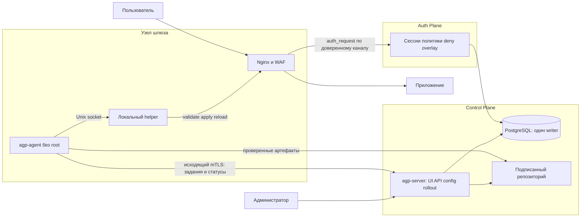

# AGP v2 — распределённая платформа управления доступом и защитой

> Исторический эскиз от 2026-11-11. Подробная инженерная спецификация продолжена
> в [комплекте docs/v2](v2/README.md). Примеры форматов в этом эскизе упрощены и
> заменены schemas/OpenAPI из нового комплекта; при разработке использовать их.
> Статус Proposed и принятые решения v1 не изменены.

Статус: **Proposed, проект для согласования и последующей реализации**. Дата: 2026-11-11.
Читатели: владелец продукта, разработчики, аудиторы безопасности и операторы Linux/PostgreSQL/Nginx.
Документ задаёт TARGET; наличие описания не означает наличие функции или эксплуатационную готовность.
Принятые [ADR 0001](adr/0001-single-node-mvp.md) и [план v1.1](v1.1-plan.md) сохраняются:
single-node с ручным применением остаётся поддерживаемым baseline, MFA/invite/уведомления — согласованным направлением.
Автоматическое управление Nginx предлагается как дополнительный режим v2; изменение статуса ADR требует отдельного решения.

## 1. Назначение, предпосылки и границы

AGP должен управлять политиками доступа, публикацией приложений, шлюзами, WAF, обновлениями и аудитом из одного центра.
Предлагается сохранить один Go-монорепозиторий и модульный сервер, добавляя агент и минимальный привилегированный helper.
В первую поставку распределённой версии входят центральная авторизация и Linux-узлы; региональная автономная авторизация — позднее.
Предполагаются одна организация, доверенная административная сеть, управляемые DNS/TLS и корпоративная служба времени.
Массовое внедрение требует инвентаризации ОС, архитектур, Nginx, компонентов, сетей и владельцев действующих конфигураций.
Администратору платформы нужны отдельные полномочия на изменение, утверждение и применение; оператору узла — локальные права установки.
Примеры ниже проектные, используют условные идентификаторы и домены `example.net`, не содержат действующих секретов.

### AS-IS: что подтверждено исходниками

Источник baseline: commit `6eac09e62b2de2730d8d3fc194fdb5827b21ccc2`; это статическая проверка, без приёмки инфраструктуры.
`go.mod` задаёт Go 1.22, pgx/v5 5.7.2, modernc.org/sqlite 1.34.4 и x/crypto 0.31.0; это не перечень актуальных безопасных версий.
Есть `cmd/agp`, `cmd/agpctl`, встроенный UI, локальные пользователи/Argon2id, сессии в БД, CSRF и permissions.
Основное production-хранилище — PostgreSQL, SQLite — fallback; `auth_request` проверяет сессию, ресурс, группы и CIDR.
Генератор выдаёт рекомендации Nginx, которые применяются вручную; rate limiter находится в памяти процесса.
Есть аудит, публичные downloads, диагностика, install/update/backup/restore scripts и базовые HTTP probes.
Агента, helper, распределённых ревизий, WAF-провайдера, подписанного репозитория и OIDC SSO в этом baseline нет.
CLI пока содержит `version`, `hash-password`, `create-admin`; будущие команды apply/enroll ниже не объявляются существующими.

### Обязательный hardening до выдачи платформе привилегий

| Статическое наблюдение | Требование к исправлению и приёмке |
| --- | --- |
| `users.manage` разрешает обновление пароля целевого superadmin без проверки его статуса: `admin_handlers.go:139–174`, `server.go:61` | Проверять полномочия относительно целевого пользователя для пароля, блокировки, групп и удаления; негативные тесты делегированного администратора, аудит и отзыв сессий. |
| Ресурсы на путях портала разделяют origin с UI/API; session cookie имеет `Path=/` | Разнести management, login/SSO и приложения; проверить, что приложение не получает management-cookie и не может обращаться к API как доверенный origin. |
| В host-based шаблоне `proxy_set_header` заданы на `server`, но дочерний `location /` задаёт собственные: `generator.go:324–351` | Генерировать полный набор доверенных `X-AGP-*` в каждом proxy location и удалять входные значения; проверить отсутствие подмены на upstream. Риск зависит от доверия приложения к этим заголовкам. |
| Диагностика проверяет результат DNS, затем соединяется по имени: `resource.go:72–95,185–220` | Соединяться с проверенным IP, сохраняя исходные Host/SNI; запретить повторное разрешение и обход CIDR через rebinding, proxy environment и redirects; негативные сетевые тесты. |

Ссылки в таблице относятся к `internal/httpapi/`, `internal/reverseproxy/nginx/` и `internal/diagnostics/` соответственно.
Это конкретные ограничения текущей реализации, а не утверждение о подтверждённой эксплуатации уязвимостей.
Дополнительно нужны dependency review, threat model и независимое security review прав администратора и цепочки применения.
TARGET для CI: изолированный PostgreSQL с одноразовыми тестовыми credentials, Actions закреплены SHA; release/signing secrets доступны только доверенному release job.
Текущий workflow передаёт secret DSN в release-check для pull request; назначение этой БД не установлено. Корпоративному bare Git нужен отдельный CI runner/service.

## 2. Плоскости, компоненты и топологии TARGET



Плоскости — границы ответственности и доверия; на первом этапе они могут размещаться на одной VM.
Общий процесс или общая БД остаются общей точкой отказа: crash `agp-server`/БД выключает и auth, защищённый доступ закрывается.
Независимая работа Auth Plane при отказе управления требует раздельных процессов/зависимостей; недоступность только management API — иной сценарий.
В `agp-server` предлагаются модули config/revisions, inventory, rollout, identity/auth, audit, repository и notifications.
Новые точки входа: `cmd/agp-agent` и `cmd/agp-helper`; отдельные relay/auth binaries вводятся только при подтверждённой необходимости.
Control Plane не проксирует пользовательский трафик, а агент не принимает решения о доступе пользователя.
Недоступность управления останавливает изменения: Nginx/WAF сохраняют последнюю подтверждённую конфигурацию.
Недоступность Auth Plane или его authoritative storage закрывает защищённый доступ; cached allow в первой версии запрещён.
Успешная работа Nginx при отключённом Control Plane сама по себе не доказывает доступность приложений.
Для `auth_request` 2xx означает разрешение, 401/403 — отказ, остальные ответы — ошибку; политика шлюза не должна превращать ошибку в разрешение ([Nginx](https://nginx.org/en/docs/http/ngx_http_auth_request_module.html)).

| Топология | Условия и порядок реализации |
| --- | --- |
| Single-node | Сервер, PostgreSQL, агент, Nginx/WAF на одной VM; существующая ручная модель продолжает работать без агента. |
| Distributed | Центральные Control/Auth Plane, шлюзы с исходящим mTLS; auth-маршрут и сетевые задержки проверяются отдельно. |
| Split-WAF | Отдельный HTTP WAF proxy перед gateway; ModSecurity сам по себе не удалённый сетевой сервис. |
| noInternet | Между узлами и центром есть корпоративная сеть; пакеты доставляются из внутреннего зеркала, внешние зависимости отсутствуют. |
| airgap | В изолированном контуре собственные Control/Auth Plane и доверенный импорт пакетов; отключение внешнего auth не заменяется токеном регистрации. |

В split-WAF backend gateway принимает прикладной трафик только от WAF proxy по проверяемой идентичности/сетевой политике.
TLS завершается на WAF и повторно защищает межузловой участок; согласуются Host/SNI, client IP, размеры запросов и timeout.
Прямой маршрут клиента к gateway/upstream, обход WAF при health failure и резервный «непроверенный» upstream запрещены.
DNS, балансировщик и firewall остаются ответственностью инфраструктуры; AGP проверяет условия, но не получает неограниченное управление ими.

## 3. Единая модель и согласованность

Web UI, YAML/JSON import и будущий CLI используют одну типизированную доменную модель и один путь валидации.
PostgreSQL хранит утверждённые неизменяемые ревизии; Git может предлагать изменения, но не становится вторым writer.
YAML декодируется в ограниченное JSON-совместимое подмножество: без custom tags, aliases/anchors, merge keys и duplicate keys.
Обязательны лимиты байтов, глубины, числа объектов/строк, длины строк, времени разбора и размера распакованного bundle.
Неизвестные поля и неоднозначные значения отклоняются; значения по умолчанию раскрываются до вычисления digest.
Семантическая нормализация задаёт порядок множеств, URI/CIDR и числовые типы; canonical JSON даёт одинаковый hash независимо от UI/YAML.
Пароли, PEM private keys, shell и raw Nginx directives в декларации запрещены; используются ссылки на версии секретов.

| Сущность TARGET | Основные данные и инварианты |
| --- | --- |
| Node / CapabilitySnapshot | Неизменяемый node ID, site, labels, ownership, fingerprint, ОС/arch, версии, capabilities и их digest. |
| Gateway / Route / AccessPolicy | Host/path/upstream, привязка к узлам, TLS/WAF, группы/CIDR; коллизии и обход auth запрещены. |
| ConfigRevision / CompiledBundle | Canonical model, parent revision, content digest, compiler version, route/auth generation, validation results. |
| Plan / Approval / Rollout | Конкретные node IDs, base/target digest, dependency versions, автор, утверждение, deadline и волны. |
| Task / Attempt / ApplyJournal | Тип операции, idempotency key, fencing epoch, durable state, причина и проверенный результат. |
| SecretVersion / Certificate | Metadata и ссылка на ciphertext/key store, срок, получатели, версия; секрет не включается в audit diff. |
| DenyEvent / AuditEvent / Outbox | Монотонный security sequence, отзыв/блокировка, субъект, событие, доставка и дедупликация. |

У сущностей стабильные ID и optimistic revision; обновление требует compare-and-swap относительно ожидаемой версии.
Предлагаемый новый management API версионируется отдельно от текущего `/api/v1`; конкретные URI согласуются при реализации OpenAPI.
Устаревший CAS возвращает конфликт без частичной записи; UI показывает diff и требует повторного планирования.
Idempotency key связывается с actor, scope и digest запроса; повтор возвращает прежний результат, иной payload с тем же ключом отклоняется.
Принятие ревизии, plan и outbox фиксируется одной транзакцией; доставка задания допускает повторы, побочные эффекты — только идемпотентно.
Утверждённый plan фиксирует node IDs, capability digest, config/compiler/artifact digest, secret versions и базовое состояние каждого узла.
Изменение labels, прав, секрета, capabilities или состава узлов после plan требует проверки предусловий и нового plan при несовпадении.
Селектор labels нельзя повторно вычислять в момент apply; новый узел не должен неожиданно попасть в уже утверждённый rollout.

### Маршруты, авторизация и запреты

Bundle связывает маршруты и immutable auth snapshot одним deployment generation; агент не применяет их независимо.
Auth Plane сначала подтверждает наличие target snapshot; шлюз отправляет доверенные deployment/route IDs с каждого `auth_request`.
Сервис авторизации использует именно этот snapshot, текущую сессию/членство и актуальный deny overlay; неизвестная generation закрывает доступ.
Во время rollout одновременно обслуживаются старый и новый snapshots, пока подтверждено наличие шлюзов старой generation.
Изменение маршрутов на узле не является транзакцией PostgreSQL: безопасность обеспечивается последовательностью подготовки, проверкой generation и отказом при mismatch.
Запреты, блокировки пользователей, отзыв сессий/узлов и срочное закрытие ресурса идут отдельным append-only deny-потоком.
Сначала подтверждается ужесточение deny overlay, затем выкатываются связанные маршруты/политики; до подтверждения изменения не объявляются применёнными.
Security sequence и минимально допустимая версия не уменьшаются при rollback конфигурации или восстановлении старой БД.
Актуальный high-water mark хранится вне восстанавливаемой БД и её backup: в независимом защищённом append-only security journal с отдельным доступом и резервированием.
После restore Auth сверяет authority epoch/sequence с этим checkpoint и восстанавливает deny-поток до него; до сверки, при несовпадении или недоступности checkpoint доступ закрыт.
Копия sequence внутри старого backup не является доказательством свежести; восстановление самого независимого журнала входит в отдельную DR-процедуру.
Снятие запрета — отдельная авторизованная и аудируемая операция с новым sequence, а не побочный эффект отката.
При недостоверной свежести deny-потока Auth Plane прекращает разрешать запросы; допустимый предел устаревания требует продуктового SLO.
Старый bundle может быть восстановлен только поверх текущих запретов; недоступный совместимый auth snapshot означает RecoveryRequired.

## 4. Три версионируемых контракта TARGET

Это проектные форматы, ещё не поддерживаемые текущим AGP. Для каждого нужны schema, valid/invalid fixtures и compatibility tests.
Ниже ровно три семейства контрактов; транспорт и HTTP routes определяются реализацией, а не этими примерами.

### 4.1. Декларативная конфигурация: `agp.config/v1alpha1`

```yaml
apiVersion: agp.config/v1alpha1
kind: Gateway
metadata:
  name: branch-edge
spec:
  nodeSelector:
    site: branch-a
  ownership: managed
  componentProfileRef: nginx-waf-tested-001
  tls:
    certificateRef: cert-app@7
  authorization:
    mode: central
    failureMode: closed
  waf:
    engine: modsecurity
    policyRef: balanced@3
    mode: detection
  routes:
    - id: app-one
      hostname: app.example.net
      path: /
      upstream: https://backend.example.net:8443
      allowedGroups: [staff]
```

`componentProfileRef` разрешается в проверенный tuple и его digest; слово «latest» недопустимо.
`certificateRef` указывает на неизменяемую версию; nodeSelector только помогает построить plan с явным списком узлов.
`detection` регистрирует нарушения, но не обещает блокировки; UI обязан явно показывать этот режим.
Все маршруты защищены Auth Plane; будущие публичные маршруты потребуют отдельного явного типа и проверки риска.

### 4.2. Типизированное задание: `agp.task/v1alpha1`

```json
{
  "apiVersion": "agp.task/v1alpha1",
  "id": "task-42",
  "nodeId": "node-a",
  "kind": "ApplyConfig",
  "idempotencyKey": "rollout-8-node-a",
  "planId": "plan-8",
  "writerEpoch": 12,
  "nodeDeploymentSequence": 23,
  "expiresAt": "2026-12-01T12:00:00Z",
  "preconditions": {
    "baseRevision": 16,
    "capabilityDigest": "sha256:aaaaaaaaaaaaaaaaaaaaaaaaaaaaaaaaaaaaaaaaaaaaaaaaaaaaaaaaaaaaaaaa"
  },
  "payload": {
    "targetRevision": 17,
    "deploymentGeneration": "deployment-17",
    "bundleDigest": "sha256:bbbbbbbbbbbbbbbbbbbbbbbbbbbbbbbbbbbbbbbbbbbbbbbbbbbbbbbbbbbbbbbb",
    "secretVersions": ["cert-app@7"],
    "minimumDenySequence": 91
  }
}
```

Даты/digests/ID иллюстративны; это не действующее задание. Узел проверяет identity, scope, expiry, epoch и все preconditions.
Помимо writer epoch узел сохраняет монотонный nodeDeploymentSequence: старое задание не применяется после нового rollout или rollback даже при совпадении baseRevision.
Каждый rollback получает новый sequence; повтор уже принятого task возвращает сохранённый результат, а не выполняет старое действие заново.
Перечень типов закрытый: Inventory, ValidateConfig, ApplyConfig, UpgradeComponent, Rollback, CollectDiagnostics.
У каждого типа собственная payload schema; нет command, argv, script или произвольного пути/URL от администратора.
Ответы и события ссылаются на task ID, attempt, sequence и durable state; повтор/перестановка сообщений не возвращает состояние назад.
mTLS аутентифицирует транспорт; подписанный короткоживущий plan связывает target/node/digests/epoch и проверяется helper до записи.
Plan также заранее разрешает recovery начатой до expiry операции только на конкретный проверенный base digest с сохранением актуального deny/security floor.
Это локальное разрешение переживает потерю CP и истечение plan во время apply; оно не разрешает новые apply/upgrade, произвольный rollback или снятие запретов.
Ключ plan-signing отделён от node identity, CA и release-signing; агент не может сам выпустить новое привилегированное разрешение.

### 4.3. Подписанный release manifest: `agp.release/v1alpha1`

```json
{
  "signed": {
    "apiVersion": "agp.release/v1alpha1",
    "releaseId": "release-demo-42",
    "sequence": 42,
    "expiresAt": "2026-12-01T12:00:00Z",
    "platform": "linux-amd64",
    "compatibilityProfile": "nginx-waf-tested-001",
    "minimumAgentProtocol": "agp.task/v1alpha1",
    "artifacts": [{
      "path": "objects/component-set.tar.zst",
      "length": 12345,
      "sha256": "cccccccccccccccccccccccccccccccccccccccccccccccccccccccccccccccc"
    }],
    "dependencyClosureDigest": "sha256:dddddddddddddddddddddddddddddddddddddddddddddddddddddddddddddddd",
    "sbomDigest": "sha256:eeeeeeeeeeeeeeeeeeeeeeeeeeeeeeeeeeeeeeeeeeeeeeeeeeeeeeeeeeeeeeee"
  },
  "signatures": [{"keyId": "release-demo", "sig": "BASE64_SIGNATURE_PLACEHOLDER"}]
}
```

Это синтаксический образец с фиктивной подписью/размером/digests: production-верификатор обязан его отклонить.
Подписываются детерминированные байты `signed`; алгоритм, canonicalization и ключи фиксируются schema и test vectors до реализации.
Manifest доставляется как target через TUF, подпись manifest проверяется отдельно разрешёнными release keys; hash без доверенной подписи недостаточен.
Manifest и замкнутый dependency index фиксируют точные пакеты, файлы, лицензии, SBOM, совместимость и минимальные security versions.
Запрещены post-install загрузки из интернета и произвольные package hooks; формат обновления и root-действия должны проходить отдельную проверку.
Агент хранит максимальные принятые security sequences; обычный rollback не устанавливает release ниже security floor.

## 5. Процедура plan → apply → verify → rollback

Предусловия: утверждённый plan, живой auth snapshot, доверенные артефакты, достаточно диска, доступные секреты и отсутствие drift.
Перед изменением сохраняются полное дерево конфигурации, версии компонентов, ownership inventory и проверяемый backup.
Первая установка, adoption, upgrade бинарников, смена listener/CA и contract-миграции выполняются в согласованном окне обслуживания.
Обычный config reload не гарантирует отсутствия ошибок и не заменяет проверки приложения.

1. Сервер валидирует canonical model, полномочия, route collisions, references и соответствие поддерживаемому профилю.
2. Compiler создаёт неизменяемое полное дерево: основной config, все includes, WAF rules, module paths и ссылки на secret versions.
3. Агент загружает bundle в staging, проверяет digest/signatures/limits, владельца файлов, запрет traversal/symlinks и свободное место.
4. Helper выполняет эквивалент `nginx -t` тем же pinned бинарником и с тем же полным деревом includes/TLS/WAF, которое будет активно.
5. После CAS/fencing-проверки helper записывает intent в durable journal и выполняет fsync до atomic switch; затем синхронизирует каталог/checkpoint и запрашивает reload.
6. Агент подтверждает новые worker generation и выполняет synthetic allowed, denied, revoked-session и WAF probes через реальный listener.
7. Только полный набор проверок переводит узел в Succeeded; иначе выполняется проверяемый rollback и публикуется причина.

`nginx -t` и reload — действия целевого helper, здесь они не выполнялись. Командные пути/flags берутся из проверенного профиля, не из запроса.
Nginx при reload запускает новые workers и завершает старые постепенно; принятие сигнала не доказывает применение новой generation ([Nginx](https://nginx.org/en/docs/control.html)).
Длительные соединения старых workers отслеживаются отдельно; срочный отзыв доступа может требовать разрыва соединений по отдельной политике.
WAF probe проверяет событие при detection и фактическую блокировку при blocking, а также отсутствие обхода через альтернативный маршрут.
Probe credentials имеют минимальные права и короткий срок; тела запросов/секреты не сохраняются в отчётах.

Durable states: `Pending → Prepared → Validated → Activating → Reloading → Verifying → Succeeded`.
Ошибка после начала изменения: `RollbackPending → RolledBack` либо `RecoveryRequired`; до изменения — `Rejected`/`Failed`.
Журнал содержит task/plan IDs, base/target digest, active generation, epoch и checkpoints; write-ahead записи и смена active синхронизируются с диском.
После сбоя агент сопоставляет journal, файловое дерево и фактические workers; повтор безопасно продолжает ту же операцию.
Неоднозначный reload не повторяется вслепую; узел исключается из rollout до восстановления доказуемого состояния.
Rollback проверяет прежнее дерево целиком, совместимость бинарников и актуальный deny overlay, затем повторяет probes.
Неудачный rollback сохраняет диагностику без секретов и статус RecoveryRequired; автоматическое отключение auth/WAF запрещено.

### Managed, adopted и drift

В managed AGP владеет явно выделенными service/config/artifact paths; shared файлы учитываются отдельно.
В adopted сначала выполняются read-only inventory, compatibility check и backup полного Nginx tree; существующий config автоматически не переписывается.
Оператор вручную согласует выделенный include и trust boundary; AGP управляет только учтёнными файлами, сохраняя сторонние locations/modules.
Полное дерево adopted проверяется на конфликты, незащищённые маршруты и несовместимый ABI; при невозможности доказать безопасность apply блокируется.
Изменение неуправляемого include после plan считается drift и останавливает apply; автоматическое «исправление» чужих файлов запрещено.
Экстренная ручная правка фиксируется как drift; дальнейшие действия — импорт через compiler либо восстановление управляемой ревизии по решению оператора.

## 6. Идентичность, helper, секреты и управление браузером

Enrollment token одноразовый, короткоживущий, хранится как hash и ограничен site/organization/node template и допустимыми capabilities.
Узел сам генерирует закрытый ключ и CSR; token не становится постоянным ключом и не передаётся в URL, process arguments или audit.
Атомарное потребление token, подтверждение fingerprint оператором и проверка первоначального trust anchor исключают повтор и подмену центра.
Агент устанавливает исходящий mTLS stream; renewal использует identity узла и новый CSR, а не повтор enrollment token.
Отзыв node identity закрывает уже существующие streams, отменяет очереди и запрещает reconnect/renewal; одной CRL-проверки при handshake недостаточно.
После отказа управления helper не начинает новые привилегированные операции без действительного разрешения; существующий traffic plane сохраняется, начатая операция допускает описанный ограниченный recovery.
Срок жизни сертификатов/plan и поведение при потере времени определяются политикой; недоверенное время блокирует enrollment/update.

Helper — отдельный минимальный root-процесс, доступный только через Unix socket с owner/group/mode и проверкой peer credentials.
Проверяются typed operation, node/plan identity, epoch, digest и разрешённые root-owned каталоги; доступ агента к socket не равен праву на любые операции.
Операции над файлами используют directory-relative handles, запрет symlinks/traversal и защиту от TOCTOU; секреты не читаются по переданному пути.
Внешние программы вызываются по фиксированным абсолютным путям и заданным аргументам, с ограниченными environment, timeout и output size.
Запрещены shell, raw directives, произвольные systemd units, команды установки и запись вне ownership allowlist.
Изоляция service account, systemd sandbox и минимальные capabilities проверяются на целевой ОС; helper включается после независимого security review.

Management UI/API размещаются на отдельном origin, недоступном upstream-приложениям; agent API — на отдельном listener/trust boundary.
Пользовательский login/SSO origin отделяется от management; приложения получают собственную host-only gateway session, не management session.
Для OIDC предлагается Authorization Code + PKCE со state/nonce, строгими redirect URI и проверкой issuer/audience/signature/expiry.
Одноразовый code обменивается на backend, токены не попадают в URL приложения; OIDC-потоки опираются на [OpenID Connect Core](https://openid.net/specs/openid-connect-core-1_0.html).
Cookies имеют Secure, HttpOnly, host-only scope и подходящий SameSite; широкий `Domain=.example.net` запрещён.
Management cookie никогда не передаётся приложению; gateway session удаляется из upstream Cookie, сохраняя отдельно разрешённые application cookies.
CSRF, ограниченный CORS/Origin, CSP и object-level authorization обязательны; SameSite не заменяет изоляцию origin.
Права Editor/Approver/Deployer/Auditor ограничиваются Site/NodeGroup/Resource; инфраструктурные группы не смешиваются с группами доступа пользователей.
Назначение групп и изменение permissions не могут превышать delegation ceiling оператора; защита privileged principal распространяется на весь его lifecycle.
Ослабление auth/WAF, смена trust anchors и массовое обновление требуют второго уполномоченного администратора; автор не утверждает собственный опасный plan.
Локальный break-glass администратор с MFA и аудитом сохраняется; lifecycle v1.1 реализуется без ослабления его утверждённых требований.

Секреты хранятся шифрованными с envelope encryption, ключ шифрования отделён от БД и резервных копий; выдача ограничивается node/task scope.
Закрытые ключи node/CA/release/plan-signing/TLS разделены; private CA root не хранится в рабочем Control Plane.
Rotation CA: dual trust → новые certificates → подтверждение всех узлов → прекращение старой выдачи → удаление старого trust после окна совместимости.
Ротация секретов создаёт новую SecretVersion и новый plan; emergency revoke обходит обычную очередь rollout и не откатывается.
Backup включает БД/PITR, конфигурации, ciphertext, trust metadata и защищённое восстановление key store; независимый security journal восстанавливается отдельно.
Restore drill проверяет отзыв после точки backup, независимый checkpoint, доступность ключей и предотвращение возврата старых прав; потеря key store означает невозможность расшифровки backup.

## 7. WAF, артефакты и изолированные контуры

Интерфейс WAF engine: capabilities, validate/compile policy, health/probe и нормализованные security events.
Первый предлагаемый provider — ModSecurity v3 + OWASP CRS; другие engine подключаются через тот же интерфейс после собственных тестов.
Профиль совместимости фиксирует точные Nginx version/build flags/ABI, connector, libmodsecurity, CRS, ОС/arch и digests.
Динамический модуль с неподтверждённым ABI не загружается; нельзя смешивать «последние версии» разных компонентов.
Исключения CRS версионируются отдельно от исходных rules, ограничены rule/route/parameter, имеют владельца, причину и срок review.
Detection → tuning → canary blocking → wider blocking; включённый module в режиме detection не считается блокирующей защитой.
При отказе WAF защищённый маршрут закрывается либо остаётся на последней проверенной версии; незаметный bypass запрещён.

Предлагается использовать TUF с offline root и отдельными targets/snapshot/timestamp ролями, порогами подписей и делегированием ([спецификация](https://theupdateframework.github.io/specification/latest/)).
Проверяются chain of trust, длины/hashes, expiry, versions и rollback/freeze protection; доверенный root доставляется до первого enrollment.
Offline bundle содержит metadata chain, manifest, полное замыкание зависимостей, SBOM/лицензии и все необходимые trust updates.
Airgap import проверяет подписи и сроки так же, как online; отключение expiry для удобства запрещено, требуется плановая доставка свежей metadata.
Истёкшая metadata блокирует новое обновление, но сама по себе не удаляет работающий pinned data plane.
Rollback приложения допускается только в совместимый подтверждённый release выше security floor; снижение floor требует отдельного аварийного решения с аудитом.

## 8. HA, аудит, мониторинг и восстановление

Control Plane масштабируется несколькими instances вокруг одного PostgreSQL writer; multi-master не входит в первый TARGET.
PG failover обязан исключать старый writer инфраструктурным fencing; lease/epoch rollout дополнительно отклоняется агентом при устаревании.
Потеря lease запрещает выпуск новых задач; outbox и дедупликация предотвращают потерю/двойное применение после смены лидера.
Auth Plane масштабируется отдельно; sessions/revocations остаются authoritative, готовность проверяет доступ к требуемому snapshot и deny sequence.
Fleet rollout: canary → ограниченные волны → подтверждение каждой волны; ошибка auth/WAF/rollback останавливает дальнейшее распространение.
Rate limiter переносится в общий backend либо использует доказуемо ограниченные распределённые квоты; сбой не должен снимать лимит логинов/enrollment.
До проектирования HA фиксируются тестовые нагрузки; текущая производительность, доступность, RPO/RTO и число поддерживаемых узлов не подтверждены.
Цели latency/throughput/staleness и допустимые потери событий согласуются и измеряются; этот документ не обещает численных SLA.

Audit разделяет admin/config/security events и объёмные traffic/WAF logs; доставка через outbox/spool допускает повторы с event ID.
Spool ограничен диском/временем, имеет high-water alert и явную политику переполнения; потеря подтверждённых административных событий не замалчивается.
При невозможности надёжно записать критическое изменение оно блокируется; для traffic logs применяются явные quotas/sampling с видимыми counters потерь.
Не журналируются cookies, tokens, private keys, Authorization, пароли и request bodies; URL/query/личные данные редактируются по политике.
Retention, доступ, legal hold и backup retention задаются отдельно; WAF-поток направляется в SIEM/object storage, не бесконечно в основную БД.
Dashboard показывает desired/applied generation, drift, Auth/WAF readiness, сертификаты, backlog, denied decisions и rollout state.
Уведомления: SMTP/webhook/Alertmanager через очередь, с dedup, retries, maintenance windows и routing; секреты каналов версионируются.
Для webhook/SMTP действуют egress allowlist и защита от SSRF; отсутствие связи означает задержку доставки, а не гарантированное оповещение.
При инциденте оператор останавливает rollout, сохраняет redacted journal, проверяет auth/deny freshness и ownership, затем выполняет подтверждённый recovery plan.

## 9. Миграция, совместимость и выход из управления

1. Зафиксировать backup/restore и security baseline; сохранить v1.0 production path и согласованный v1.1 backlog.
2. Импортировать legacy CRUD в canonical model с сохранением resource/user/group IDs; показать diff host/path/auth/cookies без применения.
3. Legacy UI/API направить через тот же revision service: прямой обход новых ограничений через старый CRUD запрещён.
4. Сверить вручную применённый Nginx с моделью; неизвестные include/directives остаются у оператора, несовместимые ресурсы не adopt автоматически.
5. Подключить agent сначала inventory-only, затем validate-only, затем один adopted/managed canary с возможностью возврата к ручному режиму.
6. Разнести origins и провести управляемую повторную аутентификацию; legacy sessions/cookies отозвать, исключить их принятие на app origins.

Изменения БД проходят expand → backfill → совместное чтение/запись → проверка → contract; необратимый contract только после окна rollback и backup.
Откат бинарника не откатывает автоматически схему/данные/deny sequence; downgrade допускается лишь в документированной матрице совместимости.
Предлагаемое окно: server поддерживает текущую и предыдущую minor-версию agent/protocol; точная длительность в календаре определяется release policy.
До обновления server fleet inventory должен подтвердить допустимые версии; несовместимый узел остаётся на прежнем traffic plane, новые задачи блокируются.
Alpha schema может меняться только с явным converter, compatibility fixtures и новым version ID при несовместимом изменении.

Detach сначала останавливает задания, фиксирует состояние и отзыв identity, передаёт оператору config/dependency/ownership inventory.
Если auth сохраняется, меняется только управление; полный выход требует отдельного согласованного способа авторизации до отключения AGP.
Uninstall удаляет только принадлежащие AGP файлы/units после проверки drift; adopted Nginx, чужие configs и shared packages сохраняются.
Последний работающий config, резервные копии и redacted audit export передаются владельцу; приватные ключи не экспортируются автоматически.
При offline detach identity отзывается в центре, а локальный helper деактивируется оператором; отзыв сертификата сам по себе не удаляет софт с узла.

## 10. Этапы реализации и проверяемая приёмка

| Этап | Результат и условия приёмки |
| --- | --- |
| 0. Baseline hardening | Исправлены четыре ограничения из §1, есть негативные RBAC/header/DNS/origin тесты, PostgreSQL integration и restore drill; admin MFA/recovery/break-glass и раздельные права approval/apply проверены до допуска root-helper. |
| 1. Configuration Core | Три schema/fixtures, bounded parser, canonical digest, revisions/CAS/idempotency, migration preview; UI/YAML дают одну ревизию, гонка записи даёт конфликт без потерь. |
| 2. Read-only agent | Enrollment/mTLS/rotation/revoke, inventory и validate-only; token replay отклоняется, отозванный stream закрывается, агента нельзя использовать для shell. |
| 3. Single-node apply | Выполнены условия этапа 0 и независимое security review helper; managed/adopted ownership, allowlist, durable journal, полный nginx validation, probes/rollback; fault injection на каждом checkpoint восстанавливает доказуемое состояние. |
| 4. WAF и artifacts | Проверенный pinned tuple, rules/exceptions, detection/blocking probes, TUF/offline closure/SBOM; подмена, expiry, downgrade, нехватка диска и bypass блокируются. |
| 5. Distributed fleet | Auth/route generations, deny overlay, canary/waves, outbox, SIEM/alerts; partition/duplicate/reordered tasks не открывают доступ и не расширяют список target nodes. |
| 6. HA и lifecycle | Writer fencing, rate limiting, PG/key-store recovery, backup/PITR, upgrade/detach; проверены потеря центра, потеря auth, split-WAF bypass и восстановление из старого backup. |

На каждом этапе обновляются эксплуатационные процедуры, threat model и совместимость; отдельная среда проверяет install/upgrade/rollback без production-секретов.
Оценка трудоёмкости и календарь пока не подтверждены: нужны состав команды, поддерживаемые ОС, масштаб, SLO и результаты первого вертикального среза.
Обязательные fault cases: crash/reboot, power loss между journal/switch/reload, DNS drift, отказ БД/auth, истечение identity, потеря диска и смена writer.
Regional Auth/relay, multi-tenancy, SAML и универсальная оркестрация остаются за пределами первой распределённой поставки.

### Три продуктовых решения для согласования

1. **Автономность:** рекомендовано central Auth с fail-closed, без offline allow; автономная авторизация филиала требует отдельной модели отзыва и допустимой устарелости.
2. **Границы первой поставки:** рекомендована одна организация, ограниченный список Linux/arch и топологии single-node/distributed; split-WAF/airgap принимаются после отдельных стендовых сценариев.
3. **Единый вход и операционные цели:** рекомендованы отдельные origins и OIDC через корпоративный IdP с локальным MFA break-glass; владелец задаёт SLO, retention и RPO/RTO до HA-приёмки.

Следующий инкремент: baseline hardening и Configuration Core без root-применения; результат — проверенный импорт одного ресурса в canonical revision и plan preview.
Неподтверждено: поддерживаемые реальные ОС/версии Nginx-WAF, PKI/IdP, сетевые условия площадок, нагрузка, календарь и инфраструктурная приёмка.
