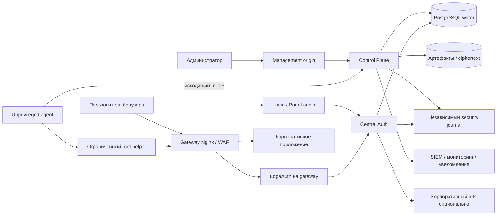
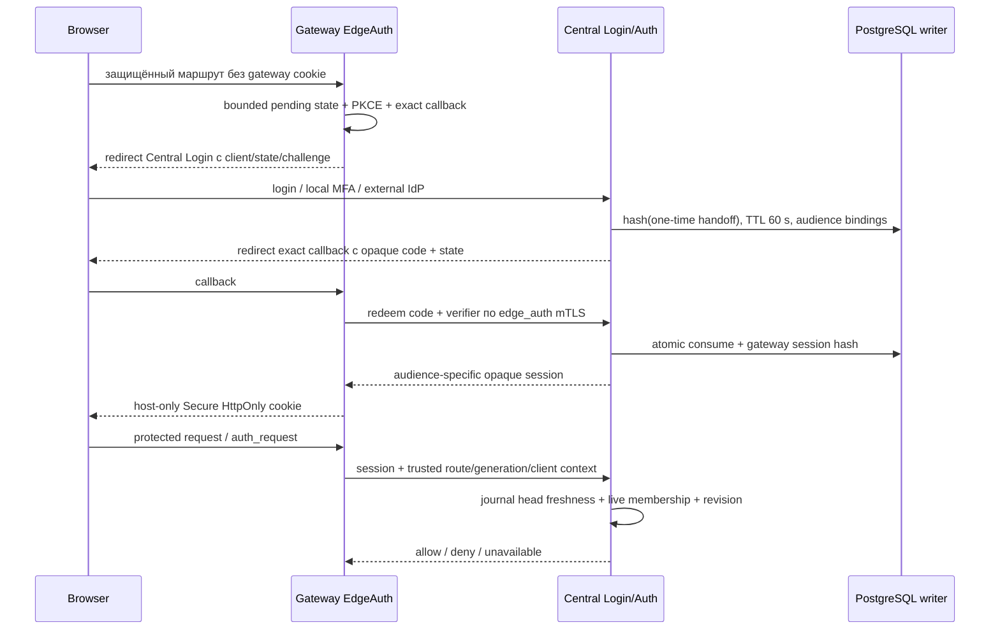
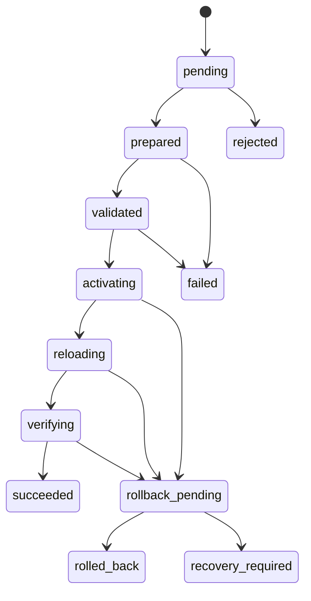

# AGP v2: архитектура и инженерные решения

Редакция: 2026-11-17. **TARGET: итоговое ТЗ принято владельцем; архитектурные
решения имеют отдельные статусы ADR.** WAF Zones приняты в ADR-V2-09; ранее
принятые требования AD/2FA/email и Angular сохраняются.
Ни один новый компонент или SLO здесь не объявляется реализованным либо измеренным.
Принятый [ADR 0001](../adr/0001-single-node-mvp.md), [план v1.1](../v1.1-plan.md)
и поддержка ручной single-node установки сохраняются.
Основание: [распределённая платформа](../distributed-platform.md), пользовательские материалы
и проверенные `internal/domain/models.go`, PostgreSQL migrations `001..007`.
Точные API и форматы: [контракты](api/openapi.yaml), [модель данных](data-model.md),
[reference DDL](database.sql), [требования](requirements.md), [безопасность](security.md).

## 1. Контекст, цели и ограничения

AGP объединяет доступ к корпоративным приложениям, публикацию маршрутов, управление шлюзами,
WAF, жизненный цикл пользователей и проверяемое изменение инфраструктурной конфигурации.
Пользователь портала видит доступные приложения; редактор готовит изменение; оператор применяет
его на определённых узлах; утверждающий подтверждает риск; аудитор проверяет историю и права.
Оператор Linux устанавливает агент/helper, делегируя AGP только явно выделенную область.
Владелец приложения согласует доступ, health probes, маршрут и допустимые WAF-исключения.
Владелец платформы принимает масштаб, SLA, PKI, сохранность данных и эксплуатационные расходы.

AS-IS: Go backend, embedded UI, PostgreSQL production и SQLite fallback, локальные пользователи,
Argon2id, группы/permissions, сессии, CSRF, портал, downloads, diagnostics, Nginx recommendations.
Исторический baseline: применение Nginx вручную. Текущие opt-in пакеты добавляют
S0/S1, signed native WAF, read-only agent inventory, trusted zone materialization,
owner-approved agent PKI и локальный syntax probe; [границы AS-IS](development.md)
не означают готовность helper, remote task execution, rollout или safe apply.
Legacy `is_admin` и permissions не превращаются автоматически в новую полномочную модель.
Найденные ранее ограничения проверки superadmin, origin isolation, identity headers и DNS
диагностики остаются работой baseline hardening, а не закрываются выпуском документации.

Первый v2 контур — одна организация, один PostgreSQL writer, без multi-master.
Pilot — Linux Ubuntu 24.04 amd64; это целевая qualification-платформа, а не текущий сертификат совместимости.
Другие ОС/arch допускаются только отдельным проверенным compatibility profile.
Nginx, connector, libmodsecurity, CRS, build flags/ABI и OS packages фиксируются точным tuple
после qualification; выбор «последних версий» при установке запрещён.
Существующие DNS, NTP, PostgreSQL, PKI, object storage и балансировщик интегрируются по контрактам;
AGP не получает произвольный SSH, управление firewall всего предприятия или гипервизором.

До HA-приёмки владелец задаёт число узлов/маршрутов/пользователей, concurrency, трафик,
допустимую задержку Auth, RPO/RTO, retention, длительность support window и связи площадок.
Тесты подтверждают эти значения на отдельном стенде; оценка без измерений не является гарантией.
Система работает all-in-one и distributed; Kubernetes, облако и service mesh не обязательны.
Regional autonomous Auth, multi-tenancy, SAML, универсальный remote execution и mobile clients
не входят в первый инкремент; расширение не должно скрыто ослаблять central fail-closed.

### Реализованное разделение node identity

На 2026-11-20 managed agent pilot использует четыре разные CP поверхности:
management/login HTTP origins, EdgeAuth mTLS, agent TLS 1.3 mTLS и enrollment TLS 1.3
с server authentication. Enrollment не принимает browser cookies/Authorization/Origin
или forwarded identity. CP выбирает ровно один источник identity: external public
registry либо managed issuer client. Отдельный issuer хранит issuing key и durable
ledger вне CP restore domain; exact server/writer/reader URI roles и разные credentials
разделяют выдачу и чтение registry. Installation trust roots/pins доставляются до token.

Полная Site closure строится по declared managed nodes, а не по списку живых
сертификатов; pending/expired/revoked узлы сохраняются и препятствуют неполному plan.
Локальный `agp-agent-validate` проверяет typed policy через exact signed renderer и
`nginx -t` в private unprivileged workspace с durable replay result. Эта граница
не предоставляет kernel filesystem/network sandbox или удалённый NodeBundle helper.
Квалификация локального syntax probe не переводит compiler preview в deployable.

### Реализованная основа допуска helper

На 2026-11-24 `internal/helper` добавляет Linux admission gate и installation-bound
локальный durable store для apply/rollback subset. Helper проверяет разные pinned keys
permit/control/journal, fresh current proof между двумя same-state journal heads и
сохраняет intent с high-water до выдачи исторического `noExecution=true` receipt.
Exclusive flock и trusted directory descriptors удерживаются весь срок открытия store;
ошибка durability закрывает handle. Сохранённый intent блокирует другую задачу,
`RequireRecovery` не умеет снимать блокировку. Это исторический admission-only срез;
последующий execution runtime описан ниже, root recovery qualification ещё не закрыта.
Это не поставка root-helper и не закрытие REQ-11/REQ-12;
[границы и следующий этап](development.md#основа-допуска-helper--as-is-на-2026-11-24).

### Реализованный Plan и отдельный planning review

`internal/deploymentplan` проверяет полный immutable Plan v1/v2 и execution-purpose
подпись; новый helper admission дополнительно сверяет полный v1 Plan с exact task,
target и installation profile. Planning-only CP workflow не выпускает этот execution
envelope; отдельный opt-in execution runtime описан ниже. Global-only CP workflow
формирует отдельное frozen предложение из trusted full-Site inventory, published native WAF closure, server catalog и full-node compiler preview.
Independent explicit `config.approve` reviewer может подписать только
`planning_review` выделенным ключом; proposal и signed review всегда
`deployable=false`/`noExecution=true`. Current grants/session/floors/epoch/dependencies
проверяются заново до replay. Этот planning-only workflow не удостоверяет реальные
baseline/owned-tree/sandbox/runtime evidence; wire Plan не закрывает полную approval
closure compiler/release/tuple.
[Реальные маршруты и ограничения](protocols.md#подписанный-plan-и-planning-review)
дополняют TARGET deployment-plans/approvals, не заменяя их.

### Реализованная read-only проверка owned tree

На 2026-11-25 `internal/ownedtree` добавляет content-bound manifest с отдельным
trusted installation digest, полным списком файлов/каталогов и node/site binding.
Reader удерживает filesystem descriptors, проверяет ancestry, exact membership,
owners/modes, hashes и mount identity. Opt-in `NewGateWithOwnedTree` связывает
manifest с installation и проверяет дерево до/после fresh authorization нового
admission. Старый `NewGate` остаётся foundation без такой проверки; исторический
`noExecution` replay не зависит от текущего дерева.

Root-only `cmd/agp-owned-tree` выдаёт unsigned локальное наблюдение, не выполняет
native runtime validation и не меняет CP baseline. Это read-only этап перед
CaptureBaseline, а не его квалифицированная реализация. Последующий executor описан
ниже; полная recovery qualification остаётся TARGET.
[Форматы и границы](protocols.md#локальный-owned-tree-manifest-и-наблюдение).

### Подключённый opt-in execution runtime — AS-IS на 2026-11-26

Concrete Sources связывает sealed revision/ownership, текущие agent identity/inventory,
signed component release, независимую qualification подпись полных native bytes и
подписанное root helper наблюдение базы. Публичные root-owned pins и private service-owned
материалы разделены; CP не может установить себе qualification key через БД/материал.
Подтверждение базы связано с одноразовым challenge, boot, точным anchor и текущей
цепочкой counters; неизвестная база не становится доверенной после одной подписи.

CP держит PG identity lease и локальный lifetime flock с live inode witness; это
single-host single-writer профиль, без HA. Agent передаёт только immutable request через
защищённый Unix socket с SO_PEERCRED. Helper самостоятельно получает StartProof/journal,
пишет signed outbox прямо в CP и удаляет из outbox только после фактического 204.
Daemon открывает существующий ledger, выполняет pending recovery до приёма задач и не
выполняет автоматическую инициализацию. Native v1alpha2 content digest исключает sequence,
но manifest/slot её закрепляют. Переход с prototype v1alpha1 автоматически не выполняется.

Отсутствие `AGP_EXECUTION_CONFIG` оставляет execution выключенным. Квалификация настоящих
root/Nginx/cgroup/reboot и production installer, а также producer квалифицированной
service/WAF materialization остаются незавершёнными. Profile/zone assignments этот
execution путь отвергает. Подробные границы — в [AS-IS](development.md#согласование-применение-и-откат--as-is-на-2026-11-26).

## 2. Проверяемые свойства решения

| Свойство | Наблюдаемая проверка |
| --- | --- |
| Один источник конфигурации | UI/import/API дают одинаковые canonical bytes и digest; Git не пишет БД напрямую. |
| Контролируемый эффект | После approve не меняются target nodes, bundle, secret versions, preconditions и waves. |
| Отсутствие скрытого allow | Ошибка Auth, неизвестная generation, journal lag и revoked session дают deny/error. |
| Безопасный повтор | Duplicate/reordered task не выполняет повторно завершённый побочный эффект. |
| Защита от stale writer | Старый epoch/sequence отклоняется узлом независимо от версии Control Plane. |
| Сохранение отзыва | Config rollback и DB restore не уменьшают security floor/deny head. |
| Прозрачное управление | UI различает desired, validated, approved, applied, verified и drift. |
| Ограниченная привилегия | Только helper пишет owned paths; payload не содержит shell/argv/raw directives. |
| Обратимость | До apply есть base inventory и проверяемый recovery target; ambiguity видна оператору. |
| Сохранность аудита | Критическое изменение, AuditEvent и outbox фиксируются в одной PG-транзакции. |

Это критерии архитектуры; численные бюджеты и подробные acceptance scenarios находятся в ТЗ.
Связи, которые невозможно гарантировать CHECK/FK, проверяют domain services и contract tests.

## 3. Контекст C4 и границы доверия

Management origin, login origin и приложения имеют отдельные host-only cookies и доверие.
Соседство DNS-имён не разрешает общий `Domain=.example.net` и не заменяет Origin/CSRF проверки.
Management API не доступен upstream-приложениям как доверенный same-origin endpoint.
Agent API имеет отдельный listener либо эквивалентную проверяемую boundary с mTLS cert role.
Auth subrequest приходит из доверенного gateway context; клиентские `X-AGP-*` удаляются.
Для каждого proxy location compiler генерирует полный набор trusted headers без наследования «на удачу».
Backend приложение не принимает прямой обход защищающего gateway/WAF из клиентской сети.

Встроенный UI допустим как способ поставки; module boundary не требует отдельного deployment.
Control Plane не проксирует прикладной трафик, agent не принимает решения о пользовательском доступе.
EdgeAuth выполняет browser handoff и audience/session plumbing; он не имеет helper-доступа
и не является offline Auth. На каждый защищённый запрос решение принимает Central Auth.

## 4. Контейнеры и варианты размещения

| Вариант | Размещение | Свойства и ограничения |
| --- | --- | --- |
| Manual baseline | `agp`, PostgreSQL/SQLite, операторский Nginx | Recommendations без автоматического применения; остаётся поддерживаемым. |
| All-in-one managed | Server, PostgreSQL, agent/helper, EdgeAuth, Nginx/WAF на VM | Минимальная эксплуатационная сложность; отказ VM/DB закрывает защищённый доступ. |
| Distributed | Central Control/Auth, PG writer; gateway nodes с agent/helper/EdgeAuth | Управление и трафик разделены; central Auth/network остаются зависимостью запроса. |
| Split WAF | WAF proxy и gateway — разные HTTP hops | Только после доказательства anti-bypass, client IP и end-to-end TLS policy. |
| noInternet | Корпоративная сеть без внешнего интернета | Внутренний registry/mirror; runtime не скачивает зависимости извне. |
| airgap | Собственные Control/Auth/DB/journal и import station | Полная локальная цепочка доверия и dependency closure; не «агент без Auth». |

All-in-one сервер может держать Control/Auth logical modules в одном binary и разных listeners.
Для независимого отказа Auth и management нужны раздельные процессы/ресурсы, не только разные URL.
Размещение independent security journal на той же восстанавливаемой VM/диске не обеспечивает
защиту от rollback всей машины; такой стенд не проходит DR/security acceptance.
PG read replicas пригодны для отчётов; Auth/security mutations и rollout coordination читают writer.
HA — несколько server/Auth instances с одним fenced PostgreSQL writer, отдельным journal и key store.
Автоматическая смена PostgreSQL writer требует инфраструктурного fencing; SQL lease не устраняет split-brain.

## 5. Модульная структура и контракты

Один Go-монорепозиторий, модульный server, небольшие отдельные agent/helper/EdgeAuth процессы.
Предлагаемые executable boundaries: `cmd/agp`, `cmd/agpctl`, `cmd/agp-agent`, `cmd/agp-helper`,
`cmd/agp-edge-auth`; последний вводится при отдельном gateway, не смешивается с agent daemon.
Имена будущих каталогов — implementation guidance, а не заявление о текущем коде.

| Модуль | Вход/выход | Запрещённые обходы |
| --- | --- | --- |
| Identity | Password/MFA/IdP, session, membership, handoff | Direct grant через users CRUD без privileged-target policy. |
| Authorization | generation/route/session → allow/deny/reason | Cached allow, unknown generation fallback, stale replica. |
| Configuration | Typed draft → immutable revision/validation | UI-only defaults, raw SQL mutation, произвольные Nginx snippets. |
| Compiler | Revision+capability+profile → content-addressed bundle | Runtime discovery, `latest`, secret plaintext в bundle/audit. |
| Fleet inventory | Identity, capabilities, ownership, heartbeat | Heartbeat как доказательство действующего auth/WAF. |
| Planner | Revision+fixed inventory → immutable digest plan | Повторное вычисление selector при dispatch. |
| Rollout coordinator | Plan+approvals → waves/tasks/reconciliation | Новый apply после потери lease или истечения preconditions. |
| Agent transport | Typed task, receipt, inventory | Shell/SSH tunnel или смешение EdgeAuth cert role. |
| Helper | Signed narrow authorization → owned filesystem effect | Путь/команда/URL от пользователя как root. |
| Artifact repository | Verified digest/TUF/manifest → exact bytes | Неподписанный upgrade, unbounded extraction, post-install downloads. |
| Security authority adapter | Pending operation → journal → PG projection | Sequence из PG backup как свидетельство свежести. |
| Audit/notifications | Tx events/outbox → dedup export/delivery | Секреты/request bodies или успешный alert без delivery evidence. |

Domain services зависят от storage/clock/crypto/transport interfaces, не от HTTP handlers.
Валидация shared DTO независима от UI; domain invariant вызывается одинаково из legacy adapter,
нового API и CLI. Storage transaction boundary принадлежит application service.
HTTP handler не начинает внешние root-эффекты внутри PG-транзакции.
Internal event содержит aggregate ID/version и типизированный payload; subscribers идемпотентны.
Новая подписка на outbox не становится вторым writer canonical configuration.

## 6. Configuration Core и наследование

Canonical revision — **полный организационный snapshot** `Configuration`, содержащий все Gateways
и typed profile assignments; `config_head` указывает на один такой snapshot. Отдельный Gateway —
редактируемый объект внутри snapshot. Compiler строит полное owned Nginx tree узла из всех назначенных
ему Gateways точной revision: сохранение одного Gateway не удаляет соседние listeners/routes.
Лимиты размера/сложности применяются ко всему Configuration, а не умножаются на число Gateways.

Scoped editor отправляет typed `GatewayChange` с baseRevisionId; сервер проверяет object scope,
вносит upsert в полный parent snapshot и atomically CAS обновляет global head с новой revision.
Всё вне разрешённого изменения сохраняется; parallel stale base даёт 412 и scoped diff/rebase,
без last-write-wins. Полное canonicalContent требует отдельного global read/write permission;
scoped Gateway view не раскрывает чужие объекты и не выдаётся за bytes всего snapshot/digest.

Вход — строго типизированное JSON-совместимое подмножество YAML/JSON.
`agp.config/v1alpha1` сохраняет профиль `pilot-500`; `agp.config/v1alpha2` явно
указывает `capacityProfile: fleet-10k`. Верхние границы 10 000 Gateway, 100 000 Routes
и 64 MiB полного snapshot задают валидируемый envelope, не измеренную производительность.
Per-Gateway предел 1000 Routes и per-plan предел 500 узлов остаются. Byte/count/depth
limits проверяются до крупных allocations; планирование учитывает per-node/task caps.
Qualification на 1000/5000/10 000 Gateway и миграция профилей описаны в [ТЗ](requirements.md).
Парсер ограничивает bytes/depth/object count, запрещает aliases, anchors, merge/custom tags,
duplicate/unknown keys, неоднозначные числа и неявное преобразование дат.
ID opaque case-sensitive; ревизия-counter не равна ID; bigint wire-значения — decimal strings.
Перед digest раскрываются defaults, нормализуются host/CIDR/path и порядок множеств.
Canonical JSON хранится для воспроизводимости; relational projections критических полей позволяют
проверять ссылки, lineage и ограничения. Canonical bytes восстанавливаются по спецификации,
а не через `jsonb::text`, Go map iteration или произвольный YAML emitter.

Global → Site → NodeGroup → Node → Route/Resource — поддерживаемые уровни явного профильного override.
`PolicyProfile` имеет стабильный ID и immutable published versions; assignment ссылается на exact version,
уровень и typed target scope. Region — label/grouping, не отдельная сущность первого контура.
UI показывает effective value, source, inherited value и diff; «сбросить override» отличается от пустого значения.
Два пересекающихся NodeGroup override одинакового приоритета с разными значениями — validation error.
Безопасность не использует last-write-wins; deny/security floor вообще не участвует в наследовании allow.
Списки групп/CIDR имеют явную семантику set replacement; ACL replacement консервативно dangerous,
если validator не доказал ужесточение. Intersection group IDs не подменяет AND membership expressions.
`lockedFields` запрещает нижнему уровню менять значение; unlock требует изменения parent version.
Central/fail-closed, platform MFA и WAF minimum остаются обязательными после всех overrides.
Computed per-node effective config/provenance фиксируются в bundle manifest и validated plan.
`policy_profiles`, `policy_profile_versions`, typed override relations и `profile_assignments`
хранят authored values; `effective_route_policies` и provenance — exact result по bundle digest.
Assignment resolution включает NodeGroup membership snapshot/digest; live изменение профиля либо
его target expansion требует нового resolution и plan, не переписывает старый bundle/Auth snapshot.

### WAF Zones как слой authoring

[WAF Zone](waf-zones.md) — Site-scoped группа логических Gateway для общей защиты,
а не отдельный уровень `PolicyProfile`, NodeGroup, DNS/сетевая зона или область RBAC.
Authoring хранит immutable zone versions, typed membership selector и точную пару
`policyRevisionId + mode`. Resolution материализует обычные `Gateway.spec.waf` bindings
в полном Configuration; compiler/agent не разрешают live selectors во время apply.
Политики Routes не расширяются до независимого full-WAF binding. Нынешний per-resource
Angular mock показывает форму редактирования, но не является реализацией зон.

Для Gateway разрешена одна primary zone. Явные IDs и AND-label selectors равноправны;
`siteDefault: true` — отдельное явное назначение для несовпавших сервисов в пределах Site.
Более одного совпадения — ошибка, отсутствие совпадения/default — onboarding и запрет
публикации. Защищённые метки меняются через путь проверки WAF с current scopes/floors;
нет выхода из защиты обычным rename или снятием label. Existing profile inheritance,
locks и WAF minimum проверяются после materialization и показываются в provenance.

База зоны разделяется потребителями и не содержит route exceptions. Производная
политика конкретного Gateway хранит базовую policy revision и локальные изменения;
rebase на новую базу сохраняет совместимые изменения и блокирует конфликты.
Каждое исключение остаётся route/rule/field-scoped с owner/reason/review/expiry.
Не вводятся wildcard exceptions или изменяемая глобальная копия для соседних сервисов.

Resolution фиксирует Gateway IDs, source/target zone versions, label/config revisions,
membership digest и точные итоговые bindings. Source closure и digest входят в plan
resolved inputs и подпись/approval полного плана. Новое совпадение после approval
создаёт следующий resolution/plan. Удаление участника, перенос или retire зоны требуют
explicit replacement assignments под CAS; старое назначение действует до безопасного
применения замены, без промежуточного `off` или выбора случайного default.

Одна UI-команда координирует отдельные site-scoped планы. На общем узле активируется
полное дерево всех Gateway: diff/permissions/approval учитывают также косвенные
изменения соседних зон. Canary выбирается по узлам и показывает все затронутые
приложения; небольшой процент трафика одного приложения этим механизмом не обещается.
Partial/unknown rollout не превращается в «зона защищена». Retry/recovery привязаны
к observed base и актуальным floors; expired exception не оживает при rollback.

Редактирование создаёт successor revision с parent ID и новым content digest, не меняет старый body.
State `draft → validated → approved → published → superseded` описывает workflow,
но `published` не означает, что все узлы применили revision.
Validation report связан с content digest, validator/compiler versions и capability digests.
Approved revision не разрешает apply без отдельного плана, проверенных approvals и текущих прав.
Ошибки в строке import возвращают field path/code и безопасный preview; секретные значения не отражаются.
Неполный import не создаёт частично изменённую конфигурацию.
Resource groups и administrative roles не смешиваются: доступ сотрудника к приложению
не даёт права развернуть конфигурацию приложения или изменить membership.

## 7. Идентификация, SSO и решение о доступе

Management session и login session существуют в Central Auth с разными audience/cookies.
Локальные account lifecycle/MFA/recovery реализуют согласованный v1.1. AD DS connector,
корпоративная OIDC-федерация, 2FA и одноразовые email-коды обязательны по REQ-02;
контракты и границы — [identity](identity.md). Directory adapters остаются внутри Identity;
agent/helper/EdgeAuth не получают AD passwords, LDAP credentials или право проверять OTP.
Прямой AD использует live directory check, а не offline membership snapshot. Отказ AD
закрывает решения соответствующих principals, сохраняя отдельный local break-glass с MFA.
Corporate OIDC используется как Authorization Code + PKCE, issuer/audience/nonce/state/redirect
проверяются по allowlist; email не является внешним первичным ключом, используется issuer+subject.
AGP не объявляется полноценным OIDC issuer первого выпуска.

Handoff одноразовый, случайный, хранится hash, TTL 60 секунд; scope фиксирует node/client,
gateway, exact redirect URI, state и S256 challenge. Timeout redemption не создаёт второй session.
Callback не принимает произвольный `next` URL; исходный path хранится сервером и проверяется.
Gateway session относится к gateway+node+EdgeAuth identity и current principal security version.
Gateway cookie удаляется из upstream Cookie; application cookies пересылаются только по политике.
EdgeAuth pending store содержит state/PKCE/login-flow data с TTL/quotas; он не источник access rights.
Logout/revoke source session отзывает либо делает неприемлемыми связанные gateway sessions.
Admin cookie не обменивается напрямую на приложение; локальный agent не может redeem edge_auth code.

Auth request связывает доверенные node/gateway/route/deploymentGeneration и session audience.
Auth загружает **точный** immutable auth snapshot revision, а не только последний global head.
Проверяются current principal state, password/security version, session expiry/revocation, MFA freshness,
current membership и актуальные restrictive security events/barriers.
Policy groups — OR по группам; CIDRs — OR по сетям; итог groups AND network AND MFA AND session.
Пустой required group set не означает everyone: неполная protected policy отклоняется validation.
Пустой allowCidrs означает отсутствие дополнительного IP-ограничения, явно показанное в UI.
Trusted client IP вычисляется только из доверенного proxy chain; произвольный X-Forwarded-For отвергается.
Новый group grant проходит административную policy и аудит; удаление membership — restrictive event.
Ни agent heartbeat, ни working Nginx не доказывают успешный Auth path.

Auth на каждом allow получает head независимого journal в первом безопасном режиме;
после чтения writer snapshot сверяет head повторно и разрешает только при совпадении
authority/applied head в одном согласованном decision context. При гонке повторяет bounded check либо deny.
Journal недоступен, authority epoch mismatch, PG applied head позади head или существует affected barrier — fail-closed.
Измеряемый bounded-staleness/lease режим возможен только отдельным ADR после определения revocation SLO.
Долгоживущие WebSocket/stream соединения не переавторизуются сами: задаётся maximum lifetime,
реестр соединений и явная политика экстренного разрыва; это отдельный acceptance scenario.

## 8. Security authority и восстановление запретов

Независимый journal — отдельный Go service с собственным PostgreSQL cluster, service account,
storage, credentials, PKI и backup/restore domain; предпочтительна отдельная VM.
Reference schema: [security-journal.sql](security-journal.sql), она не ставится в CP database.
Размещение на общем hypervisor не устраняет common failure; rollback обеих VM snapshots небезопасен.
До qualification реализации journal privileged deployment не включается.
API journal поддерживает `Head`, `Append(operationId, expectedEpoch, expectedHead, digest, typedPayload)`,
`GetByOperationId` и упорядоченный replay с проверяемой цепочкой digest.
Append атомарно и идемпотентно назначает sequence; конкурирующий expected head получает conflict.
Receipt связывает operation ID, epoch, sequence, digest и предыдущий head.
Authentication/authorization journal отделены от release signing и node PKI.

1. PG-транзакция сохраняет `security_operations.pending`, affected `security_barriers`, AuditEvent и outbox.
2. Worker отправляет Append; до подтверждения affected permits закрыты, UI показывает pending restriction.
3. Неизвестный результат Append сверяется через operation ID; новый payload под прежним ID отклоняется.
4. PG-транзакция проверяет receipt/chain, сохраняет SecurityEvent, materializes restriction и applied head,
   закрывает соответствующие barriers и записывает AuditEvent/outbox completion.
5. Auth разрешает только после совпадения writer projection и независимого head.

Нет распределённой атомарной транзакции между PG и journal; безопасность обеспечивается barrier,
replay и fail-closed. Append-success/PG-failure создаёт lag, а не потерянный запрет.
При head conflict pending operation пересчитывается только с сохранением исходного payload/idempotency
и повторной authorization либо получает recovery_required; sequence не выдумывается клиентом.
Снятие запрета — отдельная typed operation с ссылкой на исходное событие, причиной,
новым sequence, MFA и вторым полномочным человеком; config rollback не снимает запрет.
Перед password/MFA/OIDC-binding replacement durable journal принимает
`bump_authenticator_floor(principalId, authenticatorId, minimumVersion)`.
Credential/factor/link содержит version; версия ниже floor не принимается даже после DB restore.
Journal не содержит hash/seed/новый password. Если commit нового authenticator потерян после floor bump,
старый authenticator остаётся disabled до контролируемого reset, а не возвращается для удобства.
Повышение minimum release/security floor монотонно; снижение — отдельная аварийная процедура,
не обычная кнопка rollback и не скрытое изменение поля policy.

После restore сервер стартует в recovery mode: mutations и permits закрыты до проверки authority epoch,
independent journal head, key recovery и replay всех событий после backup point.
До reopening journal продвигает authorityEpoch, сохраняя монотонность sequence: все восстановленные
sessions/gateway sessions/handoffs/invites/enrollment/recovery codes с прежним issuedAuthorityEpoch невалидны.
Требуется повторный login/reissue; старый consumed token не воскресает из backup.
Восстанавливаются revoked sessions/identities/secrets, удалённые membership/role bindings и resource deny.
Копия head в восстановленной БД служит начальной точкой replay, не доказательством свежести.
Потерянный journal не восстанавливается «выбрать максимальный sequence из узлов» без trust proof.
В такой аварии нужен независимо подтверждённый внешний head либо quorum-approved новая authority epoch,
supervised credential reset и повторная авторизация fleet; старые grants не возобновляются вслепую.

## 9. Plan, rollout и агентный протокол

Planner фиксирует revision ID/content digest, node IDs, base revision/bundle, capabilities,
compiler/profile/artifact digests, immutable secret versions, waves, risk и expiry.
До первого плана `CaptureBaseline` создаёт validated revision+bundle: для пустого managed node —
закрытый bootstrap config; для adopted — inventory и подтверждённое полное рабочее дерево.
Неизвестный base не разрешается и не подменяется пустой строкой: без verified baseline plan не строится.
Selector разрешается **один раз**; новые label matches не добавляются в существующий plan.
Удаление/перемещение узла, capability drift, отозванный secret и изменившиеся права инвалидируют dispatch.
Plan immutable, изменение target/wave/risk создаёт новый digest и новые approvals.
Dangerous операции включают ослабление auth/WAF, trust/PKI, broad grants, adoption,
массовый upgrade, смену listener и irreversible migration; полный policy registry — в security spec.
Два человека означают автора и независимого approver с проверенными scopes, не два API-токена одного лица.
Права автора/утверждающего/deployer, MFA и expiry проверяются повторно перед каждой wave dispatch.

```mermaid
stateDiagram-v2
    [*] --> queued
    queued --> running: current rights + lease + preconditions
    running --> paused: manual / threshold / dependency
    paused --> running: recheck without changing plan
    running --> succeeded: all targets verified
    running --> failed: terminal target failure
    running --> recovery_required: ambiguous target
    queued --> cancelling
    running --> cancelling
    paused --> cancelling
    cancelling --> cancelled: untouched cancelled; active reconciled
    cancelling --> recovery_required: state unknown
```

Cancel останавливает новые dispatch, не прерывает fsync/atomic switch посреди критического шага.
Уже активный узел заканчивает verify либо bounded recovery; отмена не означает автоматический revert всех successful nodes.
Partial success сохраняется явно; повтор failed wave требует нового plan при изменении предусловий.
Canary выбирается fixed IDs; wave начинается после успешных probes и наблюдения согласованного окна.
Wave threshold учитывает readiness/auth/WAF/regression/rollback, а не только HTTP 200 heartbeat.

Task types закрыты: inventory, validate_config, apply_config, upgrade_components,
rollback_config, collect_diagnostics; у каждого отдельный typed payload и result schema.
Plan/task/permit связывают отдельный authorityEpoch; это не writerEpoch, который решает leader fencing.
После DR непринятые old-epoch tasks удаляются на reconcile; ранее принятая операция может выполнить
только bounded authorized recovery. Network partition не позволяет обещать мгновенную остановку принятого эффекта.
Writer lease позволяет dispatch только текущему holder; каждый privileged task несёт writerEpoch
и nodeDeploymentSequence. Узел хранит highwater вне заменяемого config tree.
PlanTarget фиксирует expectedNodeDeploymentSequence как observed accepted base, не резервирует counter.
Dispatch под node lock выделяет новую nodeDeploymentSequence; readonly tasks используют `"0"`.
Node durably повышает accepted highwater до первого эффекта, даже если последующий apply завершится ошибкой.
Sequence никогда не уменьшается; rollback получает новый sequence и применяет старый bundle поверх актуального deny.
Same task ID+digest возвращает durable receipt; same ID+другой digest — security reject.
Delivery at-least-once; externally observable side effects требуют durable journal/reconciliation.
Timeout означает unknown до сверки task ID/journal/generation, а не доказательство failure.
После смены writer coordinator сначала reconciles active operations и только затем планирует новые.

## 10. Helper, ownership, apply и drift

Agent работает без root, исходящее mTLS; helper доступен через локальный защищённый Unix socket.
Peer UID/service policy и подписанное narrow authorization проверяются независимо.
Helper allowlist связывает тип операции, node identity, pinned executable/profile, owned paths,
base/target digest, task/plan/expiry/epoch/sequence и recovery authorization.
Ни filename из bundle, ни environment, ни диагностический URL не превращаются в команду или root path.
Archive extraction запрещает traversal, symlinks/hardlinks/devices, unexpected modes/owners и превышение quotas.
Разрешённые file tree, service IDs и lock paths задаются installation/adoption manifest.

Apply: stage → digest/dependency checks → full `nginx -t` → durable intent/fsync →
atomic config switch/fsync directory → reload → worker generation check → synthetic probes → commit receipt.
Проверяется именно полное активируемое дерево includes/TLS/WAF тем же pinned executable.
Reload ack не доказывает generation; старые workers/долгие соединения наблюдаются отдельно.
Probes включают allowed, denied, revoked session, unknown generation, WAF detection/blocking и direct-bypass checks.
Synthetic accounts ограничены, секреты краткоживущие, response bodies не сохраняются.
После crash сверяются journal, active symlink/tree, service binary/profile и фактические workers.
Неоднозначный результат переводится в recovery_required; автоматическое отключение auth/WAF запрещено.

Managed означает владение выделенными paths/units/packages, adopted — подтверждённое принятие
existing owned subset, manual — recommendations без helper apply.
Adoption начинается inventory/export/diff; неизвестные includes/directives сохраняются у оператора
и блокируют автоматическое применение до явного решения, не удаляются compiler.
Drift: filesystem/profile/generation mismatch → apply blocked → export redacted diff → accept/adopt/revert отдельным plan.
Автоматически затирать изменения локального администратора нельзя; emergency deny не зависит от drift rollback.
Detach отменяет новые задания, завершает recovery и передаёт owned inventory.
Management-only detach отзывает agent identity и выключает helper; EdgeAuth сохраняется только через
явное retained binding с живым Central Auth. Полный detach отзывает обе service roles после replacement Auth.
Uninstall удаляет только AGP-owned files; shared/adopted конфигурация, приложения и backups сохраняются.
Отключение central Auth требует заранее согласованного replacement Auth; detach не делает маршруты публичными.

## 11. Артефакты, WAF и обновления

Compiler output адресуется digest; secret plaintext выдаётся node/task scope по отдельному каналу
и материализуется в защищённой runtime области, не в downloadable public bundle.
Release manifest фиксирует exact components, dependency closure, SBOM/licences, compatibility profile,
security sequence и protocol bounds. Manifest signature и TUF metadata проверяются независимо.
TUF root offline; targets/snapshot/timestamp keys раздельные; trust bootstrap до enrollment.
Обычный rollback допускает только совместимый verified release не ниже current security floor.
Airgap import проверяет chain/hash/length/expiry и полное замыкание; выключить expiry «для удобства» нельзя.
Истёкшие update metadata останавливают новые upgrades, но не удаляют уже pinned рабочий dataplane.
Не допускаются arbitrary package hooks и незадекларированные internet downloads.

WAF mode `off` — явный риск, `detection` — журналирование, `blocking` — фактическая блокировка.
Первоначальное включение: detection → tuning → fixed canary blocking → waves.
Exception ограничено policy/route/rule/parameter, имеет owner/reason/reviewAt/expiresAt и visible risk.
Review deadline вызывает alert и блокирует следующее approval без review; expiresAt — hard boundary.
Central Auth закрывает route, если активный bundle содержит истёкшее exception, до safe apply удаления
либо нового утверждённого продления. Физические Nginx rules сами по часам не меняются.
Auth snapshot содержит exception expiry; clock freshness проверяется. Старый bundle с истёкшим
exception непригоден как автоматический recovery target без отдельного безопасного решения.
Split-WAF gateway принимает трафик только от разрешённого WAF identity/network;
TLS/SNI/Host/client IP/body limits/timeouts согласованы обоими hops.
WAF health failure не переключает на bypass upstream.

## 12. Хранение, согласованность и наблюдаемость

PostgreSQL хранит typed control/auth state; filesystem CAS достаточен all-in-one,
S3-compatible CAS подключается при потребности в общем хранении/retention.
Ciphertext и artifacts раздельны по namespace/ACL; KEK/private CA/release keys вне БД/backup.
PG transaction обеспечивает aggregate change+AuditEvent+Outbox; file/object effect имеет staged state,
digest verify, idempotent finalize и sweep orphan objects после grace window.
CAS `WHERE row_version = expected` нужен даже при READ COMMITTED; critical allocation/head/lease
использует row locks/unique constraints, serializable retry там, где predicate invariant этого требует.
Долгих PG-транзакций во время сетевого I/O, подписи, nginx validation или apply нет.
Очередь outbox обеспечивает at-least-once; consumer dedup по event ID и aggregate version.

Metrics: desired/applied/verified generation, drift, journal applied/head lag, Auth decisions/reasons,
DB pool latency, deny barriers, cert expiry, outbox/spool depth, rollout checkpoints и dropped log counters.
Trace correlation проходит API→plan→rollout→task→receipt, без токенов и PII labels.
Audit/admin/config/security facts отделены от высокообъёмных traffic/WAF segments.
Logs не содержат Authorization/Cookie/password/private keys/request bodies/query secrets.
Agent spool ограничен byte/time quota, durable critical receipts, highwater alerts и explicit overflow policy.
Невозможность записать критический audit блокирует mutation; traffic overflow виден как loss counters.
Notification delivery имеет dedup/retry/backoff/maintenance/routing; pending не выдаётся за delivered.
Webhook/SMTP egress проходит DNS pinning/allowlist/redirect restrictions, как диагностика.

## 13. Миграция и совместимость

Legacy public users/groups/resources сохраняют ID, семантику и data ownership до cutover.
Случайные ID v1 содержат uppercase base64url: запрещены lowercasing/UUID rekey.
ID вне нового wire profile переводятся только явной identity bridge с preview и operator acceptance.
`agp_v2` reference схема не исполняется как текущая migration и не меняет public tables.
Expand создаёт новые tables/adapters; backfill проверяет counts, references, IDs, policy parity и digest;
dual-write выполняется одним application transaction через один writer, не двумя независимыми services.
Read comparison не отправляет двойные emails, не создаёт двойные sessions и не применяет Nginx.
Legacy API mutation идёт через тот же Configuration Core/RBAC; прямой bypass запрещён после cutover.
Origin migration отзывает legacy cookies/sessions, требует повторного login и проверяет app isolation.
Ручные Nginx configs импортируются только preview → inventory-only → validate-only → explicit adoption.

Expand-compatible binary rollback допускается до contract; schema downgrade/restore не выполняется автоматически.
Contract допускается после acceptance, backup/restore drill и завершения rollback support window.
Protocol текущей и предыдущей minor поддерживается по release matrix; несовместимый node остаётся
на работающем pinned dataplane, новые mutation tasks блокируются с видимой причиной.
Alpha schema breaking change получает новый version/converter/fixtures, не меняет прошлые bytes.
Public downloads/portal settings/diagnostics initially используют legacy storage adapter,
после target schema design — отдельная migration с field parity; их нельзя молча потерять при rewrite.

## 14. ADR: ключевые решения

ADR-V2-01..07 сохраняют Proposed статус. Владелец принял выбор Angular в ADR-V2-08
и модель WAF Zones в ADR-V2-09 от 2026-11-17. Принятие TARGET требований не означает
закрытие qualification, измерение SLO или готовность текущего runtime.

### ADR-V2-01: модульный server и отдельные границы привилегий

**Context:** маленькая текущая система должна вырасти без неоправданной эксплуатационной сложности.
**Decision:** один Go repository, server modules; отдельные agent, helper и EdgeAuth service accounts/processes.
**Alternatives:** микросервис на каждый модуль — больше независимых deploy, сетевых контрактов и on-call;
единый root daemon — быстрее прототип, но чрезмерный blast radius и смешение credential roles.
**Consequences:** проще all-in-one; выделение Auth возможно позже; process isolation/security review обязательны.

### ADR-V2-02: PostgreSQL writer и immutable revisions

**Context:** UI/API/import конкурируют; нужны approvals и воспроизводимость.
**Decision:** PG17+ один writer, typed relational projections + immutable canonical JSON/digest, CAS.
**Alternatives:** Git authority задерживает interactive editing/secret lifecycle; event-sourced всё усложняет queries;
JSON-only теряет критические типы/FK; multi-master добавляет конфликтующие security changes.
**Consequences:** привычная эксплуатация и транзакции; DB fencing/backup нужны; SQLite не fleet authority.

### ADR-V2-03: central Auth с отдельным browser handoff

**Context:** management cookie нельзя передавать приложениям; веткам нужен единый login.
**Decision:** Central Auth, EdgeAuth, одноразовый bound AGP handoff; external IdP через OIDC client.
**Alternatives:** shared cookie domain опасен; полноценный AGP OIDC issuer существенно расширяет scope;
offline gateway allow требует отдельной revocation model и неподтверждённого staleness budget.
**Consequences:** изоляция понятна; network/journal latency влияет на запрос; auth loss закрывает доступ.

### ADR-V2-04: deny journal вне восстановленной БД

**Context:** старый backup не должен возвращать отозванные права/ключи.
**Decision:** independent sequenced idempotent journal, PG projection, barriers и per-allow head check.
**Alternatives:** sequence только в PG не выдерживает restore; node maxima не доказывают полноту;
обычный audit export eventual не является authority; leased freshness возможно позднее отдельным ADR.
**Consequences:** дополнительная критическая зависимость/стоимость; DR проверяем; no journal означает fail-closed.

### ADR-V2-05: pinned plan и ограниченный helper

**Context:** approvals теряют смысл при изменившихся selectors или arbitrary commands.
**Decision:** exact targets/digests/versions, signed narrow authorization, durable local journal и fencing.
**Alternatives:** SSH scripts быстрее стартуют, но не дают reproducibility/least privilege;
универсальная orchestration platform требует отдельного threat model и команды эксплуатации.
**Consequences:** больше contract/fault tests; ownership/adoption обратимы; hidden custom directives не поддерживаются.

### ADR-V2-06: provider WAF и квалифицированные release sets

**Context:** Nginx dynamic module совместимость и offline supply chain нельзя вывести из semver.
**Decision:** first provider ModSecurity/CRS, exact tuple + TUF + manifest signature + dependency closure.
**Alternatives:** latest packages проще, но невоспроизводимы; встроенный собственный WAF слишком дорог;
remote WAF допустим позже при anti-bypass qualification.
**Consequences:** qualification/updates требуют труда; engine interface оставляет расширение без обещания универсальности.

### ADR-V2-07: staged adoption и expand-contract

**Context:** существующие ручные установки и approved v1 решения продолжают работать.
**Decision:** preview/adapters/ID preservation, inventory-only→validate-only→canary, reversible expand first.
**Alternatives:** big-bang rewrite быстрее на чистом стенде, дороже outage/data-loss risk;
вечный dual-write увеличивает drift и эксплуатационную стоимость.
**Consequences:** некоторое временное дублирование; parity/rollback window обязательны; contract отдельный milestone.

### ADR-V2-08: Angular и единый UI/help layer

**Status:** выбран владельцем, 2026-11-17; миграция и production qualification впереди.
**Context:** инженеру нужен единый лёгкий интерфейс и понятная помощь у важных параметров.
**Decision:** Angular + TypeScript, standalone components/typed forms, общие tokens/components;
HelpTip «?» с кратким объяснением и переходом в локальный versioned manual без потери draft.
**Consequences:** Node build toolchain и lockfile обязательны; UI потребляет существующие
security/API contracts. v1 static frontend сохраняется до управляемого cutover.
Визуальный контракт и пример — [ui-design](ui-design.md).

### ADR-V2-09: WAF Zones и безопасное массовое управление

**Status:** принято владельцем, 2026-11-17; реализация и qualification впереди.
**Context:** при 1000+ приложений настройка каждого Gateway отдельно затрудняет
поддержание общей защиты; live selectors и общие изменяемые политики делают эффект
согласования непредсказуемым.
**Decision:** Site-scoped зоны логических Gateway с одной primary zone, typed explicit
IDs/AND labels/site default, exact policy revision и режимом. Immutable resolution
материализует bindings в полный Configuration, сохраняя существующие profile locks/floor.
Базовая политика общая; route-specific исключения входят в производную policy конкретного
Gateway с provenance/rebase. Планы закрепляют состав и полный node diff; новые участники
не попадают под старое approval. Перенос/retire требует CAS и explicit replacement.
Одна UI-команда может создавать отдельные планы нескольких Site. `fleet-10k` — новый
версионированный envelope, old `pilot-500` неизменен.
**Alternatives:** поштучные копии расходятся; mutable shared policy скрывает blast radius;
произвольные приоритеты пересекающихся зон затрудняют проверку; DNS/сеть/NodeGroup не
отражают принадлежность приложений к общей защите; live selectors после approval меняют цели.
**Consequences:** добавляются authoring/resolution/provenance и rebase services; backend
проверяет косвенно затронутые объекты полного node bundle. Canary остаётся по узлам.
Ограничения task/agent и shared-node apply не повышаются одним расширением snapshot.
UI показывает Zones → приложения → effective protection. Прототип per-resource и Go v1
не получают эти возможности автоматически. Полные инварианты — [WAF Zones](waf-zones.md).

## 15. Этапы, зависимости и критерии готовности

| Этап | Зависимость | Приёмка | Возврат / stop condition |
| --- | --- | --- | --- |
| 0. Hardening/lifecycle | Рабочая v1 установка | Four baseline regressions, MFA/recovery/privileged-target tests, PG integration, restore drill | Без прохода helper не допускается. |
| 1. Configuration Core | Typed schemas и policy semantics | Deterministic digest, CAS conflict, ID-preserving migration preview, equivalent UI/import | Ручной v1 режим; не выдаёт privileged tasks. |
| 2. Identity/journal/read-only fleet | PKI и independent journal выбран/qualified | Enrollment replay/revoke, role separation, journal crash/replay, inventory/validate-only | Отзыв node identity, ручное управление сохраняется. |
| 3. One-node apply | Ownership inventory, reviewed helper, live Auth snapshots | Crash injection на checkpoints, allow/deny probes, verified rollback, highwater no decrease | recovery_required закрывает дальнейшие mutation. |
| 4. WAF/artifact supply | Exact tuple, trust keys, profiles, zone authoring/resolution | Detection/blocking, membership/rebase/expiry, anti-bypass/tamper/closure/offline tests | Pinned working tuple выше security floor; no hidden shared-node changes. |
| 5. Fleet/UX | One-node доказан, fixed plans/waves | Partial failure/cancel/resume/drift/permissions race/duplicate tasks | Stop new waves, reconcile active, new plan if inputs changed. |
| 6. HA/DR/lifecycle | Measured workload/SLO и fenced DB/journal/key store | Writer loss, old backup replay, key recovery, detach/upgrade compatibility | Документированный fenced failover или controlled fail-closed. |
| 7. Regional | Принятый предел устаревания/revoke и отдельные regional contracts | Partition/ownership/relay/local Auth tests | Без принятого риска автономный allow не включается. |

Квалификация split-WAF и independent airgap относится к S6 отдельными профилями; closed-network noInternet dependency closure — S4. S7 не подменяет эти сценарии и посвящён автономности авторизации.

Каждый этап имеет contract fixtures, integration/fault/security tests и operator runbook.
Done означает implemented+reviewed+tested+observability+rollback documented, не только merged код.
Ни документация, ни successful unit tests не заменяют стендовый Nginx/WAF/PKI/PG qualification.

## 16. Риски и решения, оставшиеся за владельцем

Главные технические риски: latency/availability independent journal на allow path, helper privilege,
drift adopted конфигураций, ABI компонентов, восстановление ключей и переход origin/session model.
Снижение рисков: короткие вертикальные slices, pinned qualification matrix, fault injection и rehearsal
на обезличенной копии; не перенос неясности в «реализуем потом» перед privileged rollout.

До production допуска нужны ответы: организация PKI/IdP/journal/key store; точные масштабы и SLO;
retention/PII policy/notification recipients; допустимый downtime первой adoption и long-lived connections.
До соответствующей функции допустимы engineering defaults из требований; они не являются принятым SLA.
Изменение этих предпосылок оформляется ADR с влиянием на schema/protocol/UX и migration path.
