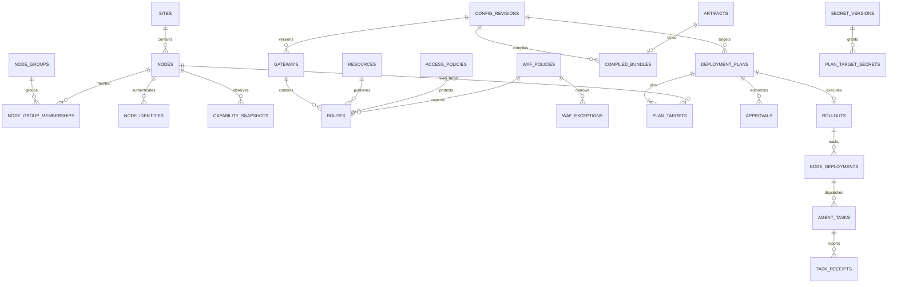
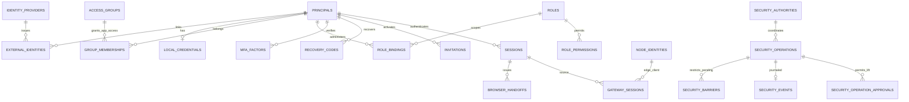

# AGP v2: модель данных, хранение и транзакции

Статус: **TARGET / итоговая спецификация для реализации**, 2026-11-17; принятая логика WAF Zones. Это не текущая production schema.
[database.sql](database.sql) — исполнимая reference schema PostgreSQL 17+ в namespace `agp_v2`.
Независимый journal имеет [отдельную reference schema](security-journal.sql) для **другой БД/cluster**.
Это не migration для существующей БД и не команда для production; `public.*` не изменяется.
DDL не требует extensions/superuser и не создаёт global roles/grants.
Реальная migration вводится отдельно после review, parity tests и rehearsal backup/restore.
Связанные документы: [архитектура](architecture.md), [протоколы](protocols.md),
[API](api/openapi.yaml), [безопасность](security.md), [эксплуатация](operations.md).

## 1. Правила типов и канонизации

| Тип | Wire / Go boundary | PostgreSQL | Проверка и смысл |
| --- | --- | --- | --- |
| `Id` | string; opaque, case-sensitive | `object_id` domain over text | `^[A-Za-z0-9][A-Za-z0-9_-]{0,127}$`, 1..128 ASCII; не сортировать по смыслу. |
| `UInt63` | decimal string → checked int64 | nonnegative bigint domain | `^(0|[1-9][0-9]{0,18})$` и значение ≤ 9223372036854775807. |
| `Digest` | `sha256:` + 64 lower hex | `digest` domain over text | Digest проверяется по canonical bytes, не по произвольной JSON serialization. |
| `Timestamp` | RFC3339 UTC, `Z` | timestamptz | API нормализует UTC; SQL session timezone не меняет instant. |
| `ShortSeconds` | JSON integer, 0..86400 | integer domain | 0 разрешён только по field semantics; не Go duration nanoseconds. |
| `RetentionDays` | JSON integer с явной единицей | integer CHECK | Длительное хранение не обрезается лимитом short operation. |
| `IP` | canonical IPv4/IPv6 string | inet | Address, не произвольный X-Forwarded-For. |
| `CIDR` | normalized network/prefix | cidr | Host bits отвергаются либо явно нормализуются до preview/digest. |
| `Port` | integer 1..65535 | integer CHECK | Не string и не shell argument. |
| `Enum` | exact lowercase string | text CHECK | Неизвестное значение отвергается; расширение требует version/compatibility review. |
| `SecretVersionRef` | immutable version ID | FK secret_versions | Не alias `latest`, не secret plaintext. |
| `issuedAuthorityEpoch` | UInt63 string | issued_authority_epoch bigint | Токен приемлем только в current independent authority epoch. |
| `Metadata` | bounded object | jsonb ≤16 KiB | Только validated noncritical extension metadata, не RBAC/routes/security floor. |

Конкретные payload limits wire schema могут быть строже общих storage CHECK.
SQL storage superset не является разрешением принять превышающий wire limit запрос.
Размер decoded input, depth, arrays, strings и decompressed archive ограничиваются до allocation.
`null`, отсутствующее поле и пустой set различаются согласно schema; PATCH имеет явную семантику.
Неизвестное поле не сохраняется «на будущее» и не исчезает молча из UI.
Go DTO содержит typed wrappers с Parse/Validate/MarshalJSON; generic float64 для bigint запрещён.
Browser работает с bigint strings/checked BigInt, не `Number` для revision/sequence/bytes.
PostgreSQL bigint exhaustion приводит к stop/recovery, не wraparound и не отрицательному counter.

Legacy `storageID()` использует prefix+base64url, включая uppercase; lowercase ID запрещён.
Обычные `usr_*`, `grp_*`, `res_*` сохраняются побайтно, включая регистр.
Если старый внешний ID не входит в wire profile, `identity_bridges` фиксирует raw legacy ID,
новый canonical ID и причину в migration report; mapping требует явного review до cutover.
Нельзя скрыто заменить все ID на UUID или потерять ссылки audit/download/resource groups.
Canonical host — lowercase IDNA ASCII, без портов/схемы/trailing dot; display Unicode отдельно.
Path нормализуется без неоднозначных encoded slash/dot-segments; overlap проверяется compiler.
Доменный путь не преобразуется произвольным decode/re-encode циклом разных компонентов.
Множества сортируются по canonical byte ordering; arrays с семантическим порядком сохраняются.
Установленные defaults входят в canonical bytes; `jsonb::text` не является canonical serializer.
Config digest, bundle digest, plan digest и event chain digest — разные вещи и отдельные поля.

## 2. Источники истины и жизненный цикл данных

| Набор | Authority | Что считается projection/cache |
| --- | --- | --- |
| Desired configuration | immutable ConfigRevision в PG | UI forms, Git import, compiled views. |
| Local membership/session/RBAC | PostgreSQL writer после journal-protected security transitions | Auth process local structures без cached allow. |
| AD account/security groups | Полный live read квалифицированного DC/GC плюс текущие AGP mappings | Directory observations только для UI/аудита, не cached allow. |
| Restrictive security events/head | Независимый append-only security journal | PG SecurityEvent/materialized restrictions/applied head. |
| Artifact bytes | Verified content-addressed storage | PG metadata/index; local downloads/staging. |
| Encryption/trust root | Отдельный key store/offline roots | Wrapped DEK/cert public metadata в PG. |
| Effective local filesystem | Helper journal + verified live tree/workers | CP desired/applied/last-seen projections. |
| Administrative audit | Transactional AuditEvent, exported custody | Dashboards/search index/SIEM ingestion state. |
| Traffic/WAF telemetry | Redacted node spool/segments | Search/metrics; потери учитываются явно. |

Видимый heartbeat не изменяет applied generation без signed/typed receipt evidence.
Данные canonical revision immutable; state workflow mutable и CAS-protected.
Soft-delete сохраняет reference identity и historical lineage; не означает вечное хранение PII.
Время `occurred_at` узла и `received_at` центра хранятся отдельно; clock skew измеряется.
Journal order определяется sequence, не timestamp или HTTP delivery order.
Одна организация не означает все операторы global admin; scopes хранятся явно.

### Execution source storage — AS-IS на 2026-11-26

Реальные paired migrations `035_execution.sql` и `036_execution_sources.sql` относятся
к отдельному opt-in sequential workflow, а не к reference DDL ниже. Source storage
сохраняет одноразовые baseline challenges, signed captures/outcomes, verified baseline
с boot digest/capture reference, монотонными accepted/receipt/epoch/deny counters,
row version и freeze. Подпись
проверяется по внешнему installation receipt pin; строка в БД сама не создаёт trust.
Qualification keys и installation catalog находятся вне CP restore domain; полные
secret-bearing материалы хранятся отдельно private. Повторный capture не сбрасывает
цепочку, неизвестная база блокирует дальнейшее исполнение. Native content `TreeDigest`
в v1alpha2 не включает sequence; manifest и storage slot закрепляют sequence отдельно.

## 3. ERD: контроль и применение

Версионные FK включают `revision_id`: Route не может сослаться на policy другой revision.
Одна Route ID может существовать в разных revisions с разными значениями; это version identity,
а Resource ID — стабильный каталог приложения и scope прав.
PlanTarget хранит fixed node, не label selector; селектор остаётся authored input/provenance.
Composite/semantic связи node↔bundle↔capability↔revision проверяются planner в дополнение к FK.

## 4. ERD: identity, session и security

Administrative role assignment и access group membership независимы.
Resource policy membership вычисляется по текущему членству, а route rules — по request generation.
Блокировка principal, revoke session и remove membership не ждут применения Nginx.
Полиморфные audit/security subject references намеренно переживают tombstones, без фиктивного FK.
Application валидирует subject kind/ID и owner scope до записи, audit хранит redacted identity snapshot.

## 5. Data dictionary: identity и персональные данные

| Таблица | Ключи, основные поля | Инварианты и использование |
| --- | --- | --- |
| `principals` | PK id; UNIQUE username_key; kind/state/security_version/row_version | Local/OIDC/directory/service; deleted tombstone; break-glass только local. |
| `identity_bridges` | PK(entity_kind,legacy_id); UNIQUE(kind,canonical_id) | Bridge public users/groups/resources, preserve IDs; raw old ID разрешён только здесь. |
| `local_credentials` | PK/FK principal_id; UNIQUE authenticator id; version/password_phc/must_change | Argon2id PHC; floor checked before login; kind local проверяет service. |
| `identity_providers` | PK id; UNIQUE issuer/security_guard_id; client_id/enabled | OIDC provider; HTTPS issuer/metadata/JWKS и redirect allowlist валидирует typed config. |
| `identity_provider_versions` | PK id; UNIQUE digest; security_guard_version/endpoints/algorithms/client secret/claim rules | Immutable endpoint+MFA mapping version; current_version resolver принадлежит этому provider. |
| `identity_provider_clients` | PK(provider_version,purpose); UNIQUE exact client/redirect | Раздельные login/management clients; issuer-specific exact callbacks, без wildcard/fallback. |
| `external_identities` | PK(provider_id,subject); FK principal; UNIQUE authenticator id/version | Связь через verified issuer+subject; version below journal floor disabled. |
| `access_groups` | PK id; UNIQUE name; mfa_required | Группы доступа пользователей, не fleet NodeGroup и не role. |
| `group_memberships` | PK(principal,group); granted_by/expires_at | Current membership; expiry требует freshness проверки, remove идёт через deny operation. |
| `sensitive_profiles` | PK/FK principal; FK secret_version | PII envelope ciphertext; explicit permission+audit на чтение. |
| `mfa_factors` | PK id; principal/seed secret FK; last_accepted_step | Только TOTP first slice; verified/revoked lifecycle, step CAS запрещает replay. |
| `recovery_codes` | PK(principal,code_hash); batch/consumed_at | Одноразовые высокоэнтропийные коды; batch rotation отзывает старые. |
| `invitations` | PK id; UNIQUE token_hash/security guard/authorization operation; kind/action/epoch/version/contact/generation pins | Email token irrevocably reserved за одним flow и consumed с activation/reset; supervised ticket consumed при authorized recover transition. |
| `identity_activation_stages` | PK/FK flow; token/principal/policy/PHC/sealed seed/TOTP proof/recovery hashes | Initial credentials staged до atomic activation; не normal allow и не общий response cache. |
| `identity_password_reset_stages` | PK/FK flow; token/principal/policy/PHC/current TOTP proof | Только typed reset_password; новый hash не появляется в live credential до finalization, MFA не заменяется. |
| `identity_invite_outbox` | PK id; UNIQUE token; epoch/generation/expiry/claim | Pre-flow encrypted invite/reset payload; volatile DEK, один SMTP attempt, no wrapped DEK в backup. |
| `sessions` | PK id; UNIQUE token_hash; audience/security version/auth context/expiry | Management/login; auth time/method/strength/issuer/acr/amr/claim policy; inet IP. |
| `browser_handoffs` | PK id; UNIQUE code_hash; source session/node/gateway/client | TTL ≤60 s, exact redirect/state/S256, atomic single consume via edge_auth mTLS. |
| `gateway_sessions` | PK id; UNIQUE token_hash; source session/node/gateway/client | Narrow audience; не management cookie; mapped principal/version/MFA. |
| `directory_providers` | PK id; UNIQUE name/security_guard_id; forest_guid/enabled/CAS | Прямой AD DS, отдельный от OIDC provider; current version FK проверяет ownership. |
| `directory_provider_versions` | PK id; UNIQUE digest/(provider,guard version); bind/CA secret FKs; config_json | Immutable typed canonical config по directory-provider schema; guard floor до публикации. |
| `directory_identities` | PK authenticator id; UNIQUE principal/(provider,forest,objectGUID); authenticator_version | Stable AD link; DN/UPN/email не являются ключом, revoke/floor закрывают старую связь. |
| `directory_group_mappings` | PK(version,group objectGUID,access group); FK version/group | Непривилегированный mapping; равен canonical config, не выдаёт management role. |
| `directory_membership_observations` | PK(identity,version,groupGUID,access group); FK mapping; observed/expiry | Evidence для UI, не cached allow. Local membership хранится отдельно. |
| `identity_contacts` | PK authenticator id; FK principal/address secret; version/verified/revoked/CAS | Ciphertext адреса, verified state; изменение контакта через independent floor. |
| `identity_flows` | PK id; UNIQUE binding hash; epoch/security snapshot/purpose/audience/state/expiry | Pending primary/MFA, server-owned auth context, общий attempt/resend budget; не session. |
| `email_challenges` | PK id; UNIQUE(flow,generation); один live challenge/flow; contact/version/epoch | HMAC 32 bytes + внешний key ID, expiry/attempts/consume/delivery state; без plaintext code. |

Directory session methods: `directory_password|directory_mfa`; sessions и gateway_sessions
содержат directory identity и immutable provider version FKs. При проверке доступа service
повторно проверяет принадлежность principal/provider, live AD state и текущий guard floor.
Полный AD/MFA/email lifecycle и правила DR определены в [identity](identity.md).
Provider guard subjects выделяются сервером в зарезервированном service namespace без прав;
они не human actors и не обходят отдельное approval. Любая смена config/disable требует
нового guard version и durable journal floor до публикации, включая OIDC claim policy.
У OIDC provider guard version принадлежит identity_provider_versions, у direct AD —
directory_provider_versions; старый config ниже floor не допускает даже нового входа.

Flow `context_json` — закрытая server-owned проекция: verified OIDC issuer/acr/amr/authTime,
claim policy version, source session ID для step-up, recovery security operation ID и policy
digest. У каждого purpose свой DTO; credentials, arbitrary claims, email и OTP запрещены.
Факт успешного внешнего MFA сохраняется с verified issuer mapping, а не с client boolean.
Email proof обновляет только разрешённый contact/setup шаг; session создаётся исключительно
при атомарном completion подходящего login flow после current policy/epoch/floor/AD checks.
Flow и challenge locks берутся в порядке flow → challenge; неверные attempts commit,
resend инвалидирует прошлое поколение в той же транзакции. Outbox ссылается на challenge,
epoch и encrypted delivery secret, worker сверяет их непосредственно перед SMTP submit.
GC удаляет/crypto-erases delivery payload при consume/expiry/cancel, а evidence хранит
по retention policy без raw адресов/кодов. Старые flow и email payload после restore не используются.

Local principal отдельно хранит `lifecycle_state=invited|active` и блокировку; wire
`LifecycleUserView.lifecycleState` не выводится из наличия password hash. Новая pending
учётная запись не имеет активных local credentials. Normal auth/session/edge/management
проверяет active. Только private typed setup context допускает invited principal;
purpose либо browser boolean не являются таким разрешением. Полные DTO и границы —
[identity lifecycle schema](schemas/identity-lifecycle.schema.json).

У email invite/reset `reserved_flow_id`, binding hash и reserved_at записываются один раз;
raw token после claim больше не авторизует обмен. Cancel/expiry/lost binding закрывают
reservation без unclaim. Initial completion одной TX публикует staged password/factor/
recovery hashes, active state, invite consumed_at и completed flow после durable floor
receipts. У supervised ticket иная граница: consume атомарен с authorized recover-flow
transition, до factor/password setup. Private action `replace_mfa|reset_password` не
расширяется взаимно. Typed recovery intent покрывает target/PV/epoch/policy/custodian/
restrictive specifications; child requests с уникальными IDs сохраняются до append.

AS-IS integration stage использует paired migrations 029–031; это не применение
reference SQL к существующей БД. `identity_recovery_capabilities` хранит private action,
стабильный guard и current target/policy/version snapshot; `totp_factor_version` вместе
с flow `mfa_at` фиксируют ordinary-reset factor/proof pins. Reference
`identity_password_reset_stages.mfa_authenticator_version/mfa_proof_at` выражают ту же
границу. Initial stage сохраняет отдельный `email_confirmed`; без него TOTP не начинается.
Anonymous expired setup flows очищаются независимо от наличия principal; deadlines
повторно проверяются перед окончательной публикацией credentials. Final stage/fullcombined
и внешняя qualification остаются отдельными от DDL syntax/contract PASS.

Runtime adapter `identity_one_time_tokens` представляет reference `invitations`; оба
сохраняют purpose/proof-kind/action и независимый service token guard. Floor consume/revoke
использует guardId/guardId, а не human principal: anonymous reset issuance не отзывает
sessions жертвы. Реальная смена password/factor отдельно поднимает соответствующие human
floors. Public reset response всегда 202 без account/contact/delivery metadata; recipient
разрешается из verified contact, а ordinary reset требует действующего TOTP. Privileged
reset использует distinct approval, не anonymous email request. Старый hash не получает
новую разрешённую version после restrictive password reset execution.

После прерванной initial activation durable floors могут закрыть restored invited row.
Только distinct-approved `restart_activation` с exact observed principal/password/factor/
recovery/replay floors поднимает SV/PV выше max(row,floor), закрывает прежние stages/tokens
и оставляет invited без credentials. Active target запрещён; ticket не выдаётся. Новый
обычный invite и полный password/email/TOTP setup выполняются отдельно после applied. Это не
общий allowPending и не понижение независимых floors.

AS-IS pending-local input сначала приводится к lowercase по той же policy, что local
primary lookup; это не меняет display name/password bytes и не доказывает реализацию
полной TARGET Unicode normalization ниже. Permission-bearing groups отклоняются до
metadata/idempotency replay; pending creation не является positive grant.

`username_key` вычисляется одной закреплённой Unicode normalization/case policy с collision preview.
SQL UNIQUE работает по уже нормализованному key, `lower()` не заменяет эту policy.
Смена username не меняет principal ID и не переносит external identity по совпадению email.
Для local account пароль меняется с проверкой целевого privileged principal и session revocation.
TOTP seed шифруется; last accepted step хранится для каждого factor и atomically monotonic.
Enrollment TOTP создаёт unverified factor, grants MFA только после successful code verification.
Initial activation использует отдельный staged enrollment: live factor и floors не
публикуются generic confirmation до atomic activation. Recovery enrollment требует
typed replace_mfa authorization; reset_password не разрешает enrollment.
Recovery consumption: `UPDATE ... WHERE consumed_at IS NULL RETURNING`, одна transaction
с revoke старых sessions, security operation и audit; два запроса не потребляют один code успешно.
Recovery не превращает временный session в постоянный superadmin; отдельная policy для MFA reset.
В stage legacy recovery-code capability guard детерминирован по исходным flow/principal/
binding/epoch. Materializer replay проверяет тот же независимый floor и не создаёт новый
guard взамен spent/cancelled. Для supervised publication live AD проверяется отдельно
у автора, reviewer, target и текущего executor; совпадающие principals дедуплицируются.
Break-glass имеет контролируемый local account/MFA, bounded activation, alert и обязательный review.
PKI/IdP administrator не получает незаметно право login as user; impersonation first slice отсутствует.

Session tokens/invite/enrollment/handoff/recovery codes получают криптографическую энтропию,
хранятся только hashes; hash не заменяет rate limit для низкоэнтропийного TOTP/password.
Token hashes не возвращаются API и не становятся audit metadata.
Session сохраняет authentication_time, method/strength и проверенные issuer/acr/amr с версией
claim-mapping policy. Самопровозглашённый `amr=mfa` либо cookie gateway не доказывают MFA;
только allowlisted provider claim policy сопоставляет внешнее assurance с внутренним требованием.
Policy явно выбирает none/acr_any/amr_all/acr_and_amr, approved acr/amr и maximum auth age;
empty required sets, неподдерживаемый signing algorithm/issuer и endpoint SSRF отвергаются.
Mapped auth context переносится в handoff/gateway session, а policy/group MFA проверяется current.
Время создания app cookie не обновляет authentication_time; step-up создаёт новый проверенный context.
Для redeem timeout безопасный default — restart browser flow/revoke orphan TTL session;
one-time consumed code нельзя повторно обменять на новый session или извлечь plaintext token из hash.
Для password используется Argon2id PHC с versioned calibrated parameters, не SHA-256.
Local credential, TOTP factor и external identity link имеют stable authenticator ID/version.
Перед replacement journal принимает `bump_authenticator_floor(principalId,authenticatorId,minimumVersion)`;
current version ниже floor не используется, даже если старый password hash/seed/link вернулся из backup.
Journal не хранит новый password/hash/seed. Commit новой material может не успеть после durable floor:
тогда login этим authenticator закрыт до supervised reset, прежняя version не включается обратно.
Удаление PII очищает display/profile/search projections по retention policy, сохраняя pseudonymous
principal ID для необходимого audit; законные сроки/основания определяет владелец данных.
Audit retention и удаление PII не обещают физического исчезновения из уже выпущенного backup.

## 6. Data dictionary: fleet, RBAC и инфраструктура

| Таблица | Ключи, основные поля | Инварианты и использование |
| --- | --- | --- |
| `sites` | PK id; UNIQUE name; timezone | Site — эксплуатационная площадка/scope; IANA timezone проверяет application. |
| `node_groups` | PK id; optional site; UNIQUE name | Fleet selection/RBAC; overlap policy явно валидируется. |
| `nodes` | PK id; site FK; ownership/state/highwater/allocated seq | Retired ID не переиспользуется; observed highwater и allocated counters различны. |
| `node_group_memberships` | PK(group,node) | Не меняет уже approved fixed targets; group/site consistency domain check. |
| `node_labels` | PK(node,key); selector index(key,value,node) | Quotas/count/typed keys; labels не разрешают apply без plan. |
| `node_identities` | PK id; UNIQUE cert fingerprint, issuer+serial | service_role agent/edge_auth; public metadata only; bounded rotation overlap. |
| `enrollment_tokens` | PK id; UNIQUE hash; node/issuer/expiry/consume | Scope ровно один предварительно созданный node, single use. |
| `capability_snapshots` | PK id; UNIQUE(node,digest); observed_at | Immutable closed typed inventory; observed facts, не команды root. |
| `resources` | PK id; name/category/icon/disabled_at | Stable res_* catalog для портала/authorization scope; routes versioned отдельно. |
| `permissions` | PK key | Closed registered permissions (`config.edit`, etc.), не user-authored wildcard strings. |
| `roles` | PK id; UNIQUE name; system_role | Stable preset anchor; name itself grants no authority. |
| `role_definitions` | PK digest; UNIQUE(role,version); creation transaction | Immutable permission/scope definition; wire version is UInt63, digest pins the complete definition. |
| `role_definition_permissions`, `role_definition_scopes` | PK(definition digest,permission/scope) | Immutable children sealed in the definition creation transaction; no append to an already published role. |
| `role_bindings` | PK immutable incarnation id; principal/definition digest/epoch/one typed scope/expiry/revision | Exactly one global/site/node_group/node/resource scope; terminal revoked_at only. No tuple UNIQUE across history; a new approved grant has a new ID. |
| `role_binding_revocations` | PK binding id; epoch/event/time, deliberately no binding FK | Durable deny tombstone survives restore even when the positive binding row is absent. |

Node identity cert SAN/subject binds node and service role; issuer/serial never recycled.
Private node keys создаются/хранятся локально, не пересылаются как inventory или в PG.
Service account EdgeAuth не получает task/secret/helper rights агента; agent не redeem handoff.
Rotation создаёт новую NodeIdentity; revoke старой обрывает существующие transport streams.
`last_seen_at` для human display; dispatch проверяет freshness CapabilitySnapshot и runtime identity.
`operating_system`/architecture в node — inventory summary; exact OS/build tuple в profile digest.
`arm64` storage/DTO может описывать inventory, но pilot apply capability запрещает неподтверждённую arch.
`high_deployment_sequence` — последний наблюдённый узлом accepted counter, который нельзя уменьшить.
`allocated_deployment_sequence` — server allocation highwater, допускает пропуски и не ниже accepted.
Новая privileged операция блокируется при active/unknown/recovery-required операции на узле.
Row_version node используется для существенного inventory/ownership change, не heartbeat timestamp;
read-only task и last_seen update сами по себе не инвалидируют plan.
Scope operator вычисляется по живым memberships/roles при plan creation, approval и каждой wave.
Нельзя назначить другому полномочия выше собственного delegation ceiling или изменить privileged
target через общий `users.manage`; защищены пароль, block, group, role, invite, delete, MFA и sessions.

Каталог `GET /roles` и redacted `GET /role-bindings` требуют `users.read`; mutation требует
`users.privileged.manage`, fresh primary/MFA и полного delegation ceiling. Публичный input
сохраняет principalId/roleId/scopeType/scopeId: global запрещает scopeId, остальные требуют его.
Definition digest — SHA-256 RFC 8785 JCS объекта ровно `{id,name,version,permissions,allowedScopes}`:
version — UInt63 decimal string, оба массива sorted/unique; поле digest полностью исключено
из hash input. Operation requestDigest отдельно хеширует только typed roleGrantRequest либо
roleBindingRevokeRequest, не envelope операции. Структурные fixtures используют synthetic
digests и не доказывают криптографическую проверку.
Сервер выбирает immutable definition и фиксирует `roleGrantRequest`: binding incarnation,
role version/digest/permissions, target SV/PV/fingerprint, epoch, policy, scope closure и версии
всех authoritative sources. Full F10000 closure и sources ограничены 131072 уникальными записями каждый;
serialized positive-grant intent — 64 MiB. Малый публичный create input не принимает эту closure.
Operation approval window первого профиля — пять минут;
публичный input не задаёт expiry, `grantExpiresAt=null`, в отличие от operation `expiresAt`.
Initial activation не выдаёт infrastructure roles: новый grant target обязан быть `active`.
Role/binding metadata для чтения не является разрешением; effective reader дополнительно
проверяет lifecycle, independent head/epoch/floors, expiry и отсутствие tombstone.

Scope sources — closed union `scope_graph|managed_node|gateway_ownership|configuration|resource`.
Полный TARGET сохраняет authoritative sites/node_groups/memberships, nodes, resources и
`routes.resource_id` → gateway/site/node graph из нормализованной модели. Для первого runtime
профиля отдельный typed `scopeGraph` в существующем offline/pre-secure BootstrapManifest
закрепляет immutable ownership/membership и explicit resourceId/gatewayId/routeId mapping;
это installation metadata, не grant и не SQL seed. Exact wire
`apiVersion=agp.role-scopes/v1alpha1`, id, required non-null sites/nodeGroups/nodes/resources/
resourceRoutes arrays описаны в [schema](schemas/role-grant.schema.json) и
[installation example](examples/role-scope-graph.json). SQL revision первого профиля фиксирован 1;
wire version отсутствует. Manifest ограничен 16 MiB: sites/groups/nodes по 10000, resources и
resourceRoutes по 100000, node groupIds до 100. IDs уникальны между типами; одна exact
(gatewayId,routeId) placement соответствует одному explicit resourceId. Optional group site
должен совпадать с site всех member nodes. Факты сверяются с current managed_nodes,
sealed gateway ownership, actual resources и конфигурацией. Operator-declared catalog,
labels и догадка resourceId=routeId не дают authority. Global scope не требует graph;
non-global без authoritative mapping закрыт. Динамическая смена такого graph требует
отдельного approved workflow; её закрытость в первом профиле не отменяет TARGET CRUD.

## 7. Data dictionary: ревизии и маршруты

`config_revisions.canonical_json` хранит полный `Configuration` организации, включая Gateways и
profile assignments; singleton `config_head` — его общий desired head. Все versioned Gateway/Route/
policy rows с одним revision_id являются projections этого snapshot. CompiledBundle содержит полное
owned дерево конкретного узла из всех его Gateways, поэтому partial editor не заменяет весь Nginx
одним изменённым объектом. Size/count budgets относятся к полному snapshot.

`GatewayChange` — авторизованный server-side merge в parent snapshot с baseRevisionId и CAS head
в одной transaction; остальные объекты копируются без изменения. Даже параллельные изменения разных
Gateways могут получить 412 при stale global base и требуют controlled rebase, а не потери чужого edit.
Полный canonical документ доступен только global scope; scoped read DTO показывает разрешённый
Gateway и provenance, не возвращает чужой canonicalContent и не используется как вход digest полного snapshot.

| Таблица | Ключи, основные поля | Инварианты и использование |
| --- | --- | --- |
| `config_revisions` | PK id; UNIQUE revision_number; indexed content_digest; parent/state/canonical_json | Body immutable; draft body меняется созданием successor; state+row_version CAS. |
| `config_head` | PK singleton=true; revision_id/row_version | Один logical desired head; CAS предотвращает потерянный update. |
| `policy_profiles` | PK id; name/site/CAS | Stable authored profile identity; новое тело создаёт version. |
| `policy_profile_versions` | PK id; UNIQUE(profile,version); digest/level/state/typed overrides/locked_fields | Only published versions resolve; body immutable; explicit optional booleans distinguish unset/false. |
| `profile_override_groups` | PK(profile_version,group) | Set replacement only when overrides_groups=true; no ACL expression guessing. |
| `profile_override_cidrs` | PK(profile_version,cidr) | Set replacement only when overrides_cidrs=true; empty CIDR override explicitly removes restriction. |
| `profile_assignments` | PK(config revision,id); profile version/one typed scope | Global/site/node_group/node/route; assignment level and profile level equal. |
| `access_policies` | PK(revision,id); mode/MFA/session age | Central fail-closed; policy групп/CIDR типизирована дочерними relations. |
| `policy_groups` | PK(revision,policy,group); versioned FK | OR внутри group set; пустая protected group policy запрещена validator. |
| `policy_cidrs` | PK(revision,policy,network cidr) | OR внутри allowlist; empty означает нет дополнительного IP ограничения. |
| `waf_policies` | PK(revision,id); pinned source policy/engine/ruleset/thresholds | Shared policy projection без mode; Gateway binding хранит режим независимо. |
| `waf_policy_revisions` | PK id; UNIQUE(policy,revision); site/digest/closed canonical/typed engine/ruleset/thresholds/state | Independent authored API revision; config projection pins source_policy_revision_id FK. |
| `waf_policy_revision_exceptions` | PK(policy revision,id); logical route/match namespace+name/owner/review/expiry | Authoring can precede config draft; route existence/scope resolved before publish/use. |
| `waf_policy_revision_exception_rules` | PK(policy revision,exception,rule ID) | Lossless ruleIds[]; bounded array size and ruleset membership validator. |
| `policy_revision_approvals` | PK id; one-of FK WAF/profile/zone version; digest/actor/decision/reason/expiry | Digest-bound publication approval; author cannot approve dangerous policy; final plan approval remains separate. |
| `gateways` | PK(revision,id); site/topology/ownership/listener/profile; waf_policy_id/waf_policy_revision_id/waf_mode | Mode — authored binding, не общее поле политики. FK сохраняет same-site published source. Manual не даёт root apply; listener inet+port. |
| `gateway_nodes` | PK(revision,gateway,node); role gateway/waf_proxy | Explicit mapping; same site/trust path checks application. |
| `routes` | PK(revision,id); gateway/resource/host/path/upstream/policies/TLS | UNIQUE per gateway+host+path недостаточен: cross-listener overlap тоже validator. |
| `waf_exceptions` | PK(revision,id); policy/route/rule/parameter/owner/review/expiry | Review alert; hard expiry closes route through Central Auth until safe replacement. |
| `waf_exception_rules` | PK(config revision,exception,rule ID) | Deployed normalized rule set; match_field distinguishes query/header/cookie/body names. |
| `validation_reports` | PK id; one-of FK config/WAF/profile/zone revision; digest/validator/findings | Immutable outcome для точных bytes/version; report не является approval. |

Wire Gateway.routes.access нормализуется в AccessPolicy/policy_groups/policy_cidrs.
Одинаковые policy sets могут быть дедуплицированы внутри revision только детерминированным compiler,
не зависящим от того, вводили их из UI или YAML; IDs согласуются в canonical normalization contract.
Изменение current resource metadata не изменяет route host/upstream в immutable revision.
Resource disabled deny overlay проверяется независимо от `routes.enabled` исторической revision.
`tls_secret_version_id` относится к certificate/private-key package с проверенной цепочкой/SAN;
secret kind/expiration/recipient node проверяет validator, FK одного недостаточно.
HTTPS upstream проверяет trust/SNI; запрет `verify:false` в wire не обходится текстовой internal URL.
URL credentials, fragments, unsupported schemes, proxy env и redirects за пределы policy запрещены.
DNS resolution фиксируется для соединения diagnostics, Host/SNI сохраняются отдельно.
WAF authoring revisions и Gateway config revisions имеют разные IDs/lineage; standalone WAF draft
не требует фиктивной Gateway revision. Published source policy переносится в pinned config projection,
затем node-specific bundle. `match.field` не теряется: header `id` и query_arg `id` разные selectors.
Policy/Profile draft проходит validation/publication без live apply; config plan разрешает только
immutable published inputs. Approve/publication policy не заменяет dangerous rollout approval.
Publication требует успешной validation и digest-bound policy approval; dangerous author/approver
разные, permissions/MFA/expiry повторно проверяются перед публикацией.
Global/Site/NodeGroup/Node/Resource authored profiles хранят typed override columns/sets;
false/empty/unset различаются flags overrides_groups/overrides_cidrs и NULL scalar.
Опубликованная profile version immutable; изменение создаёт successor version и новые assignments.
Resolution идёт global→site→node_group→node→route с exact assignment expansion snapshot.
Конфликт peer groups одного уровня — validation error, не merge или порядок SQL выдачи.
`locked_fields` ancestor требует равного значения либо conflict; снятие lock меняет parent version.
Group/CIDR replacement считается dangerous, если не доказано restriction; intersect group IDs
не означает AND membership для пользователя, состоящего в двух разных группах.
Central/fail-closed, MFA/WAF floor проверяются после resolution; overrides их не отменяют.
Route rows/access policy — authored baseline, node-specific result хранится в bundle effective tables.

### WAF Zones: групповые назначения и происхождение

Логика принята владельцем 2026-11-17; нормативный сценарий и ошибки —
[WAF Zones](waf-zones.md). Зона является authoring layer и материализует обычный
`Gateway.spec.waf`; новая цепочка наследования либо route-level full policy не вводится.
Zone revision publication не меняет состав desired Configuration или узлы.

| Таблица | Ключи и типы | Назначение / инварианты |
| --- | --- | --- |
| `waf_zones` | PK Id; Site FK; row_version UInt63 | Стабильная identity, Site неизменяем. Owner/name находятся в версиях и не выдают RBAC. |
| `waf_zone_revisions` | PK Id; UNIQUE(zone,revision); parent/owner/policy FKs; mode/membership enums; canonical JSON/digest/state/CAS | Published content immutable; base policy same Site, опубликована и без route exceptions. Parent принадлежит той же зоне. |
| `waf_zone_selector_labels` | PK(zone revision,key); value text | 1..32 условий AND, закрытые bounded keys/values. |
| `waf_zone_explicit_gateways` | PK(zone revision,gateway Id) | 1..10000 authored IDs; существование и Site проверяются в frozen Configuration. |
| `gateway_labels` | PK(config revision,gateway,key); selector index(revision,key,value,gateway) | Versioned projection metadata.labels; это не изменяемая внешняя таблица, способная live снять защиту. |
| `waf_zone_resolutions` | PK Id; zone/base config/Site FKs; action/capacity; inventory/resolution digests; UTC created/expiry | Полный canonical снимок и дочерние projections создаются одной транзакцией. TTL ровно 30 минут. |
| `waf_zone_resolution_members` | PK(resolution,gateway); exact source/target zone/policy refs, binding digests, disposition | Gateway принадлежит base Configuration и Site. Conflict не имеет target; inherited/derived имеет полный target. |
| `waf_zone_resolution_routes` | PK(resolution,gateway,route); composite FK на member и base route | Сохраняет все exact route consumers, не только count; route не принадлежит соседнему Gateway. |
| `waf_zone_resolution_nodes` | PK(resolution,gateway,node); same Site FKs | Фиксированное разрешение node selector, до 500 узлов на план; не повторный live selector при dispatch. |
| `waf_zone_resolution_conflicts` | PK(resolution,gateway,code,path); bounded redacted message/candidates | Закрытые machine codes из schema; любой конфликт блокирует materialization. |
| `config_waf_zones` | PK(config revision,stable zone); exact version FK; partial UNIQUE(revision,Site) WHERE is_default | Одна активная версия stable zone на snapshot, максимум одна явно объявленная default zone Site. Это projection source closure, не live current pointer. |
| `waf_zone_assignments` | PK(config revision,gateway); same-Site zone/resolution/policy FKs; mode/source/digest | Одна primary zone; exact target равен snapshot member и authored Gateway binding. Пропуски обязательных назначений блокирует validator. |
| `waf_policy_lineage` | PK derived policy revision; base/zone/prior-derived/source config/Gateway FKs; typed override fields/digest | Создаётся до validation derived policy; mode остаётся в Gateway/Profile binding. Rebase сохраняет и проверяет местные изменения, без wildcard exception propagation. |
| `waf_zone_changes` | PK Id; request/resolution digests, base/zone/result config refs, state/CAS | Async pending → materialized либо failed. Терминальный результат immutable; materialized означает draft, не deployed. |

IDs/digests/times используют общие domains; mode/operation/disposition — закрытые enums,
множества — дочерние relations либо bounded typed arrays с последующей semantic validation.
`WafPolicy.spec` не получает невалидируемых lineage полей. API create policy принимает отдельный
closed `derivation` envelope; сервер вычисляет diff/override_fields/digest и связывает
derived policy с конкретным Gateway/Site/base zone. First derive и rebase доступны одним путём.

Resolver сравнивает exact zone versions из base Configuration и явно запрошенные successors.
Replacement destination successor требует closure **всей** изменённой stable zone; нельзя
оставить её участников на двух desired versions. Departing Gateway обязательно получает
следующее валидное назначение. Retire удаляет только desired reference после замены;
исторические версии и observed старые bundles остаются доступными для аудита.

Revision service под общим CAS атомарно создаёт successor Configuration, mappings,
provenance, audit/outbox. Прямая ручная правка projection запрещена. Draft child insert
triggers защищают gateway labels/config zone assignments; immutable fact guards запрещают
UPDATE/DELETE. У resolution дополнительно проверяется `creation_tx`: дочерние строки нельзя
дописать после commit исходного снимка. Перед публикацией canonical/projection parity,
child count, unique targets, digests, current scope/expiry/floors проверяются сервером.
FK/DDL не заменяют эти cross-row проверки и разграничение ролей БД.

Body Configuration остаётся flattened routing document. Полная desired source identity —
config digest **и** pinned assignment_resolution digest с zone/policy/lineage closure;
именно их фиксируют compiled bundle и plan. Standalone Configuration export без source
closure восстанавливает маршруты, но не считается полным экспортом зон. Zone body,
revision envelopes, resolutions и mappings входят в bounded комплект экспортируемых
объектов; импорт сначала создаёт drafts и проходит тот же CAS/validation, никогда live apply.
GC/backup retention сохраняет closure активного/desired bundle, rollback, plan, audit/legal
hold: zone versions, derived bases, resolutions и mappings нельзя удалить как «неиспользуемые»
по одному лишь отсутствию прямой ссылки в Gateway JSON.

### Версионированная ёмкость хранения

`agp.config/v1alpha1` и `agp.plan/v1alpha1` сохраняют `pilot-500`; новые самостоятельные
[Configuration](schemas/configuration-v1alpha2.schema.json) и [Plan](schemas/plan-v1alpha2.schema.json)
используют `fleet-10k`, а parser отклоняет неизвестный профиль. В SQL schema_version,
capacity_profile и canonical_size_bytes являются immutable content. Размер canonical bytes
вычисляется доверенным canonicalizer, не принимается от браузера и не равен `jsonb::text`.

| Budget | pilot-500 | fleet-10k |
| --- | --- | --- |
| Canonical Configuration / JSONB storage text | 2 / 4 MiB | 64 / 128 MiB |
| Gateway / profile assignments | 500 / 1000 | 10000 / 20000 |
| Routes в одном Gateway / всего | 1000 / bounded by byte budget | 1000 / 100000 |
| Canonical Plan | 2 MiB | 32 MiB |
| Plan targets / secret versions на target | 500 / 100 | 500 / 100 |
| Resolved inputs count / JSONB storage text | 1000 / 256 KiB | 50000 / 16 MiB |

У Zone authored body canonical budget 2 MiB (SQL storage text 4 MiB); Resolution —
64 MiB canonical / 128 MiB storage, с profile-aware count/total-route quotas.
Transport JSON string escaping и размер полного compiled artifact имеют отдельные limits;
wire canonical limit не повышается из-за storage headroom. Переполнение возвращает
адресный capacity conflict до выделения больших массивов. Capability/schema negotiation
не позволяет передать fleet artifact старому агенту. Лимит 100 secret versions на узел
сохраняется: размещение слишком многих разных TLS/secret consumers требует разделения
по узлам либо новой квалифицированной версии task profile.
Эти числа — критерии разработки и верхние quotas, не результат load qualification.

## 8. Data dictionary: артефакты, планы и применение

| Таблица | Ключи, основные поля | Инварианты и использование |
| --- | --- | --- |
| `artifacts` | PK digest; UNIQUE object_key; size/backend/state | Byte digest/CAS; staged≠verified; quarantined не раздаётся в task. |
| `release_manifests` | PK id; UNIQUE release_sequence/manifest_digest | Signed manifest, dependency closure/SBOM FKs, exact profile/platform/expiry. |
| `release_artifacts` | PK(release,relative_path); artifact FK | Dependency closure; path validation запрещает traversal/link/devices. |
| `compiled_bundles` | PK digest FK artifact; revision/node/capability/compiler/auth digest/resolved inputs | UNIQUE generation и inputs; exact reproducible output, без plaintext secrets. |
| `deployment_plans` | PK id; UNIQUE plan_digest; revision/operation/risk/author/expiry/state | Immutable content, editable только workflow state+CAS. |
| `plan_targets` | PK(plan,node); required base/target bundle/capability/wave/expected sequence | Fixed targets; verified CaptureBaseline до первого plan, unknown base запрещён. |
| `node_baselines` | PK id; node/revision/bundle/capability/ownership inventory/capture proof | Managed empty node получает closed bootstrap bundle; adopted exact existing tree. |
| `effective_route_policies` | PK(bundle,route); authored revision/MFA/WAF/timeouts/digest | Exact per-node resolved policy, immutable within bundle. |
| `effective_policy_groups` | PK(bundle,route,group) | Resolved current route group requirement, live user membership отдельно. |
| `effective_policy_cidrs` | PK(bundle,route,cidr) | Resolved network restriction, not generic text. |
| `effective_policy_provenance` | PK(bundle,route,field); source assignment/profile/ancestor lock | UI field lineage plus effective value digest; no rewrite after publication. |
| `plan_target_secrets` | PK(plan,node,secret_version) | Immutable recipient grants для exact versions; revoke wins over plan. |
| `approvals` | PK id; UNIQUE(plan,approver); digest/decision/expiry | Approval не переносится на новый digest; independent human dangerous case. |
| `rollouts` | PK id; UNIQUE plan_id; state/wave/deployer | Один rollout на immutable plan; retry изменившегося operation — новый plan. |
| `node_deployments` | PK id; UNIQUE(node,seq), UNIQUE(rollout,node) | Partial UNIQUE один active privileged deployment/node, recovery тоже блокирует. |
| `agent_tasks` | PK id; UNIQUE(node,idempotency_key); payload digest/state/expiry | Closed kind-specific schema, mutating needs deployment; timeout → unknown. |
| `task_receipts` | PK(task,attempt_id,receipt_sequence); UNIQUE event_id; identity/epochs/result | Canonical NodeDeployment states; optional internal ordinal; stale/reordered receipt не снижает projection. |
| `auth_snapshot_readiness` | PK bundle; exact auth digest/deny floor/expiry | Runtime lease/evidence; старый PG row сам по себе не доказывает readiness. |
| `writer_leases` | PK fixed name; holder/epoch/expiry/CAS | Coordination поверх fenced PG, не replacement database fencing. |

Task payload/result JSON — closed typed DTO, not generic extension bag; SQL проверяет верхнюю
форму/размер, schema validator проверяет discriminated union и все критические nested fields.
Typed relational task columns дублируют security-critical routing/epoch/sequence, equality проверяется
на write и dispatch; source bytes подписываются и digest проверяется helper.
Compiler build identity включает source/version/toolchain/options; version label без digest недостаточен.
Bundle artifact digest проверяет bytes; deploymentGeneration binds bundle и auth snapshot.
`resolved_inputs_json` — closed typed array `{kind,id,digest}` для access/WAF policy revisions,
rulesets, component/policy profiles, certificates и assignment_resolution; это projection подписанного manifest.
Resolved inputs digest входит в compiler unique key: NodeGroup membership мог измениться без смены
Gateway body и node capabilities, поэтому старое bundle нельзя перезаписать новым effective result.
Каждый input resolver проверяет version/digest и expiry; UI показывает те же inputs в immutable plan.
WAF hard expiry включён в auth snapshot: истёкшее exception закрывает route до safe removal/extension
через новый plan; review_at отдельно вызывает review alert и не изображает удаление physical rule.
Одновременно допустимы старые/новые auth snapshots, пока есть active/rollback-pinned deployments.
GC не удаляет старый snapshot только потому, что `config_head` перешёл на новую revision.

Plan `draft|validated|approved|expired|superseded`; ConfigRevision
`draft|validated|approved|published|superseded`; ни один status не является blanket permission.
Approval withdrawal не мутирует историческую approval: plan superseded либо separate rejection fact
с новыми authorization checks; dispatch также rechecks current principal state/scope.
Для повторного approve после rejection создаётся successor plan, история не переписывается.
NodeDeployment states полностью перечислены CHECK; разрешённые переходы контролирует service CAS,
SQL enum membership сам не запрещает скачок pending→succeeded.
TaskReceipt observed state/result относится к exact node identity, task, digest и sequence;
проверка mTLS sender происходит до записи, FK не удостоверяет сетевого отправителя.
Adapter получает node_identity_id из mTLS, writer/authority epochs из immutable matched task;
receipt_digest вычисляется по canonical receipt body. result_json хранит closed typed receipt projection,
а не отсутствующее на wire произвольное поле result. Internal attempt ordinal optional, wire key — attemptId.
Unsigned/unknown receipt не обновляет node applied state.

PlanTarget `expected_node_deployment_sequence` — принятый base highwater при планировании.
Dispatch под row lock выделяет новый counter `max(allocated,accepted)+1`; task содержит
expected base и новый nodeDeploymentSequence; skips допустимы, reserve при approve не делается.
Node durably принимает новую sequence до первого побочного эффекта, после чего её не уменьшает
даже при rejected/failed/rolled_back. Recovery продолжает same task по журналу, не старое новое apply.
Read-only inventory/validate/diagnostics используют sequence `"0"`, не потребляют deployment counter
и сами не инвалидируют plan; смена capability digest либо ownership при этом инвалидирует предусловие.
Unknown queued/accepted task сначала reconciles, только затем допускается новая privileged операция.

## 9. Data dictionary: security journal, аудит и очереди

| Таблица | Ключи, основные поля | Инварианты и использование |
| --- | --- | --- |
| `security_authorities` | PK id; epoch/applied head/observed journal head | DB projection, не independent checkpoint; applied≤observed, sequence across epochs не reset. |
| `authenticator_floors` | PK(authority,principal,authenticator); minimum version/source sequence | Monotonic journal projection; no principal FK so replay works after older backup. |
| `security_operations` | PK operation ID; expected epoch/head/payload digest/state/journal mode/approval status | Restriction journaled; positive role grant uses none_positive_grant and never replayed as grant. |
| `security_barriers` | PK(operation,scope_kind,scope_id); cleared_at | Pending deny affected scope; global barrier при неизвестном impact. |
| `security_operation_approvals` | PK id; UNIQUE(operation,approver); payload digest/expiry | Второй человек для deny lift/security weakening, не plan approval «по аналогии». |
| `security_events` | PK id; UNIQUE(operation), UNIQUE(authority,sequence) | Journal receipt/chain; immutable kind/subject/version/ref/reason/digest; epoch doesn't reset sequence. |
| `audit_events` | PK id; times/actor/type/object/outcome/reason/correlation/IP | Immutable administrative fact, actor FK намеренно не нужен для retention/tombstones. |
| `traffic_event_segments` | PK id; node/time/count/dropped/artifact/retain_until | Index of redacted WAF/traffic segments, не бесконечная row-per-request основная БД. |
| `outbox` | PK event id; UNIQUE(topic,aggregate,version); lease/retry/delivery | Tx event; consumer idempotent; claim lease bounded, no external effect while SQL lock held. |
| `idempotency_records` | PK(actor,operation,key); request digest/result/expiry | Same key+same digest возвращает прошлый результат, другой digest→conflict. |

Security operation protocol: PG pending+barrier+audit+outbox → journal idempotent Append →
journal receipt → PG materialized restriction+SecurityEvent+applied head+completion audit.
Этот порядок относится к restriction/deny lift/authenticator floor. Positive `grant_role_binding`
сначала pending/approval queue с двумя людьми и fresh independent head, затем atomic PG grant+audit.
`journal_mode=none_positive_grant` допускает applied operation с NULL journal sequence;
deny journal никогда не переигрывает positive grants после restore. Revoke grant всегда journaled.
Новые typed families `provider_security_change` и `identity_recovery` используют required
journal mode, digest-bound distinct approval и закрытые payload DTO из OpenAPI/identity.md.
Первая поднимает provider guard floor до CAS публикации successor config/enabled;
вторая отзывает factor/sessions до однократной выдачи purpose-bound recovery ticket.
Обычный `createInvite` не выдаёт recover_mfa ticket и не обходит эту операцию.
Approval status отделён от operation state; request digest, scope, actor ceiling/MFA и живые права
повторно проверяются в execution. Pending positive grant не создаёт restriction barrier без причины.
Awaiting approval хранится в domain queue, не в internal restriction pending, иначе
включился бы глобальный barrier. Публикация binding+applied operation+audit атомарна под
Coordinator.Current и повторным independent head check; положительного journal event нет.
Author/reviewer различны; target не согласует собственное повышение. Final transaction
повторяет текущие права и complete scope ceiling автора, reviewer, executor и active target;
исторические AD participants требуют свежей server-owned live evidence вне TX с финальным
проверенным fingerprint внутри TX. Revoke использует existing restriction family и typed
roleBindingRevokeRequest; unknown Append/materialization разбирает existing Coordinator.
Lost response разрешает только exact body/key replay после текущих проверок либо operation GET.
Новый binding после revoke/expiry никогда не снимает старый tombstone и не переиспользует ID.
Security sequence выделяет независимый journal, не SERIAL/IDENTITY/PG sequence.
Append timeout проверяется GetByOperationId, не создаёт новый op с другим ID «для надёжности».
Во время gap affected scope закрыт; если PG head позади независимого head, first safe Auth mode
закрывает permits глобально до replay, даже если отдельный barrier ещё не materialized.
Clear/unblock/enable требует explicit referenced event и второго approval, новый sequence;
обычный config rollback не является SecurityOperation deny lift.
SecurityEvent payload восстанавливает сущность после backup (например remove membership) с
expected subject version; subject kind/id и revision linkage валидируются domain service.
Historical actor ID в operations/events намеренно без FK: actor, созданный после backup point,
может отсутствовать при replay; signed journal восстанавливает факт/operation, а не активный
account и не его grants. Перед новым действием actor проверяется по live writer, replay это не bypass.
SecurityEvent chain и external head проверяются по journal trust policy, не просто сравнение integer.
Journal compaction допустим только через signed verified checkpoint+полное materialized deny set
с независимым retention/restore proof; MVP сохраняет поток, не удаляет security events TTL worker.
Новая authority epoch — отдельная trust recovery/rotation procedure, а не reset sequence после restore.
Authority epoch входит также в immutable plan, task и execution permit отдельно от writer epoch.
После DR старый unaccepted task не становится действующим из backup; node reconcile закрывает его,
а уже accepted operation получает только ранее подписанный bounded recovery, не новый произвольный эффект.

### Независимая БД Security Journal

Это отдельный Go service с собственным PostgreSQL cluster/account/storage/backup domain/PKI,
предпочтительно на отдельной VM; схема `agp_security_journal` не добавляется в CP database.

| Таблица independent journal | Ключи | Значение |
| --- | --- | --- |
| `authorities` | PK authority ID; epoch/head sequence/digest/CAS | Один serialized writer head; sequence не уменьшается при epoch advance. |
| `operations` | PK operation ID; request/authorization digest/expected head | Идемпотентная запись append, historical actor без FK к CP. |
| `events` | PK(authority,sequence); UNIQUE operation ID/event digest | Closed typed event, previous digest, persisted Ed25519 receipt, append-only. |
| `authenticator_floors` | PK(authority,principal,authenticator); source event FK | Monotonic minimumVersion для password/MFA/OIDC link. |

Journal Append под row lock authority atomically проверяет expected head/epoch, выделяет sequence,
сохраняет operation+event+floor/head и durable signed receipt. Повтор operation ID возвращает
тот же receipt только при совпадении request digest; timeout читается GetByOperationId.
Schema не выполняет криптографию/authorization и не обеспечивает физическую независимость размещения.
Separate credentials/grants, synchronous durability, backups, signed retained checkpoints и qualification
обязательны. Owner может обойти SQL triggers; обычная hash chain не делает compromised DB неуязвимой.

Audit metadata ограничена allowlisted redacted fields; пароль/token/cookie/private key/body запрещены.
Hash chain в обычной owner-controlled PG не даёт защиты от privileged tampering;
для evidentiary retention нужен внешний protected export/WORM и custody verification.
Outbox event не содержит plaintext notification secret либо invitation URL token.
Invite/reset до flow использует отдельный encrypted outbox и общий bounded SMTP transport.
DEK хранится только volatile vault, TTL не более пяти минут и не позже token expiry;
wrapped DEK/долговечный delivery secret не включаются в CP backup. Уже отправленный token
проверяется по hash и сохраняет свой срок (invite default 24 h), независимо от payload key.
Worker проверяет current epoch/target/issuer/contact/generation до единственного send;
unknown SMTP outcome, lost key/restart не requeue-ятся. Повтор доставки — новый token/generation.
Metadata GET не возвращает raw адрес, link, hash, ciphertext или key reference.
Idempotency response redacted; sensitive result повторно не извлекается из общего журнала.
TTL idempotency согласуется с максимальным retry window; после expiry опасный duplicate всё ещё
останавливается permanent task/plan identity и node journal highwater, а не только API record.

## 10. Data dictionary: секреты, lifecycle и вспомогательные функции

| Таблица / adapter | Ключи, основные поля | Инварианты и использование |
| --- | --- | --- |
| `secret_versions` | PK id; UNIQUE(secret_id,version); cipher key/digest/wrapped DEK/KEK | Ciphertext metadata; exact immutable version; revocation bypasses rollout queue. |
| `notification_channels` | PK id; kind/endpoint/chat_id/secret/enabled/CAS | SMTP/webhook/Alertmanager/Telegram typed channel; chat_id only telegram; network allowlist/TLS. |
| `notification_deliveries` | PK id; UNIQUE(channel,dedup_key); state/retries | Outbox fanout; recipients/routing/maintenance closed typed config, not raw template code. |
| `retention_policies` | PK data_class; days/approver/CAS | Explicit per-class retention; no unapproved silent forever/delete defaults. |
| `legal_holds` | PK id; object kind/id/reason/release actor/time | Hold prevents GC across referenced closure; release is audited. |
| `artifact_pins` | PK(digest,owner_kind,owner_id); expiry | Active/rollback/plan/release/backup/hold pins; owner liveness domain checks. |
| `schema_versions` | PK version; checksum/phase/time | Migration checksum, expand/backfill/contract history; no auto-downgrade. |
| Legacy `public.public_downloads` adapter | id/file/stored_name/content type/sha256/bigint bytes/enabled | Preserved until explicit migration; delivery permissions+path/MIME/quota/hash hardening. |
| Legacy `public.portal_settings` adapter | singleton brand/title/welcome/footer/support | Field parity preserved; safe rendering, branding not arbitrary HTML/JS. |
| Legacy `public.resource_diagnostics` adapter | id/resource/outcome/result_json/created_by/time | Closed typed result, redacted details, bounded retention; diagnostic egress policy. |

Последние три таблицы **не** создаются reference DDL, потому что они уже принадлежат public v1.
Adapter для них явно входит в implementation scope, SQL contract tests проверяют shape и ID parity.
Переход на новые storage tables требует отдельного expand/backfill/cutover; нельзя обещать, что
reference `agp_v2` одна заменяет всю v1 БД с downloads/branding/history.
Настройки routing/notification policy хранятся как validated versioned application config;
новые критические fields получают relational columns/FKs до включения функции.
В `extension_metadata` нельзя прятать permissions, recipients, allowed CIDRs или secret values.

DEK per secret version, AEAD envelope encryption, authenticated data binds secret ID/version/kind.
Wrapped DEK хранится в PG; KEK/unwrap access вне PG и backups; `kek_key_id` — ссылка, не ключ.
Ciphertext object namespace отдельный от public downloads и обычных artifacts.
Secret read checks current revocation, intended node/task recipient и dispatch permission;
прошлый approved plan не разрешает отозванный secret.
Rotation создаёт новую immutable SecretVersion и plan; rewrap KEK делается controlled metadata migration
с audit/verification, не меняет plaintext semantic version и не ломает verification старых backups.
CA root, online issuing CA, release/TUF/plan signing и node identities имеют разные key domains.
Никакие private CA roots не хранятся в `secret_versions` рабочей PG как обычный upload.

## 11. Транзакции, CAS, locks и isolation

| Операция | Transaction / conflict handling | Внешний эффект |
| --- | --- | --- |
| Create revision | Insert full normalized child rows+canonical digest+audit+outbox; lock/CAS head | Нет; validation отдельно по immutable bytes. |
| Advance revision/plan state | `UPDATE ... WHERE row_version=:expected`, increment exactly 1 | Нет; report/approval привязан к digest. |
| Consume invite/handoff/recovery | Conditional update unconsumed/unexpired + create credential/session + audit | Email/redirect после commit, no double consume. |
| Grant membership/role | Lock target/authorization scope; enforce delegation and privileged target; audit | Widening не требует rollout, но explicit authorization and second approval policy. |
| Restrict security state | pending operation/barrier/audit/outbox; journal outside tx; receipt materialization tx | Journal append idempotent; affected scope fail-closed in gap. |
| Dispatch privileged task | Lock node+active deployment+writer lease; recheck plan+auth; allocate seq; task/outbox | Agent delivery after commit. |
| Claim outbox | Short `FOR UPDATE SKIP LOCKED`, set lease owner/until, commit | Network send outside lock; ack/dedup after. |
| Apply receipt | Verify sender/body; insert fact; compare sequence/state/CAS projection; audit | No replay of node filesystem effect. |
| GC mark | Lock artifact row; recheck live references/pins/holds; mark deleting | Delete after commit and grace; finalize metadata separate idempotent step. |

READ COMMITTED плюс explicit row locks/CAS подходит для известного aggregate key.
Predicate invariants (например конфликт listener/path across nodes) используют deterministic lock
площадок/route namespace либо SERIALIZABLE с bounded retry и repeated validation.
Lock order фиксируется: authority/scope → node → plan/rollout → task → outbox, чтобы избегать deadlock.
Retry serialization/deadlock использует исходный idempotency key; не повторяет внешний эффект.
Lease deadline проверяется database time внутри transaction; wall clock agent отдельно проверяется
на допустимый skew перед signed expiry; время не заменяет fencing epoch/sequence.
Lease renewal не уменьшает writerEpoch; потеря lease блокирует новые dispatch.
`writer_leases` в восстановленном backup не является правом старого leader продолжать отправку.

Reference DDL enforced: types, PK/FK/UNIQUE/CHECK, immutable fact updates/deletes,
revision/plan content guard, nondecreasing node highwater и one active deployment partial index.
Reference DDL **не** enforced: HTTP authorization, cryptography, external journal trust,
full state-machine edges, semantic bundle/input equality, signature/expiry, legal hold closure,
group policy empty-set semantics, rate limits, object storage ACL и actual live Nginx state.
Эти свойства — обязательные domain-service/contract/integration/fault tests, не «DB всё проверит».
Fact triggers не запрещают owner/superuser bypass; production grants исключают прямой DML
операторов и ограничивают runtime роли по module needs. Конкретные role names создаёт deployment,
reference DDL не меняет cluster-global grants.
Сервис не дописывает version child rows после validation; finalization проверяет full projection
equals canonical content. Reference insert guards допускают создание version child/plan target rows
только в draft parent; parent row lock исключает race с finalization. В production migration
finalize procedure/permissions закрепляют полную сверку projection и immutable digest.

## 12. Физическое хранение, индексы и partitioning

PG indexes покрывают username key, sessions principal/expiry, group membership reverse lookup,
node selectors/site/state, latest capabilities, route resource lineage, dispatch queue,
audit time/actor/object и replay security sequence.
У каждого new query есть expected filter/order/cardinality и EXPLAIN на realistic fixture;
индексы не добавляются «на каждое поле» без измерения write/size cost.
Read API использует keyset pagination с stable tie-breaker ID, bounded limit и signed opaque cursor.
OFFSET для миллионов audit/traffic rows не является target.
Audit/receipts partitioning по времени вводится после measured volume; unique key+partition key/FK
перепроектируются миграцией, reference nonpartitioned schema не изображает готовое масштабирование.
Большие WAF/traffic bodies не помещаются в JSONB; sanitized segment artifacts идут в CAS/SIEM.
PG autovacuum, WAL volume, pool limits, query timeout и disk watermarks контролируются runbook.
DB access для report replicas не обслуживает authoritative Auth/read-your-write security flows.

Filesystem CAS: относительный внутренний key `sha256/aa/<fullhex>`, private owned root;
atomic write-temp/fsync/rename/fsync directory; full digest до verified state.
S3-compatible CAS: server-selected key, preconditions/checksum/length, private buckets/prefixes;
ETag не принимается за SHA-256 и listing consistency не служит транзакцией.
Object URL не принимается произвольно из manifest; repository origin/path allowlist фиксирована.
Agent spool/journal/config staging/active/previous разделены; root-only accepted counters вне
переключаемого config tree, writable agent не может подменить highwater.
Journal fsync и directory durability испытываются crash/power-loss fault injection.
Частично загруженные объекты не published; orphan sweeper имеет grace и проверяет metadata refs.

## 13. Retention, legal hold и GC

Retention таблица не содержит молчаливых production defaults; владелец утверждает audit/traffic/
diagnostics/tasks/sessions/invites/config history/artifacts/backups/idempotency по отдельности.
До принятия policy тестовый стенд имеет ограниченные quotas и synthetic data; production milestone blocked.
Operational defaults/ranges могут предлагаться runbook, но не подменяют legal/PII decision.
Session/invite expiry сразу влияет на authorization; физическое удаление выполняется позже worker.
Expired session row может сохраняться для revoke linkage/audit в течение policy window.
Used recovery/invite/handoff hashes хранятся минимум replay/support window без raw secrets.

GC делает mark→grace→recheck→delete bytes→finalize. Roots: active/unknown/recovery deployments,
rollback bases, approved/unexpired plans, pending tasks, release dependency closure,
auth snapshots всех serving generations, legal holds и backup manifests.
Ref-count поле само по себе недостаточно при crash; mark/sweep периодически сверяет graph references.
Legal hold распространяется на object+dependency closure; removal role distinct и audited.
Retired node подтверждает detach/identity revoke и отдаёт ownership handover до освобождения pins.
Offline/unknown node не считается удалённым: active/rollback artifacts остаются pinned либо
operator явно закрывает support/restore obligations отдельным решением.
`deleting` artifact запрещён для нового plan; raced pin возвращает conflict и отменяет GC mark.
Reference immutable triggers намеренно блокируют DELETE history; production retention вводит
reviewed narrowly scoped maintenance procedures/privileges+audit. Нельзя просто disable triggers
runtime worker'ом ради «чистки»; до этой migration безопасное поведение — не удалять facts.
Security journal/deny stream не удаляется обычным retention worker.
Traffic sampling/loss counters видны отдельно от critical admin audit, который не теряется молча.

## 14. Backup, PITR, DR и миграции

Backup set: PG base backup+WAL/PITR metadata, verified CAS bytes/manifests, encrypted secret objects,
key-store recovery material отдельным защищённым процессом, trust metadata, owned configs/inventory.
Independent security journal имеет собственный backup/replication/custody, не тот же restore snapshot.
Наличие ciphertext без KEK recovery не означает восстановимость; ключи без metadata тоже недостаточны.
Backup manifest связывает epochs/schema/application/protocol versions, artifact digests и PITR target;
не содержит plaintext key/token/password и не снимает запреты после backup point.
RPO/RTO выбираются владельцем и измеряются restore drill с realistic volume и compromised-node scenario.

Restore порядок: fenced old writers/agents → isolated PG/CAS recovery → key/trust verification →
journal head/epoch replay и security projection → binary/schema compatibility → local node reconcile →
Auth deny/allowed probes → controlled reopening. Mutations/permits закрыты до reconcile.
До reopening journal принимает supervised advance_authority_epoch, и все восстановленные sessions,
gateway sessions, handoffs, invitations, enrollment tokens и recovery codes прежней issuedAuthorityEpoch
становятся невалидны. Старые queued email deliveries с такими ссылками suppressed; выпускаются новые.
При любом token consume/authorization current independent epoch проверяется вместе с hash/TTL/state.
Восстановление обеих VM/PG доменов из старых snapshots небезопасно: требуется доверенный внешний
checkpoint/head либо quorum-authorized новая authority epoch с supervised reset, а не возврат старых grants.
Retained node highwater может быть выше restored PG; server reconciles и allocates строго больше,
не просит удалить локальный journal. Неподтверждённый stale plan не возобновляется автоматически.
Object recovery проверяет digest/length всей required closure, не наличие имён файлов.
Backup restore тестирует revoke после backup point, deleted membership, revoked secret/node и raised floor.

Migration: expand → bounded idempotent backfill → parity/shadow comparison → controlled cutover →
rollback observation window → отдельный contract. Каждая phase имеет checksum и fixture versions.
Legacy users/groups/resources IDs сохраняются, CIDR text переводится в cidr с rejected-row report;
session IP text в inet через checked parser, metadata_json в closed safe DTO либо archived legacy field.
Несовместимые legacy URL/path/permissions не исправляются молча: preview/error с owner remediation.
Legacy auth sessions не переносятся как cross-origin cookie; controlled relogin/revoke required.
Public downloads сохраняют SHA256/bytes/path identity, branding поля проходят safe rendering parity,
diagnostics history redacted и bounded; migration не генерирует повторные notifications.
Rollback binary разрешён только внутри expand-compatible matrix; schema/data/journal downgrade запрещён
как автоматическая часть deployment rollback. Необратимый contract требует отдельного решения.

## 15. Проверка модели перед реализацией

Минимальный contract suite: positive/negative DTO fixtures, bigint boundaries, ID case preservation,
duplicate keys, normalization digest parity, FK/check violations, CAS races, concurrent token consume,
cross-scope role escalation, empty policy, route collision и expired/revoked secret.
PostgreSQL integration: reference schema install в disposable PG17, transaction rollback, one active
deployment/node, immutable updates, outbox duplicate delivery, repeated migrations/backfill parity.
Fault suite: Append timeout/receipt loss, PG commit failure after journal append, restore stale backup,
agent duplicate/out-of-order apply, accepted counter before failed effect, GC raced pin/legal hold.
Performance suite измеряет auth+head-check latency, audit write load, index/pool/WAL behavior,
CAS/capability history growth и object store throughput на утверждённой нагрузке.
До этих проверок DDL и документы — инженерная спецификация, не operational readiness statement.
