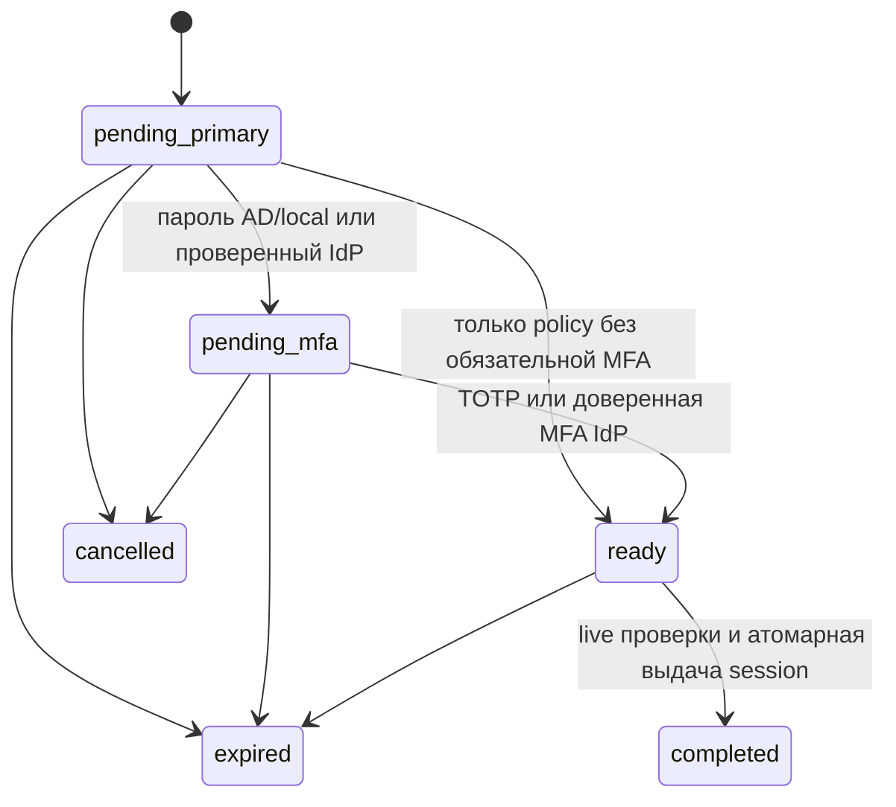

# AD, двухфакторная аутентификация и одноразовые коды

Дата требований: 2026-11-17. **TARGET: обязательные требования владельца.**
Фактическая реализация и квалификация отмечаются отдельно; stage AS-IS не отменяет TARGET.
AD, 2FA и одноразовые токены/коды обязательны для AGP. Email — поддерживаемый канал
доставки приглашений и подтверждений. Инженерные defaults ниже дополняют REQ-02,
а не объявляют существующий код готовым. Действующие исключения v1.1 сохраняются
в границах, описанных в [security](security.md).

AS-IS интегрированного кода на 2026-11-25: local invitations/initial password setup и
supervised recovery реализованы с paired SQLite/native PG, HTTP и локальными browser
проверками. Активация требует saved email OTP и staged TOTP, completion остаётся
sessionless. Recovery actions из §6 разделены private capabilities; обычный reset
проверяет exact factor version/proof time, legacy recovery — стабильный flow-bound
guard. Последний management UI revocation fix прошёл targeted browser/build проверки.
Изменения перенесены в основной workspace; общий combined pipeline не завершён. Корпоративные AD DS/SMTP/root VM
и GA не квалифицированы. [Точный статус и доказательства](testing.md#invitations-activation-и-recovery-проверки).

## 1. Способы входа и полномочия

| Способ | Проверка личности | Выполнение обязательной 2FA |
| --- | --- | --- |
| Локальная учётная запись | Argon2id password | Пароль + подтверждённый TOTP |
| Прямой AD DS | Проверка пароля bind по защищённому LDAP и проверка состояния AD | Пароль AD + TOTP AGP |
| Федерация с AD через OIDC | Проверенный корпоративный issuer/subject | Разрешённый issuer-specific MFA mapping либо дополнительный TOTP AGP |
| Одноразовое письмо | Только конкретное приглашение, адрес или шаг восстановления | Не устанавливает `mfaSatisfied=true` |

Прямой AD и федерация — два конкретных поддерживаемых профиля. Общая поддержка
OIDC сама по себе не подтверждает совместимость с корпоративным AD. AD DS,
AD FS и Microsoft Entra ID — разные компоненты; точный профиль проверяется на стенде.
Kerberos/IWA, произвольные LDAP-каталоги, cross-forest trusts и SCIM не входят
в первый квалифицированный профиль и не требуются для выполнения прямого AD-входа.

AD отвечает за пароль и состояние доменной учётной записи. AGP отвечает за доступ
к ресурсам, собственную MFA policy и scoped management RBAC. Членство в Domain Admins
не создаёт superadmin AGP. Email, UPN и совпадение username не объединяют аккаунты.
У AD principal нет локального пароля, email-login или автоматического fallback к local login.
Локальная аварийная учётная запись имеет отдельный ID, явный способ входа и MFA.

## 2. Прямой AD DS: соединение и идентичность

Первый профиль: один лес/домен на provider, явный упорядоченный список DC FQDN,
`ldaps` либо обязательный `starttls`, TLS 1.2+, проверка цепочки и имени сервера.
Первый успешный TLS-qualified DC закрепляется на текущую операцию. Failover допускается
на другой настроенный DC до начала операции; неизвестный результат user bind не повторяет
пароль автоматически на всех DC. Нет downgrade, `skipVerify`, anonymous bind или пустого пароля.
LDAP referrals выключены: нельзя передавать пароль/служебный bind на новый host из ответа.
DNS и egress allowlist применяются как в [security](security.md); адрес DC не задаётся пользователем.

Служебная учётная запись только читает согласованные OU/атрибуты; credential хранится
через secret version. Пользовательский пароль используется только в отдельном коротком
TLS connection для bind, не сохраняется и не попадает в shared service-account pool.
Фильтры строятся LDAP-библиотекой с RFC 4515 escaping; DN обрабатывается отдельно.
Поиск по разрешённому UPN/sAMAccountName в заданном домене должен вернуть ровно один объект.
Нулевой/множественный результат закрывает вход. Сохранять LDAP extended errors в ответе нельзя.

Ключ связи: `(providerId, forestGuid, objectGuid)`. UUID в JSON — lowercase canonical UUID;
`forestGuid` здесь — проверенный objectGUID корня `configurationNamingContext` данного
леса, прочитанного через RootDSE, а не произвольный UUID оператора. Несовпадение закрывает provider.
decoder обязан преобразовать AD binary GUID с корректным порядком байтов первых полей,
а не hex-encode весь массив. DN/UPN/mail/displayName — обновляемые атрибуты.
Удалённый и созданный заново пользователь с тем же UPN получает другой objectGUID
и не наследует прежнюю связь/сессии/права. `username_key` directory principal содержит
provider namespace и objectGUID; одинаковый UPN в другом каталоге не создаёт collision/link.
Перенос между лесами требует явного relink,
step-up, второго администратора и увеличения journal authenticator floor.
Первый вход может создать непривилегированный principal только в явно разрешённых OU;
JIT provisioning не выдаёт management roles и не связывает существующий local principal.

Проверяются userAccountControl/disabled, lockout и account expiry с учётом вычисляемых
атрибутов AD. Password expired/must-change означает отказ bind и инструкцию сменить
пароль средствами организации; AGP не меняет доменный пароль и не сбрасывает lockout.
При неоднозначном, неполном или ошибочном чтении результат закрыт.
Один неверный пользовательский пароль не запускает серию bind/retry, усугубляющую AD lockout.

TLS simple bind не заявляется SASL signing/channel binding. Совместимость с политиками
конкретных DC проверяется тестом соединения; несовместимый профиль остаётся выключенным.
Нельзя предлагать ослабление доменной политики как автоматическое исправление.

## 3. Группы, актуальность и отзыв

Первый профиль использует транзитивные **security groups** из AD `tokenGroups`, включая
primary group. SID разрешается в стабильный group objectGUID в квалифицированном домене.
`memberOf` не подменяет этот алгоритм: у него иная семантика. Distribution groups,
неразрешимые SID/FSP/cross-forest membership не дают прав. Если полноту результата
нельзя доказать, решение закрыто; усечение по size/time limit не означает пустую успешную выдачу.
Разрешённые mappings задаются `AD group objectGUID → AGP access group ID` с provenance.
Повторяющиеся/конфликтующие mappings и циклические некорректные результаты отклоняются.
Не выполнять рекурсивный пользовательский LDAP filter без depth/count/time budget.

Локальные membership и AD membership хранятся раздельно. Отключение mapping убирает
только его источник; синхронизация не удаляет ручные membership. Для AD principal
любая выдача доступа, включая ручную роль AGP, требует актуального AD account check.
Ручной role binding не обходит отключённую доменную учётную запись.

Default первой версии — **live check перед каждым положительным решением** для AD-linked
principal: состояние пользователя и необходимые groups читаются с DC; факты в БД предназначены
для UI/аудита, не для cached allow. Login, handoff, management mutation и gateway authorize
проверяют тот же источник. Пароль после входа повторно не запрашивается.
Утрата AD/timeout даёт `identity_provider_unavailable` и 503 для защищённого решения;
отключённый пользователь даёт отказ доступа. Не повторять запрос автоматически бесконечно.
Default operation deadline 3 s, ограниченная concurrency; значения квалифицируются нагрузкой.
Если нужная группа недоступна, нет обхода через старое membership или email.

У AD есть replication lag: live read не обещает мгновенного отзыва на всех DC.
Qualification фиксирует topology, используемые DC и наблюдаемый lag; локальная блокировка
AGP через независимый deny journal остаётся способом немедленно закрыть новые решения.
Уже установленные streams прекращаются согласно отдельной drain/revalidation policy.
Bounded-staleness/offline AD allow — отдельное будущее решение, не скрытый default.

Для первого AD-backed OIDC профиля требуется отдельно проверенная связь `(issuer,sub)`
с directory identity, установленная администратором/проверенным immutable claim mapping,
с second-person approval; email/UPN не являются доказательством связи. Тогда пароль
остаётся у IdP, а AD account/groups проверяются тем же read-only live connector.
Если IdP выдаёт разные pairwise `sub` для login и management clients, каждый exact
subject получает отдельную одобренную связь с той же directory identity. Первый
профиль допускает до двух enabled links на provider/principal; отозванная история
не занимает эти места. Relink меняет target только одобренным immutable successor
с тем же стабильным guard; совпадение email/UPN не разрешает relink.
OIDC без такой связи остаётся generic OIDC профилем: AD live check не обещается,
IdP claims проверяются при login/reauth, отзыв ограничен session lifetime (default до 8 h)
либо реально квалифицированным logout/introspection механизмом. Этот generic профиль
сам по себе не закрывает приёмку корпоративного AD live-check профиля.

Отзыв OIDC provider/link закрывает использовавшие его flows, sessions и handoffs.
Историческое configuration/WAF approval перепроверяет полномочия principal, его
principal/password floors и live AD identity/provider/scope; изменение альтернативного
OIDC способа входа само по себе его не отменяет. Отзыв уже выполненных полномочий
требует явного principal security-version/floor bump либо withdrawal approval.

## 4. Двухфакторный вход и step-up

Policy вычисляется на сервере как наиболее строгое требование organization/user/access group/
resource/management action; клиент не передаёт флаг успешной MFA. Для privileged management
обязательны MFA и step-up не старше 5 минут. Факт AD bind сам по себе — один фактор.

Pending flow — ограниченная server-side transaction, TTL 5 min, отдельная host-only
browser binding cookie и CSRF; это не management/login/gateway session. До `completed`
нельзя читать каталог, management API, выдавать handoff или вызывать upstream от имени пользователя.
Пересечение flow между браузерами/audiences/purposes запрещено. После primary success ID/binding
ротируется; после completion ротируется session. Гонки completion дают одну сессию;
потерянный успешный ответ запускает новый login, plaintext session не восстанавливается.
Flow endpoints обслуживаются на соответствующем login либо management origin; допустимая
audience закреплена installation profile за origin. Management cookie выставляется только
ответом management origin, а не центральным login host для чужого домена. Flow purpose/audience
из запроса проверяется по этому binding; смена cookie Domain не используется для SSO.

TOTP: RFC 6238, 6 цифр, шаг 30 s, окно ±1 шага, уникальный seed на factor,
шифрование seed и атомарный `last_accepted_step`; URI/QR видны только при enrollment.
Bootstrap enrollment разрешён только в purpose-bound setup flow после доказательства primary
credential/приглашения; замена существующего factor требует fresh MFA либо supervised recovery.
Более строгая policy может требовать phishing-resistant внешний MFA; TOTP таким не считается.
Внешний `acr/amr/auth_time` принимается только по allowlisted versioned mapping.
Recovery code позволяет отдельный recovery flow; не превращается в обычный strong step-up
для root apply. Восстановление завершается регистрацией/проверкой нового factor.

Для bootstrap существуют отдельные flow-bound `totp-enrollments` и confirmations:
они доступны после проверенного primary credential при отсутствии active factor либо
после разрешённого recovery. Pending cookie не открывает `/api/v2/me/mfa/*`.
Recovery proof принимает high-entropy recovery code вместе с проверенным primary
credential либо purpose-bound supervised ticket после двух независимых администраторов.
Только recover flow получает право заменить factor, без административной session/step-up.
Новый seed/QR и recovery codes возвращаются один раз, не попадают в idempotency response cache;
потерянный QR требует нового unverified enrollment, потерянные codes — контролируемой регенерации.

## 5. Письма, одноразовые токены и короткие коды

| Объект | Назначение | Секрет и срок по умолчанию |
| --- | --- | --- |
| Invite/setup link | Ограниченный setup flow | CSPRNG 256 bit; 24 h, policy max 72 h |
| Password-reset link | Локальный reset, с дополнительными проверками по policy | CSPRNG 256 bit; 15 min, max 1 h |
| Email OTP | `verify_email`, `invite_confirmation`, `recovery_confirmation` | CSPRNG равномерные 8 цифр; 5 min, max 10 min |
| Recovery code | Заранее выданный независимый recovery secret | ≥128 random bit; single-use; batch rotation |
| Gateway handoff | Закрытый обмен session на gateway | 256 bit; 60 s; отдельные audience/PKCE/mTLS |

Token/code нельзя использовать для другой строки таблицы. Email OTP подтверждает владение
адресом или конкретный шаг уже разрешённой процедуры, не заменяет пароль AD/TOTP и не
снимает обязательную 2FA. Passwordless email login в первый профиль не входит.
Письмо само по себе не разрешает admin password/MFA reset или замену AD identity.
`invite_confirmation` требует действующего invite-bound flow, `recovery_confirmation` —
уже разрешённого recovery case. Подтверждение email не выдаёт login session.

Email OTP хранится как HMAC-SHA-256 с внешним pepper key ID; это не обычный SHA-256
восьмизначного числа. MAC связывает domain separator, challenge ID, flow ID, purpose,
audience, principal ID, contact authenticator/version, authorityEpoch и code с однозначным
length-prefixed encoding. Pepper отсутствует в БД/backups; compare constant-time.
Адрес берётся из проверяемого encrypted contact record, не из запроса на отправку кода.
Изменение адреса и verification нового адреса требуют отдельной transaction и инвалидируют
старые challenges; обычные invite/recovery отправляются только на утверждённый адрес.

Максимум 5 неверных проверок на flow и challenge вместе, 1 resend в 60 s,
3 отправки на flow и 5 на target/hour; дополнительные лимиты source IP/provider.
Ограничения действуют распределённо и между новыми flows: создание нового flow не
обнуляет target budget. Нет бесконечной блокировки аккаунта только по запросам атакующего.
Resend атомарно отменяет старый challenge, создаёт новый code и увеличивает generation;
старое письмо после задержки не действует. Resend не продлевает expiry самого flow.

Проверка держит row lock flow+challenge: live epoch/securityVersion/contact version,
purpose/audience/binding, expiry, limiter и current policy → compare → increment attempts
либо consume + разрешённый переход flow. Неверная попытка **commit** счётчик; общий rollback
не должен стирать попытки. Проверка и consume одного code двумя workers дают один успех.
Отмена/блокировка/reset/MFA policy change до completion проверяется повторно и закрывает flow.

Отправка через корпоративный SMTP с обязательным TLS и проверкой server identity;
секрет подключения через secretRef. Outbox содержит только short-lived encrypted payload
и ссылку challenge; plaintext code, адрес и письмо не пишутся в logs/audit/analytics/URL.
Worker до каждой отправки проверяет epoch, срок и поколение challenge. Payload key удаляется
при consume/expiry/cancel и не позже срока challenge; после сбоя очереди код не воскресает.
SMTP accepted не означает доставку: UI различает queued/accepted/failed/expired,
не объявляет SMTP accepted подтверждением чтения. Проверенный email не означает доверенный MFA.
Получение письма может быть отложено; интерфейс позволяет безопасный resend и смену
метода на TOTP/recovery согласно policy, без автоматического MFA bypass.

## 6. Хранение, API и восстановление

Reference SQL дополняется directory providers/immutable versions/links/mappings,
отдельными directory membership observations, encrypted contacts, identity flows и email
challenges. Wire config: [directory-provider schema](schemas/directory-provider.schema.json).
Challenge/flow types: [identity-flow schema](schemas/identity-flow.schema.json).
Контракты управления provider, MFA flow и email challenge включены в [OpenAPI](api/openapi.yaml).
Неактивированная proposed version читается через `GET directory-providers/{id}/versions/{versionId}`;
результаты асинхронного теста и доставки — отдельные GET test/challenge endpoints.
Contact IDs доступны владельцу через `/api/v2/me/contacts`; изменение адреса требует
recent reauthentication, обязательной по policy MFA, CAS/floor и сбрасывает verification.
В setup flow contact ID раскрывается только после действующего invite/recovery proof.
Новый contact сначала unverified; обычный recovery использует только verified адрес,
invite — явно утверждённый оператором адрес. Нельзя создать recovery contact по чужому ID.
User secret никогда не возвращается в GET. DB constraints — минимум, а не замена state machine,
permission checks, limiter и независимого журнала; см. [data model](data-model.md).

### Lifecycle local account, приглашение и initial setup

Это уточнение **TARGET**, а не заявление о выполненной приёмке. Закрытые DTO определены
в [identity lifecycle schema](schemas/identity-lifecycle.schema.json). `POST /api/v2/users`
принимает `PendingUserInput` без пароля и создаёт `lifecycleState=invited`; normal
login/session/handoff/management allow требуют `active`. Блокировка независима от lifecycle.
Приглашение не выдаёт infrastructure permissions: permission-bearing group/role assignment
проходит отдельный positive-grant workflow с delegation ceiling и вторым человеком.
Private setup helper проверяет typed server-owned context; публичного `allowPending` нет.

`POST /api/v2/users/{id}/invites` после current actor/target/delegation checks и fresh MFA
возвращает только invite ID, delivery operation ID и expiry. Сервер связывает 256-bit token
с purpose, principal SV/PV, policy, epoch, contact/version, generation и выделенным service
guard без полномочий. `principalId=guardId, authenticatorId=guardId` для token consume/revoke
не превращает anonymous reset request в отзыв sessions жертвы. Anonymous issuance никогда
не повышает human principal/password floor. Raw token не возвращается в invite API,
idempotency cache, GET, audit или logs. Reissue закрывает прошлое поколение и его reservations.

Письмо содержит ссылку только на configured auth origin. Landing page не загружает внешние
ресурсы, не логирует token и удаляет его из browser URL до дальнейшей навигации.
В purpose=activate/audience=setup flow `PrimaryProof.method=invitation` атомарно переводит
token `issued→reserved` и закрепляет его за ровно одним rotated flow/browser binding.
Это безвозвратный claim, а не окончательный consume: повтор raw token не открывает другой
flow, unclaim запрещён. Потеря нового binding, cancel и expiry закрывают reservation;
нужно новое приглашение. `consumed_at` устанавливается только вместе с успешной activation.
Таким образом сохраняется требование consume token атомарно при completion.

`POST /auth/v2/flows/{id}/password-setups` принимает только `newPassword`; action/target
берутся из private capability. Пароль — valid UTF-8, 12..1024 **байт**, без trimming,
normalization или truncation; сохраняются действующие Argon2id parameters и bounded hashing
вне DB writer. Это ограничение входа, не измеренная оценка стойкости или производительности.
Initial setup проходит обязательную последовательность `password_setup → email_code
→ totp_enrollment → ready`. После password setup flow остаётся `pending_mfa` с
`nextStep=email_code`: требуется восьмизначный `invite_confirmation` OTP на закреплённый
contact/version. Только успешный consume этого OTP разрешает `nextStep=totp_enrollment`;
подтверждение staged TOTP переводит flow в `state=ready`, `nextStep=complete`.
Переход напрямую от password setup к TOTP запрещён. Открытие письма не устанавливает
`PrimaryAt`; само по себе email proof не является password/MFA proof.

Initial enrollment целиком staged: PHC, sealed seed, candidate versions, TOTP step/proofAt
и hashes новых recovery codes не становятся live credentials при confirmation.
Completion повторно проверяет deadline, reservation, target/issuer permissions, scopes,
policy, epoch, contact и floors. После durable journal receipts одна TX публикует
password/factor/recovery hashes, переводит principal в active, потребляет invite и завершает
flow. Factor/recovery/replay floors входят в тот же заранее сохранённый набор restrictive
requests; deny journal не содержит password/hash/seed и не восстанавливает positive activation.
Cancel/expiry удаляют stage; restored invited row ниже актуальных principal/password floors
требует supervised `restart_activation`, описанного ниже. Если после journal barrier нет
свежего private AD proof либо положительная публикация больше не разрешена, поднятые
floors сохраняются, positive activation закрывается и global barrier снимается без
восстановления прежних credentials. Activate/recover всегда возвращают `mfaSatisfied=false`
и не создают session/handoff; пользователь отдельно проходит обычный вход.

### Password reset и pre-flow delivery

`POST /auth/v2/password-reset-requests` принимает username/email lookup hints и возвращает
одинаковый 202 без account/contact/delivery metadata. Origin/pre-login CSRF обязательны.
Получатель выбирается только из совпадающего verified encrypted contact, не из свободного
адреса запроса. Неизвестный, directory, blocked, privileged target, недоступная доставка
и исчерпанный target budget не отличаются в ответе. Source/global overload может дать
одинаковый 429 независимо от существования account. Этот endpoint не выдаёт recovery grant.

Default обычного local reset: email reset token **и действующий TOTP**. В recover/setup flow
email token резервируется как выше; typed action=reset_password позволяет password setup
только после требуемого TOTP. Finalization атомарно публикует новый hash/version, отзывает
старые sessions через floors и потребляет reserved mail token. До подтверждённого reset
anonymous запросы не меняют пригодность существующего password/session. Privileged target
либо отсутствие необходимых факторов требуют отдельной supervised authorization.
Directory password меняется средствами организации, локальный reset для него запрещён.

Pre-flow invite/reset outbox отделён от flow-bound восьмизначного email challenge.
Он использует тот же bounded verified SMTP transport и volatile per-message DEK vault:
payload/key TTL не более пяти минут и не позже token expiry. После отправки остаётся только
hash token; срок самого invite от этого не сокращается. Worker перед единственным send
проверяет epoch, target/issuer/contact, generation и expiry. Accepted означает только SMTP
accepted. Unknown, restart с потерянным key и истёкший payload не requeue-ятся автоматически:
нужен явный новый invite/reset request с новым token. В CP backup нет wrapped delivery DEK.
`invite_confirmation` допустим только в таком invite-bound flow на approved contact/version,
даже пока contact unverified; `recovery_confirmation` — только в уже разрешённом recovery.
Оба подтверждают лишь разрешённый email шаг и не расширяют action/не удовлетворяют MFA.

Оба provider типа получают стабильный security guard ID/version. Guard использует
`bump_authenticator_floor` с `principalId=guardId`, `authenticatorId=guardId` в отдельном
зарезервированном пространстве service subjects без полномочий. Любая смена trust/config/
MFA mapping и disable сначала повышает независимый floor, затем публикует successor config.
До завершения перехода provider закрыт. Version ниже floor не работает даже для нового login
после restore. Guard ID не выбирается из username и не может совпасть с human principal.
Создание directory provider сначала регистрирует выключенный объект (`configuration=null`),
сервер выдаёт provider/guard IDs и ETag; затем клиент отправляет initial immutable config.
Клиент не выбирает и не заменяет guard ID при импорте или редактировании configuration.
Directory link и contact имеют собственные authenticator IDs/versions с таким же floor.
Mapping change — successor provider config; восстановленный старый mapping не оживает.

Activation использует `SecurityOperation.family=provider_security_change` и закрытый
`providerChange` payload: provider type/ID, immutable version/content digest, guard ID,
previous/next guard versions, expected rowVersion/authorityEpoch, enabled, expiry и reason.
`requestDigest` покрывает JCS всего intent, включая enabled. Каждое enable/disable/изменение
config требует ранее не активированного successor с guardVersion строго выше последней
активированной версии и independent floor. Повтор того же intent только идемпотентен;
поменять enabled у прежней версии нельзя. Approver читает exact config/digest, затем
стандартные approvals/executions проверяют второго человека, live permissions и fresh MFA.
`journal_mode=required`: pending guard barrier → durable floor → CAS config/flag+audit.
Все соответствующие allow проверяют provider guard floor, а не только floor пользователя.
Provider security guards и positive roles никогда не восстанавливаются как разрешение из deny journal.

Supervised recovery имеет family `identity_recovery`. Client `IdentityRecoveryRequest`
содержит targetPrincipalId, expectedSecurityVersion, allowedAction, expiresAt, reason.
`/api/v2/users/{id}/mfa-recovery-plans` принимает только `replace_mfa`;
`/api/v2/users/{id}/password-reset-plans` — только `reset_password` для local principal.
`/api/v2/users/{id}/activation-recovery-plans` принимает только `restart_activation`
для текущего lifecycle=invited, никогда для active account. Этот action закрывает
управляемый restart после прерванной initial activation ниже уже поднятых floors.
Второй action — явное расширение контракта для обязательного supervised privileged password
reset, а не разрешение менять password по прежнему MFA ticket. Все три маршрута проходят
distinct approvals → executions с current actor/approver/target/delegation/scope checks.
Server-owned `IdentityRecoveryIntent` дополнительно фиксирует PV/epoch, policy digest,
custodian, target fingerprint и точные restrictive step specifications; requestDigest покрывает
весь intent. MFA execution сначала закрывает старый factor/recovery batch/sessions;
password execution закрывает старый local password/sessions, не меняя MFA. Нельзя присвоить
старому hash новую разрешённую version. Parent applied устанавливается только после receipts.
У `restart_activation` intent дополнительно фиксирует observed independent
principal/password/factor/recovery/replay floors. Distinct approval/execution повторно
сверяет эти значения и target ceiling, поднимает SV/PV строго выше max(row,floor),
закрывает старые tokens/flows/stages и оставляет invited без live password/factor.
Другие floors не понижаются; новая staged enrollment выбирает successor выше них.
Ни active→invited transition, ни ticket для этого action не разрешены. После applied
оператор отдельно создаёт обычный invite на утверждённый адрес, пользователь повторяет
password/email/TOTP setup. Старые raw tokens/bindings не возвращаются.
Если требуется несколько restrictive events, до исполнения фиксируется список дочерних
security operations с уникальными стабильными op IDs; parent applied только после всех
receipts и materialization. Один op ID не используется для разных journal payloads.
Только после этого `/api/v2/security/operations/{id}/recovery-tickets` однократно выдаёт
256-bit ticket для action=replace_mfa либо reset_password (не restart_activation)
уполномоченному recovery custodian; в `invitations` хранится hash,
proofKind=supervised, purpose=recover_mfa либо reset_password, authorityEpoch и authorization
operation FK. Private `RecoveryTicketIntent` связывает exact operation/action, principal,
post-execution SV/PV, policy, custodian и expiry. Ticket в flow обменивается только после binding.
Срок ticket не превышает 15 min и expiry operation; его consume и переход recover flow
атомарны. Повтор выдачи/потеря ответа не возвращают plaintext: нужна новая approved operation.
Contact/email confirmation не является approval этой операции и самостоятельно не выдаёт ticket.
Здесь consume выполняется при authorized recover-flow transition, до enrollment/password
setup; это отличается от reserved email invite/reset token, потребляемого при completion.
`replace_mfa` capability никогда не меняет password; `reset_password` никогда не разрешает
MFA enrollment/replacement. Recovery code вместе с verified primary остаётся отдельным
разрешённым MFA recovery proof. Ни один recovery путь не отменяет блокировку, не повышает
роль и не выдаёт privileged session. Утрата binding после consume требует нового разрешения.

Flow/challenge/outbox хранят `issuedAuthorityEpoch`; flow — snapshot principal securityVersion,
проверенные authenticator IDs/versions, provider config version и current purpose/audience.
Contact version дополнительно фиксируется challenge. Restore сначала повышает authority epoch
и сверяет floors; все старые flows/challenges/setup tickets/письма прекращают действовать.
Проверка TOTP после restore ждёт окончания всех pre-restore допустимых временных окон:
trusted clock и сохранённый вне CP backup restore cutoff обязательны. Не менее 90 s после
надёжно установленного конца предыдущего writer lifetime при окне ±1 и шаге 30 s;
к этому минимуму добавляется измеренная верхняя граница clock skew между прежним и новым
verifier. Прежний writer должен быть fenced; неизвестные время/clock skew блокируют
readiness до supervised clock reconciliation.
Это предотвращает повтор старого TOTP в новом flow после отката `last_accepted_step`.
Рост epoch сам по себе не является защитой от такого повтора TOTP.

## 7. Приёмка и первичные источники

До корпоративного пилота S2 обязательны реальные AD и SMTP стенды: TLS trust/name errors,
StartTLS downgrade/referral, empty password, AD disable/expiry/lockout, rename/recreate,
nested/primary groups, неполный tokenGroups, DC timeout/lag/failover и отсутствие local bypass.
Для MFA/OTP: first-factor-only denial, replay/parallel consume, purpose/browser/contact mismatch,
resend out of order, limits across flows, неверные attempts с commit, mail failure, смена
policy/block во время flow и restore до consume/provider change/TOTP acceptance.
Документационные fixtures проверяют формы контрактов, не заменяют эти испытания.

- [Microsoft: user naming attributes и objectGUID](https://learn.microsoft.com/en-us/windows/win32/ad/naming-properties).
- [Microsoft: LDAP signing](https://learn.microsoft.com/en-us/windows-server/identity/ad-ds/ldap-signing) и [channel binding](https://learn.microsoft.com/en-us/windows-server/identity/ad-ds/ldap-channel-binding).
- [NIST SP 800-63B-4: authenticators](https://pages.nist.gov/800-63-4/sp800-63b/authenticators/): email не используется как OOB authenticator; verification/recovery имеют отдельные правила.
- [RFC 6238: TOTP](https://www.rfc-editor.org/rfc/rfc6238), [RFC 4515: LDAP filter escaping](https://www.rfc-editor.org/rfc/rfc4515).
