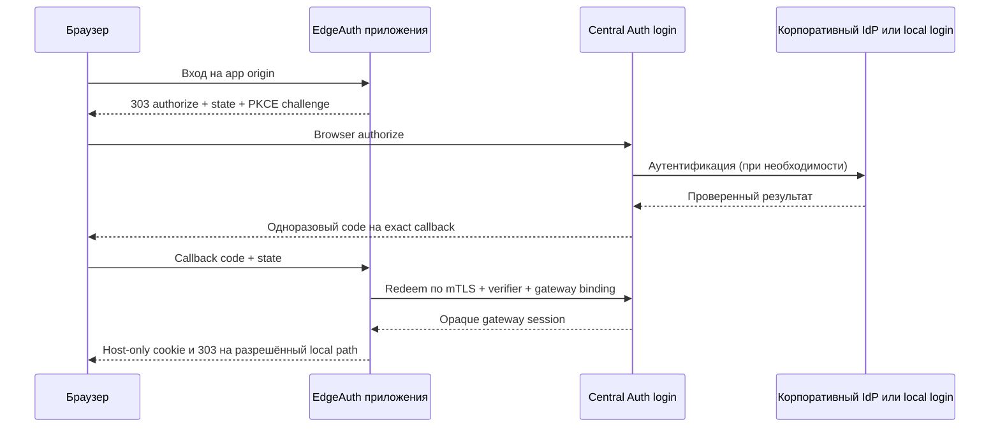

# Протоколы, типы и семантика AGP v2

Статус: TARGET итогового ТЗ, редакция 2026-11-17. Поля в [OpenAPI](api/openapi.yaml)
и [schemas](schemas/shared.schema.json) задают контракты реализации; принятие WAF Zones
не означает наличие этих endpoints в действующем Go/v1 API.
Текущие endpoints `/api/v1` не получают эти возможности автоматически.

### Текущий agent identity / local syntax срез

На 2026-11-20 реализован admin-only agent-role pilot, а не весь TARGET node RBAC:
`GET/POST /api/v2/nodes`, node GET, enrollment create/GET/approval/revocation,
node revocation и GET `/api/v2/node-identity-operations/{id}`. Profile GET
`/api/v2/node-identity-profile` сообщает `enabled` и `supportedRoles:["agent"]`.
Запись требует fresh MFA/CSRF/idempotency и актуального admin в transaction.
`Node` и `EnrollmentResult` сохраняют прежний wire; connectivity остаётся `unknown`,
identityState не доказывает health, а operation revoke имеет `state=completed`.

На отдельном server-authenticated TLS 1.3 listener `POST /agent/v1/enrollment-requests`
принимает `{nodeId,enrollmentToken,csrPem}` и отвечает 202 pending request с
`publicKeyDigest`/`requestDigest`. Первый CSR закрепляется за authorization; другой
CSR с тем же token отклоняется. Owner утверждает оба digest management approval
запросом; `POST /agent/v1/enroll` отвечает 201 прежним `EnrollmentResult` только после
approval. Renewal с новым CSR идёт через agent mTLS `/agent/v1/identities/renew`.
Roles `edge_auth`, переназначение Site и scoped node grants этим pilot не реализованы.

Локальный CLI принимает [LocalSyntaxRequest](schemas/agent-local-syntax.schema.json)
через stdin и выдаёт [LocalSyntaxResult](schemas/agent-local-syntax-result.schema.json).
Это отдельный диагностический формат, не `AgentTask`/`TaskReceipt`: sequence только
`"0"`, без shell/argv/path/URL/NodeBundle. Policy не содержит exceptions; mode только
`detection`/`blocking`. Exact request ID+canonical payload возвращает durable terminal
result; иной payload — conflict, intent без result — indeterminate. Pins/capabilities/
epoch сверяются с текущими фактами, но завершённый result остаётся историческим
syntax proof и не превращается в deployment permit. На CP эти форматы не имеют HTTP
execution endpoint. [Ручная процедура](../operations.md#управляемая-agent-identity-и-локальная-проверка-синтаксиса).

### Основа допуска helper

AS-IS на 2026-11-24: `internal/helper` принимает ограниченный закрытый subset
`agp.task/v1alpha1`: только `apply_config`/`rollback_config`. Envelope состоит из
`task`, отдельного `agp.helper-permit/v1alpha1` и `signedPlan`; это внутренний контракт пакета без
HTTP/socket transport, а не реализация всего TARGET AgentTask/TaskReceipt.

Цикл digest разрешён явно: `TaskDigest` считает canonical digest всех полей task,
установив `permitDigest` в пустую строку. Permit фиксирует этот digest и подписывается
с пустым полем `signature`; `PermitDigest` затем считает digest полного подписанного
permit и записывается в task. Для Ed25519 применяются разные purpose prefixes
`AGP-HELPER-PERMIT-v1` и `AGP-HELPER-START-v1`. Installation закрепляет разные keys/IDs
permit, control и journal через `TrustDigest`; обмен ключей между ролями отвергается.
База закреплена обязательным `Installation.Baseline` из trusted installer input:
revision ID, bundle digest и sequence. Это не runtime CaptureBaseline и не проверка
bytes базы или ownership manifest.

Новый допуск требует fresh challenge-bound signed journal head, отдельного signed
`StartProof` по helper-generated challenge и exact request/installation/head pins,
затем второго fresh head с теми же authority/epoch/sequence/digest и restore metadata.
Task живёт не более 15 минут; proof и сбор свежей авторизации ограничены 15 секундами.
Freshness проверяется непосредственно перед persistence; длительность fsync не
ограничена этим окном. Будущему executor нужна отдельная проверка перед эффектом;
исторический admission не разрешает позднее исполнение. Проверяются current
epoch, `ReleaseAfter`, deny floor и монотонные node sequence/writer epoch.
В этом историческом admission-only срезе `Sources` — только интерфейс.
Authorizer и transport подключаются отдельным execution runtime ниже; admission receipt
сам по себе не разрешает последующее исполнение.

Результат — исторический `agp.helper-admission/v1alpha1`, всегда `state=accepted` и
`noExecution=true`, не `agp.receipt/v1alpha1`. Exact task ID + idempotency key + request
digest возвращает тот же сохранённый результат без сети и нового исполнения даже после
expiry. Иное содержимое при совпадении ID/key даёт conflict; другой task при сохранённом
intent требует reconciliation. `Status` показывает `baseline`,
`reconciliation_required` или `recovery_required`; повышение recovery blocker не меняет
исторический admission receipt. Очистки intent, completion и исполнения здесь нет.

Для нового допуска `signedPlan` обязателен; поле optional в decoder только для
чтения прежнего durable state и exact historical retry. Новый gate проверяется после
historical replay, использует pinned permit key с отдельным signature domain и
принимает только Plan v1alpha1. Request ограничен 2 MiB + 64 KiB, state — request +
32 KiB. Fleet Plan v2 не расширяет автоматически бюджет helper.

### Подписанный Plan и planning review

Полные [Plan v1](schemas/plan.schema.json)/[v2](schemas/plan-v1alpha2.schema.json)
и [signed Plan](schemas/signed-plan.schema.json) реализованы в
`internal/deploymentplan`. Parser закрытый, проверяет переданный digest; normalization
сортирует targets по node ID, secret versions и canaries по ID, inputs по kind/ID.
Digest — SHA-256 canonical полного normalized Plan с `planDigest=""`.
Подпись Ed25519 покрывает `AGP-DEPLOYMENT-PLAN-v1`, newline и canonical digest полного
envelope с `signature=""`; wire signature — Base64url без padding, 86 символов.
Verify требует separately trusted key и current lifetime, но не устанавливает live
approval, revoke status или qualification. V1 до 1000 inputs/2 MiB; v2 с
`capacityProfile=fleet-10k` до 50 000 inputs/32 MiB; оба до 500 targets и
100 secret versions/target. Envelope overhead ограничен 4096 bytes. Отдельные
compiler manifest/release tuple pins отсутствуют в буквальной схеме Plan; permit
с дополнительными pins пока не доказывает полную approval closure.

Ниже — реализованные **planning-only** management routes. Требуются secure config
profile, global `config.read`, текущая management session и независимый journal.
Site-only grants не разрешают full-node disclosure. Все POST также требуют exact
Origin, CSRF, fresh MFA и Idempotency-Key.

| Route | Результат и дополнительное право |
| --- | --- |
| `GET /api/v2/config/plan-proposals?limit=20&cursor=<id>` | `{items:[{proposal,current}],nextCursor?}`, limit 1..50. |
| `POST /api/v2/config/plan-proposals` | 201 frozen proposal; global `config.edit`, body до 128 KiB. |
| `GET /api/v2/config/plan-proposals/{id}` | `{proposal,current}`. |
| `GET /api/v2/config/plan-proposals/{id}/reviews` | Массив до 200 reviews с вычисленным `current`. |
| `POST /api/v2/config/plan-proposals/{id}/reviews` | 201 independent review; explicit global `config.approve`, body до 8192 bytes. |
| `POST /api/v2/config/plan-proposals/{id}/reviews/{reviewId}/signatures` | 201 signed planning review; тот же reviewer с explicit global `config.approve`, body `{}` до 1024 bytes. |

Create принимает только revision/site, exact target IDs, rollout policy и reason.
Сервер получает full-Site trusted inventory, current native published WAF closure,
server catalog и full-node compiler preview; произвольные baseline/evidence/command
поля не принимаются. Review принимает exact proposal digest и reason; reviewer не
может быть автором, admin compatibility не даёт `config.approve`. Истечение,
смена revision/catalog/inventory/native proof/compiler/epoch либо прав участников
делает artifact неактуальным. Проверки выполняются до idempotent replay.
Historical ID автора/reviewer не связывает срок хранения artifact с существованием
аккаунта; после удаления его прав новый review/sign/replay блокируется.

[Proposal](schemas/plan-proposal.schema.json) ограничен 32 MiB и явно содержит
`purpose=planning_review`, `deployable=false`, `noExecution=true` и blockers.
[Signed review](schemas/signed-plan-review.schema.json) включает полный proposal и
exact independent review. Ed25519 подписывает `AGP-PLAN-REVIEW-v1`, newline и
canonical envelope с пустым `signatureBase64`; wire — standard padded Base64,
88 символов. `review.current=true` внутри неизменной подписи описывает проверку
в момент подписания; present authority требует нового server check.
Отсутствующий optional dedicated signer даёт 503; execution Plan/permit/StartProof
runtime CP не выпускает. TARGET `/deployment-plans`, approvals и rollouts остаются
отдельными будущими контрактами. Примеры proposal/signed review/signed Plan —
структурные fixtures с фиктивными digests/signatures, без crypto/runtime evidence.

### Локальный owned tree manifest и наблюдение

AS-IS на 2026-11-25: [manifest schema](schemas/owned-tree.schema.json),
[observation schema](schemas/owned-tree-observation.schema.json),
[структурный manifest](examples/owned-tree.json) и
[структурное наблюдение](examples/owned-tree-observation.json) описывают локальный
read-only reader. Новых HTTP endpoints, AgentTask kinds или TaskReceipt нет.
Примеры содержат вымышленные filesystem identities и не подходят для установки.

Manifest `agp.owned-tree/v1alpha1` содержит только `apiVersion`, `nodeId`, `siteId`,
`root`, `entries`. Каждая entry содержит `path`, `kind` (`directory`/`file`), numeric
uint32 `uid`/`gid`, четырёхзначный octal `mode`, UInt63 string `size`, `digest`.
У directory `size="0"` и `digest=""`; у file — exact byte count и SHA-256.
Root — canonical absolute path, отличный от `/`; relative entry `.` обозначает
его самого. Повторы paths, неявные parents, traversal, backslash и non-ASCII paths
отвергаются; entries сортируются по path без изменения caller data.

Ownership digest — SHA-256 canonical JSON всего normalized manifest. Он передаётся
отдельно trusted installer caller и должен совпасть с `Installation.OwnershipDigest`
при подключении `helper.NewGateWithOwnedTree`. Root path берётся из digest-bound
manifest; expected digest поступает отдельно из trusted installation source, а не
из этого документа. Task и CP response не выбирают root или expected digest.
Digest binding не устанавливает
реальное делегирование ownership и не подтверждает активный Nginx runtime.

Reader принимает manifest до 1 MiB/4096 entries, relative path до 1024 bytes/16
компонентов, один файл до 4 MiB и все файлы до 64 MiB. Закрытый parser отвергает
unknown/duplicate/missing fields и неверные JSON types. JSON Schema проверяет форму;
Go дополнительно проверяет unique paths, parent closure, суммарный размер,
canonical digest и фактическое дерево. UID/GID здесь числовые POSIX uint32;
размеры, inode/device/mount/link counters в observation — строки UInt63.

`Open` удерживает descriptors ancestry/root/каждой entry до `Close`. `Verify`
сверяет inode/device/mode/owner/link/size/mtime/ctime, exact child lists, mount ID,
bytes/hash; проверяет имена через pinned parent и повторяет metadata после чтения.
`statx(STATX_MNT_ID)` обязателен; mount переходы внутри owned root запрещены.
Ancestors могут пересекать mounts, но их identities закреплены на время handle.
Разрешены root/effective-UID owners; group/other write, executable files,
symlink/hardlink и special files запрещены. Единственное исключение writable
ancestor — root-owned sticky `/tmp` с непосредственным private child 0700
effective UID. Несоответствие отравляет handle, повторное открытие снова требует
trusted digest. Cancellation без обнаруженного mismatch handle не отравляет.

`Load` читает manifest как existing protected regular file с одной hard link,
защищённой ancestry и no-follow проверками до/после чтения. Root-only CLI принимает
`-manifest` и `-ownership-digest`, имеет cooperative context timeout 30 секунд,
ограничивает JSON output 4 MiB. Ошибки аргументов, root boundary и наблюдения
возвращаются как fixed error codes; неполный вывод не считается успешным результатом.
Ни reader, ни CLI не запускают native validation, не делают apply/reload,
не сохраняют file bytes и не создают durable snapshot.

Observation `agp.owned-tree-observation/v1alpha1` включает `purpose=filesystem_observation`,
`noExecution=true`, `runtimeValidated=false`, node/site, root, manifest/tree digests,
`observedAt` и entries с исходными metadata плюс `device`, `inode`, `mountId`,
`links`, `modifiedAt`, `changedAt`. `treeDigest` — SHA-256 canonical объекта
`{apiVersion:"agp.owned-tree-digest/v1alpha1",root,entries}`; metadata входят в digest,
`observedAt` — нет. Это не compiler bundle digest. Observation unsigned, время
локальное; оно не подаётся в CP как baseline, approval или runtime evidence.

В `NewGateWithOwnedTree` новый intent допускается только после двух успешных
проверок дерева: до и после live authorization. Ошибка даёт
`helper_owned_tree_unavailable`, intent/high-water не изменяются. Exact historical
replay проходит до нового filesystem gate и остаётся неизменным `noExecution`
receipt даже после исчезновения дерева. Этот read-only формат не заменяет native
execution/capture ниже; независимая root qualification исполнителя остаётся TARGET.

## 1. Единые wire-типы и версионированные профили ёмкости

| Значение | JSON / Go / TypeScript | PostgreSQL / ограничения |
| --- | --- | --- |
| ID | string / отдельный тип ID / branded string | text, case-sensitive, `^[A-Za-z0-9][A-Za-z0-9_-]{0,127}$` |
| Epoch, sequence, revision counter, bytes | decimal string / int64 после ParseUInt63 / branded decimal string, вычисления BigInt | bigint, 0..9223372036854775807 |
| Время | RFC3339 UTC с `Z` / time.Time / ISO string | timestamptz, сравнение по UTC |
| Digest | `sha256:` + 64 lowercase hex / отдельный тип / branded string | text с CHECK, без алгоритмического downgrade |
| IP / сеть | canonical string / netip.Addr, netip.Prefix | inet / cidr |
| Durations | целые seconds, отдельные ограниченные поля | integer/bigint; нет неоднозначных `5m`/milliseconds |
| Отсутствие | поле опущено только когда schema разрешает | NULL только для осмысленного «не назначено»; пустая строка не заменяет NULL |
| Объёмные файлы | бинарный stream, metadata отдельно | CAS/filesystem/object storage; не base64 в JSONB ревизии |

ID нельзя приводить к lowercase, преобразовывать в число или интерпретировать как путь.
Legacy IDs с base64url/UUID сохраняются; нестандартный ID импортируется через explicit identity bridge с проверяемой картой ссылок.
JSON number для больших счётчиков запрещён даже при небольшом текущем значении: один wire-тип на весь lifecycle.
`format: agp-uint63` требует semantic range check, одного regex на 19 цифр недостаточно.
В Go nullable patch-поле имеет tri-state «не передано / значение / очистить», явно разрешённый DTO; map[string]any не используется как доменная модель.
В TypeScript decimal string проверяется при decode; BigInt не передаётся напрямую в JSON.stringify.

### Импорт и canonicalization

1. Профиль `pilot-500` у `agp.config/v1alpha1`/`agp.plan/v1alpha1` сохраняет 2 MiB UTF-8
   на полный config, 500 Gateway, 1000 Routes/Gateway, 1000 profile assignments,
   500 targets/plan и 1000 resolved inputs. Новый `agp.config/v1alpha2`/`agp.plan/v1alpha2`
   требует `capacityProfile: fleet-10k`: 64 MiB полного config, 10 000 Gateway,
   100 000 Routes суммарно, 20 000 profile assignments, 500 targets/plan и
   50 000 resolved inputs. Canonical plan ограничен 2 MiB для pilot и 32 MiB для fleet.
   Depth 32 и 1000 Routes/Gateway сохраняются. Размер stream
   и cumulative counts проверяются до крупных allocations; unsupported version/profile
   отвергается до создания revision. Envelope не является измеренным SLO.
2. Один JSON object либо один YAML document. Duplicate keys, tags, aliases/anchors, merge keys, NaN/Infinity и неизвестные поля отвергаются.
3. Парсинг YAML создаёт то же JSON-compatible DTO; timestamps YAML не превращаются в даты автоматически.
4. Schema validation → semantic validation → reference resolution → policy/compatibility checks. Ошибки возвращаются с JSON Pointer.
5. Раскрываются defaults. Множества IDs/CIDR сортируются и дедуплицируются; ordered rollout waves и строки пользователя сохраняют порядок/значение.
6. Hostnames нормализуются IDNA в lowercase ASCII, IP/CIDR — canonical; opaque IDs никогда не нормализуются.
7. URL запрещает userinfo/fragment/query в upstream, неожиданные схемы, невалидный порт и неоднозначное кодирование.
8. Route prefix начинается `/`, не содержит traversal, `//`, backslash, percent-encoded separators/dot segments; конкретные querystrings к маршруту не относятся.
9. Unicode текста приводится к NFC как отдельный semantic step; затем применяется [JCS RFC 8785](https://www.rfc-editor.org/rfc/rfc8785.html).
10. Digest — SHA-256 canonical bytes. JCS не сортирует массивы и не нормализует Unicode: это ответственность предыдущего шага.

Сортировка не должна менять смысл route matching. Коллизии host/path, пересекающиеся prefix и redirects проверяются compiler с единым алгоритмом longest-prefix.
Root `/` и `/app/` — допустимые prefixes; `/app` получает явный нормализующий redirect по compiler policy, без открытого redirect на произвольный host.
Проверенный hostname/upstream всё равно проходит сетевую egress policy и pinned dial; schema не является защитой от DNS rebinding.

## 2. Семейства контрактов

| Контракт | Источник | Проверки сверх JSON Schema |
| --- | --- | --- |
| Gateway | [gateway.schema.json](schemas/gateway.schema.json), [YAML](examples/gateway.yaml) | Все reference IDs доступны в scope; одинаковый site; нет route collisions или открытия protected resource |
| Полный Configuration snapshot | [v1alpha1](schemas/configuration.schema.json), [v1alpha2 fleet-10k](schemas/configuration-v1alpha2.schema.json), [пример](examples/configuration.json) | Глобально уникальные IDs, assignment scope, total route count; полный snapshot, byte budget целиком |
| WAF policy | [waf-policy.schema.json](schemas/waf-policy.schema.json) | Engine/ruleset совместимы; exceptions имеют owner/reason/expiry и применяются только к указанной route |
| WAF Zone authoring | [waf-zone.schema.json](schemas/waf-zone.schema.json) | Site/object scope, one primary, AND match/default/ambiguity, exact base policy без route exceptions |
| WAF Zone resolution | [waf-zone-resolution.schema.json](schemas/waf-zone-resolution.schema.json) | Immutable exact members/source closure, source/target versions, derived policy provenance, replacements, CAS |
| WAF Zone change | [waf-zone-change.schema.json](schemas/waf-zone-change.schema.json) | Resolution/digest связан с config base и полным node diff; публикация не означает apply |
| Policy profile | [profile.schema.json](schemas/profile.schema.json) | Уровень/назначение доступны в scope; конфликты и ancestor locks проверяются до compile |
| Deployment plan | [v1alpha1](schemas/plan.schema.json), [v1alpha2 fleet-10k](schemas/plan-v1alpha2.schema.json), [пример](examples/plan.json) | targets уникальны; canary subset; base/capabilities свежие; resolved inputs/source closure входят в planDigest |
| Typed task | [agent-task.schema.json](schemas/agent-task.schema.json) | Certificate role/node, подпись permit, time, writer fence, sequence и expected base |
| Receipt | [task-receipt.schema.json](schemas/task-receipt.schema.json) | Path taskId = body taskId; node из certificate, event dedup и монотонные checkpoints |
| Release manifest | [release-manifest.schema.json](schemas/release-manifest.schema.json) | TUF, отдельная Ed25519 подпись, длины/digests, dependency closure, expiry/floor/ABI |

Примеры содержат фиктивные digest/подпись и время. Они проходят structural validation, но должны быть отвергнуты production crypto verifier.
Три базовых границы: config model → execution protocol → signed release. Plan/receipt/WAF schemas уточняют эти границы, не создают независимые источники истины.
ConfigRevision хранит полный Configuration snapshot. Gateway YAML — scoped import/upsert: server объединяет его с base snapshot под CAS, сохраняя остальные Gateways/assignments.
Compiler строит полный owned Nginx tree узла из всех назначенных Gateways этого снимка; последнее редактируемое приложение не заменяет остальные.
Полный canonicalContent доступен только global read. Scoped response gatewayView/metadata не является canonical document и не используется для пересчёта полного digest.

## 3. HTTP и управление

Управляющий browser API — `/api/v2`, agent mTLS — `/agent/v1`, auth service — `/auth/v2`.
Одинаковый путь не означает одинаковый listener: certificate role проверяется независимо от TLS и session.
Management cookie `__Host-agp_mgmt` не принимается на agent/auth API; node certificate не даёт доступа к административному API.
Browser mutations требуют exact Origin, synchronizer CSRF, актуальную session и object scope.

| Ситуация | HTTP / код | Действие клиента |
| --- | --- | --- |
| Некорректный JSON / schema | 400 / invalid_document | Показать поля с JSON Pointer; не повторять автоматически |
| Нет session / нужен login | 401 / authentication_required | Сохранить draft локально безопасно, пройти вход |
| Нет scope / нужна свежая MFA | 403 / permission_denied или step_up_required | Показать понятную причину, не предлагать обход |
| Semantic conflict / другой payload с тем же ключом | 409 / conflict или idempotency_conflict | Получить актуальный объект, построить новый запрос |
| Устаревший ETag | 412 / revision_mismatch | Сравнить base/local/server; не перетирать чужие изменения |
| Размер / rate limit | 413 / payload_too_large; 429 / rate_limited | Ограничить import или повторить после Retry-After |
| Зависимость / недостоверный security head | 503 / dependency_unavailable | Доступ закрыт; mutation остаётся pending/unknown до reconcile |

Ошибки — `application/problem+json` по [RFC 9457](https://www.rfc-editor.org/rfc/rfc9457.html), поля Problem в общей schema.
`traceId` доступен оператору; SQL, stack traces, tokens и internal topology не попадают в пользовательское сообщение.
Имена `reasonCode/errorCode` стабильны; локализуется отображаемый текст, а не machine code.
ETag равен quoted decimal mutable revision, например `"17"`; If-Match обязателен там, где он указан в OpenAPI.
Immutable content не PATCH: редактирование создаёт следующую revision с baseRevisionId; состояния/validation reports — отдельные записи.

### Idempotency и async

Mutation key — CSPRNG 128+ bits, scope `(actor, operationId/route, key)`, хранение минимум 24 часа после terminal результата.
Сравнивается canonical request fingerprint; для bodies с credentials используется keyed HMAC, не публикуемый SHA низкоэнтропийного секрета.
Тот же key+payload возвращает resource/operation, другой payload — 409. Право actor проверяется и на повторе.
Raw enrollment token и recovery codes показываются один раз: retry возвращает metadata/issued status, не повторный секрет.
Если первый ответ потерян, оператор отзывает старый enrollment и создаёт новый; нельзя незаметно выдать второй действующий token.
202 означает «принято в durable очередь», не «применено». Ответ содержит operationId/resourceId/statusUrl, GET operation доступен только тому же scope.
Клиент использует polling с backoff; SSE допускается как ускорение, корректность не зависит от соединения или доставленного UI event.
Timeout после отправки означает Unknown для клиента. Сначала query operation/idempotency key, затем reconcile; слепое повторное применение запрещено.
Pagination — opaque cursor, stable ordering `(created_at,id)`, limit 1..200; cursor привязан к фильтрам и scope, не даёт обхода разрешений.
Все даты/длины/идентификаторы в ответах используют общие типы, включая export и UI dashboard.

### Стандартные рабочие цепочки

| Пользовательское действие | Транзакционная цепочка |
| --- | --- |
| Сохранить Gateway | POST revision → validation → canonical diff; live route пока не меняется |
| Применить | create plan → resolve targets/inputs → approve exact digest → create rollout → dispatch → receipts/probes |
| Пауза | Pause останавливает новые dispatch, текущие локальные safe apply завершаются/восстанавливаются |
| Отмена | Cancel отменяет невыданные задания; выполненные узлы остаются на observed generation, автоматического общего rollback нет |
| Откат | Новый rollback plan с новым node sequence и актуальными security floors; approvals требуются заново |
| Заблокировать / отозвать | SecurityOperation/barrier → independent journal → materialize; обычная очередь rollout не задерживает deny |
| Продлить WAF exception | Новая immutable policy/revision, diff, approval, rollout; не live изменение даты в старом bundle |

Resolved inputs plan фиксируют policy/ruleset/component/certificate versions и digests; approval не разрешает будущую версию по тому же имени.
PlanTarget.expectedNodeDeploymentSequence — последний подтверждённый accepted high-water узла; allocator выдаёт новый sequence только при dispatch.
PlanTarget.baseBundleDigest фиксирует точную проверенную recovery-базу; task.payload.recoveryBaseBundleDigest обязан совпасть с ней, не только с baseRevisionId.
Plan и task также привязаны к authorityEpoch, отдельно от writerEpoch; восстановление authority инвалидирует старые approvals/непринятые задачи.
Смена label после plan не меняет targets. Неактуальный base/capability/secret вызывает invalidation/replan, не silent recompile под старым approval.
Политика inheritance: Global → Site → NodeGroup → Node → Route, Region — label; security minimum нельзя ослабить обычным override.
При нескольких NodeGroup одинакового приоритета с конфликтующим значением validation отклоняется; provenance каждого effective поля доступен UI.
Typed profiles задают overrides/lockedFields, assignments закреплены за revision; global profile не имеет siteId, остальные относятся к конкретному Site.
Порядок override не отменяет locked minimum. ACL/CIDR replacement считается опасным, пока compiler не доказал ужесточение; locked ACL допускает только разрешённое равнозначное значение либо конфликт.
Пересечение списков group IDs не моделирует «пользователь состоит в обеих группах»; произвольная boolean ACL не вводится неявно.
Plan resolvedInputs включает assignment_resolution digest (membership/назначения/версии/provenance). Изменение NodeGroup после approval требует replan, после apply — новой desired revision.
Эффективные route policies хранятся по bundleDigest/routeId, поэтому новое разрешение профилей не переписывает auth snapshot уже работающего узла.
WAF/profile authoring version проходит create → validation → digest-bound approval → publication. Соответствующие endpoints заданы в OpenAPI; publication не меняет live node.
Dangerous policy approval требует другого человека; последующий rollout всё равно утверждается по полному plan с resolved inputs и targets.

### WAF Zones и групповое применение

Authoring `agp.waf-zone/v1alpha1` не вводит live selector в Configuration/agent.
Версия зоны содержит Site, exact `policyRevisionId`, режим `detection|blocking` и один
вариант membership: `gatewayIds`, `matchLabels` с AND-семантикой либо `siteDefault: true`.
Зона не является NodeGroup, новым уровнем профилей или RBAC scope. Resolution проверяет
каждый Gateway/Route и косвенные изменения полного node bundle по current scopes.
Два non-default совпадения — конфликт; отсутствие совпадения/default — onboarding
и запрет zone-managed публикации. Legacy manual не переводится в этот контур
автоматически: сначала migration preview, сохранение IDs/disabled state и явный cutover.
Удаление label не открывает обход существующей защиты.

Рабочая цепочка: zone version → validate → immutable resolution/source closure →
semantic diff/CAS materialization полного Configuration → plan → digest-bound approvals →
site rollout/receipts/probes. Publication зоны/политики не меняет активные bindings.
Режим материализуется в `Gateway.spec.waf.mode`, `policyRevisionId` указывает exact
WafPolicy revision. Existing profile locks/WAF minimum проверяются после materialization;
Route не получает независимый full-WAF policy. Базовая policy зоны без route exceptions,
локальная derived policy сохраняет base/local provenance и проверяемый rebase.

Resolution фиксирует source/target zone versions, exact Gateway IDs, label/config revisions,
membership/source digests и итоговые назначения. Изменение selection после resolution
инвалидирует связанный change либо требует нового resolution; после approval targets
никогда не расширяются. Новые совпадения селектора и новые узлы получают следующий
change/plan. Серверная команда «все результаты» фиксирует выборку, scope и digest,
а не отправляет в privileged workflow неограниченный live запрос.

Действие `retire` и любой выход участника требуют explicit replacement assignments
под CAS, без `off` gap. Историческая версия/assignment сохраняются для наблюдаемых
bundle и audit/recovery. Нельзя удалить referenced version или молча выбрать fallback.
Более слабый итог из-за mode/PL/threshold/исключения/default/labels считается опасным
независимо от названия команды. Step-up/approval связывают exact effect и все цели.

Каждый site-scoped plan ограничен 500 узлами, даже при одной корпоративной UI-команде.
Compiled output содержит полное node tree: pending изменения соседних зон включаются
в diff/approval либо подготовка прекращается. Canary по узлам раскрывает всех потребителей,
не обещает распределения доли трафика одного Gateway. Partial/unknown reconcile и
rollback используют текущие floors/observed bases, не автоматический downgrade.
Истёкшее исключение при старом bundle закрывает только затронутые Routes через Central Auth.
Полный инвариант и типы source closure — [WAF Zones](waf-zones.md).

### Согласование identity/security изменений

POST role-bindings создаёт **pending** SecurityOperation family grant_role_binding и возвращает 202, не активный grant.
POST deny-lift-plans создаёт pending SecurityOperation с неизменяемой целью/referenced deny event; это не config DeploymentPlan.
GET security/operations/{id} показывает requestDigest, state и отдельный approvalStatus.
POST security/operations/{id}/approvals подтверждает exact requestDigest другим человеком с users.privileged.manage + config.approve и свежей MFA.
POST security/operations/{id}/executions повторно проверяет оба actors/права/expiry/digest/authority head; изменённый запрос требует новой операции.
Для deny lift/restriction выполняется journal path. Для положительного role grant после approval выполняется PG grant+audit; разрешающие grants не записываются и не воскрешаются replay ограничительного journal.
Revoke role binding всегда проходит journal. Общая очередь согласования не превращает произвольный JSON в исполняемую security command.

## 4. Enrollment и role identity

1. Оператор создаёт Node и scoped Enrollment для role agent либо edge_auth, после свежей MFA.
2. Installer получает доверенный CA fingerprint до первого запроса; trust-on-first-use на незащищённом канале запрещён.
3. Ключ и CSR создаются на узле, token передаётся по stdin/секретному файлу в TLS body, не argv/URL/log.
4. Server атомарно потребляет hash token, проверяет node/role/expiry, назначает SAN самостоятельно и выдаёт ограниченный certificate.
5. Installer проверяет certificate/public-key match; token удаляется. Повтор enrollment не переиспользует token.
6. Renewal требует текущую role identity; overlap задан installation policy. Истёкший/отозванный узел проходит новое операторское enrollment.

Agent и EdgeAuth имеют отдельные ключи, accounts и certificates; агент не получает browser sessions, EdgeAuth — helper permissions.
Каждый request сверяется с актуальным serial/revocation, включая keep-alive; streams закрываются при отзыве, очередь прежней identity не выдаётся.
Enrollment token TTL default 10 минут, максимум 15 минут; handoff и user sessions имеют другие lifetimes и другой storage.
Плановая CA rotation использует dual trust и подтверждение fleet до удаления старого CA; management expiry не выключает pinned Nginx/WAF автоматически.

### Доставка задач и подтверждение базы — AS-IS на 2026-11-26

На отдельном agent listener доступны opt-in POST:

| Путь | Запрос → успешный ответ |
| --- | --- |
| `/agent/v1/execution/tasks` | `{}` → 200, не более одной exact задачи своего узла |
| `/agent/v1/execution/start-proofs` | `ExecutionStartQuery` → 200 `ExecutionStartProof` |
| `/agent/v1/execution/receipts` | подписанный `ExecutionReceipt` → пустой 204 |
| `/agent/v1/execution/baseline-challenges` | `{}` → 201 `BaselineChallenge` |
| `/agent/v1/execution/baselines` | подписанный `BaselineCapture` → пустой 204 |

Контракты закрыты в [OpenAPI](api/openapi.yaml). Без `AGP_EXECUTION_CONFIG` сервис
выключен (503); mTLS сертификат сверяется с текущим registry, query/cookies/Origin
не принимаются. Node ID определяется по сертификату. Counters/epochs — `UInt63` strings.
Challenge содержит nonce 32 bytes (canonical base64url без padding), полный anchor digest,
node, authority epoch и UTC окно не более двух минут. Capture имеет purpose
`verified_baseline_capture`, домен подписи `AGP-HELPER-BASELINE-CAPTURE-v1`, фактический
boot digest, exact active generation и accepted/receipt/deny counters. `head.digest`
содержит `sha256:` либо пустую строку при sequence `"0"`.

Helper создаёт capture только для существующего ledger без pending/recovery, проверяет
serving tree/runtime между fresh same-state journal heads и после durability. CP
проверяет неиспользованный live challenge, установленный receipt key, boot из inventory и
известную цепочку. Первый capture соответствует exact installation baseline; последующие
не сбрасывают counters/active. Неизвестное расхождение замораживает execution source.
Capture не квалифицирует bundle, не создаёт ledger и не разрешает apply.

Agent передаёт immutable request через Unix `/execute`; это локальный фиксированный
endpoint, без произвольных path/argv и без ACK API. Helper проверяет peer UID, клиент —
root owner/inode сокета и server UID. Helper самостоятельно отправляет outbox в CP;
потерянный ответ оставляет signed receipt для exact retry. Только полученный пустой 204
позволяет локальный ACK. `TreeDigest` native v1alpha2 не включает sequence, а manifest
и storage slot включают её. Runtime wiring не является доказательством root qualification.

## 5. Agent → server и helper

HTTP/2 предпочтителен, корректность обеспечивает at-least-once long-poll до 25 секунд; входящий SSH/порт агента не нужен.
Inventory передаёт bootId, OS/arch, qualified component versions, service health и capability digest; чувствительные файлы/полное окружение не отправляются.
Capabilities — observation агента, а не разрешение установить произвольный module: server/helper сверяют signed compatibility profile.

| Операция | Deployment sequence | Разрешённый эффект |
| --- | --- | --- |
| inventory | `"0"` | Снять bounded inventory |
| validate_config | `"0"` | Проверить ограниченный bundle, без переключения active |
| collect_diagnostics | `"0"` | Только фиксированный профиль/route, network policy/pinned dial |
| apply_config / upgrade_components / rollback_config | >0 | Только exact plan target, подписанный execution permit и durable journal |

На узле одновременно не более одной mutating операции. Inventory/validation не потребляют deployment sequence и не инвалидируют plan сами по себе.
До первого плана обязателен CaptureBaseline: qualified installer создаёт закрытую managed bootstrap revision/bundle, adopted inventory фиксирует проверенную текущую базу. Неизвестная/пустая base не заменяется NULL или фиктивным digest.
Allocator под блокировкой Node выдаёт sequence больше allocated/observed; пропуски допустимы, повторное использование запрещено.
Helper проверяет expected old sequence/base, новый sequence, writerEpoch, bundle/plan/permit digest, role и security floor.
До побочных действий intent и accepted high-water записываются durable и fsync. Потеря питания не должна вернуть принятый sequence назад.
Повтор уже принятого task возвращает сохранённый receipt, а не применяет его снова; старый task с совпавшим base после rollback тоже отвергается.
Receipt сохраняется локально до отправки. Event ID уникален, receiptSequence растёт внутри attempt; задержанный event не откатывает terminal state.
Новый attempt возможен только после доказуемого reconcile, с отдельным ID; reboot сам по себе не создаёт новое разрешение.
Wire error message редактируется; максимум receipt 64 KiB, inventory 1 MiB. Большие diagnostics — отдельный закрытый artifact с TTL и digest.

Safe Apply: Prepared → Validated → Activating → Reloading → Verifying → Succeeded; ошибки и recovery states определены общей schema.
Intent+fsync предшествуют atomic pointer switch; directory/checkpoint fsync предшествуют reload. Succeeded устанавливается только после functional probes.
Execution permit заранее разрешает bounded recovery точного base bundle для начатой до expiry операции даже после потери CP/expiry.
Recovery не позволяет новую произвольную задачу, downgrade floor или снятие deny; невозможность безопасного rollback даёт recovery_required и закрытый affected traffic.
Новая операция требует свежего разрешения центра. Уже принятая операция/локальный recovery могут завершаться при partition; мгновенная остановка принятого privileged действия во время разрыва связи не обещается.
Успешный локальный commit не откатывается только потому, что CP не получил receipt. Сначала CP выясняет observed state.
Для adopted проверяется всё используемое config tree, включая чужие includes; drift блокирует apply, а не перезаписывается автоматически.

## 6. Browser login и cross-host SSO

Management origin, user login origin и application origins различаются. Общий registrable domain по возможности тоже разделяется.
Management — отдельный OIDC client/redirect либо local management login с отдельной audience/session и MFA.
Central Auth user login поддерживает local accounts, прямой AD DS и внешний OIDC IdP,
включая AD-backed федерацию. AGP работает как OIDC client, не выдаёт себя за универсальный OIDC issuer.
Обязательные AD/MFA/email flows определены в [identity](identity.md) и OpenAPI `/auth/v2/flows`.
Pending transaction не является session: пароль/TOTP/email proof, выдача session и handoff
разделены по состояниям, purpose/audience, browser binding и актуальной security policy.
Email-код не заменяет TOTP или доверенную MFA IdP. AD identity требует live проверки DC
перед allow; наблюдения sync не являются разрешением при недоступном каталоге.
Проверки внешнего IdP: pinned issuer, точный client/redirect, state/nonce, PKCE S256, подпись/alg allowlist, audience/azp, exp/iat, issuer-specific acr/amr policy.
Email не является устойчивым user ID: связывается `(issuer,sub)`, account linking требует подтверждения, автоматическое слияние по email запрещено.

Это **закрытый first-party AGP handoff**, использующий code/PKCE binding; он не является заявлением OIDC-совместимости AGP issuer.
EdgeAuth — отдельный сервисный модуль процесса трафика, не management agent; никакого offline allow или локальной копии паролей.
Pending login state/verifier хранится EdgeAuth с TTL 5 минут и защищённой browser binding cookie; state одноразовый, return path только local relative allowlist.
Browser authorize — GET `/auth/v2/authorize` с gatewayId, exact registered redirectUri, state, challenge и method=S256.
Code: CSPRNG 256 bits, base64url, hash на server, TTL 60 секунд, одноразовый atomic consume; audience gateway+node/client role фиксируются до выдачи.
Redeem — POST `/auth/v2/handoffs/redeem`, EdgeAuth mTLS, codeVerifier, gatewayId и exact redirect. Повтор, чужой node/client, expired code или PKCE mismatch закрыты.
Central Auth создаёт gateway-scoped opaque session и authoritative hashed token; session management из такого code получить нельзя.
Потерянный успешный redeem response не даёт права на второй session или повторную выдачу plaintext token: flow проверяется/завершается заново, orphan session истекает либо отзывается. First release не хранит encrypted replay delivery record.
Callback не проксируется приложению, не логирует code, использует no-store/Referrer-Policy и немедленный 303 без code в конечном URL.
Cookie `__Host-agp_gateway`: Secure/HttpOnly/Path=/, без Domain. EdgeAuth не использует AGP session cookie для прикладной аутентификации upstream.
В первом multi-node gateway profile handoff/session привязаны к конкретному EdgeAuth node: LB обязан сохранять affinity для callback и session. При потере node запускается новый handoff через Central Auth, не принимается чужая node-bound session.
Это осознанное ограничение бесшовности failover. Общий client/session store и cluster audience — отдельный квалифицируемый профиль; нельзя ради LB отключать node/PKCE binding.
До proxy_pass gateway cookie удаляется; application cookies пропускаются только по утверждённой политике. Входные X-AGP-* удаляются и формируются заново.
Все решения проверяют certificate node/gateway, routeId и deploymentGeneration, текущую session/членство и deny head.
Nginx auth_request обращается только к status adapter EdgeAuth `/_agp/authorize` по Unix socket/закрытому listener, а не прямо к JSON `/auth/v2/decisions`.
После проверки [AuthDecision](schemas/auth-decision.schema.json) EdgeAuth преобразует `allow` в **204**, deny authentication_required/session_expired/mfa_required в **401**, access_denied в **403**.
Timeout, malformed JSON, неизвестное значение, неподтверждённая identity/generation, ошибка зависимости или non-200 service response дают **503**, никогда 2xx.
Прямое проксирование `HTTP 200 {decision:deny}` запрещено: Nginx трактует любой 2xx как разрешение. Trusted identity headers выдаются только после validated allow.
X-AGP-User-ID содержит проверенный opaque ID; X-AGP-Groups v2 — список opaque group IDs, не display names. CR/LF и клиентские значения не переносятся.
Logout отзывает server-side session и чистит свою cookie. «Выйти везде» отзывает AGP session family; удалённые cookies становятся недействительны даже без физического удаления.
Выход из корпоративного IdP — отдельное явно настроенное действие, не неожиданный эффект выхода из одного приложения.
Истечение/отзыв не гарантируют разрыва уже открытого WebSocket: максимальная жизнь/drain policy и тесты обязательны.
Основа security bindings: [OAuth Security BCP](https://www.rfc-editor.org/rfc/rfc9700.html), [PKCE](https://www.rfc-editor.org/rfc/rfc7636.html).

## 7. Независимый security journal

Journal — отдельный authority/storage/backup domain, не таблица той же восстанавливаемой БД. First release не кеширует разрешающий checkpoint.
Reference implementation: отдельный Go journal service со своим PostgreSQL cluster, storage, account, backup policy и [reference DDL](security-journal.sql); выделенная VM предпочтительна.
Размещение на одной VM допускает общий failure domain, но не общий restore-domain. Возврат полного VM snapshot с обоими кластерами не является безопасной процедурой DR.
Auth получает challenge-bound current head по mTLS на каждый allow; старый корректно подписанный head не доказывает свежесть.
Allow использует Head → authoritative PG writer read → повторный Head; epoch/sequence/digest должны совпасть, local applied head равен authority head. При изменении — ограниченный retry, затем deny.
Отказ journal закрывает protected allow и security-sensitive management mutations; это явный availability tradeoff, не обещание автономности.

1. PG transaction: pending SecurityOperation + affected-scope barrier + outbox. Пока pending, affected permits закрыты.
2. Journal Append(opId, expected authorityEpoch/head, typed payload, digest) атомарно назначает sequence и durable сохраняет запись.
3. Append с тем же opId/digest возвращает прежний результат; другой digest — конфликт. Sequence назначает journal, не PostgreSQL sequence.
4. PG transaction материализует событие, применённый head и аудит/outbox; только после этого операция complete.
5. Timeout → lookup opId/head/replay; запрещено считать неизвестный Append неисполненным и снять barrier.
6. При local applied head меньше current head либо недостоверном epoch Auth fail-closed до reconcile.

Journal API — private mTLS `GET /checkpoint/v1/head?challenge=...`, `POST /checkpoint/v1/events`, `GET /checkpoint/v1/operations/{id}`, `GET /checkpoint/v1/events?afterSequence=...`.
Append DTO: operationId, authorityEpoch/expectedSequence как UInt63, kind, targetType/targetId, actorId, recordedAt, payloadDigest, originalDenyEventId для lift.
Полный typed event определяется security.md/data-model; произвольных SQL/role-grants/event body нет. Append отвечает eventId, sequence, committedAt, recordDigest.
Head включает authorityEpoch, sequence, challenge, recordedAt и подпись authority; ответ head не кешируется proxy/CDN.
Конкретные DB kind для снятия запретов перечислены в data-model; `deny_lift` — название семейства, а не дополнительный wire enum.
Снятие запрета — новое событие с двумя уполномоченными actors/approval digest и reference original deny; rollback никогда не снимает запрет.
Restore закрывает management и Auth до независимого checkpoint/replay; отсутствующий actor после backup хранится историческим ID, без воссоздания активных прав.
До открытия после restore journal фиксирует advance_authority_epoch. Все restored sessions, gateway sessions, handoffs, invites, enrollment tokens и recovery codes с прежним issuedAuthorityEpoch недействительны; требуется новый вход/выдача.
Пароли, TOTP и IdP links имеют authenticatorId/version; перед их изменением journal фиксирует bump_authenticator_floor. Старый hash/seed/link из backup ниже floor не принимается и не получает новый номер без supervised reset.
AuthorityEpoch — один независимый счётчик; issuedAuthorityEpoch в tickets соответствует SQL issued_authority_epoch, отдельного «issuance epoch» нет. Journal sequence не сбрасывается при смене epoch.
Authority epoch/keys/floor не сбрасываются возвратом старого volume. Потеря независимого журнала требует отдельной DR-процедуры, не «начать sequence с нуля».
При потере обоих restore domains нужны доверенный внешний head/ключи либо supervised новая authority с аннулированием старых credentials/grants; автоматическое продолжение старого доверия запрещено.

## 8. WAF, artifact и browser-adjacent API

WAF policy immutable: exception owner/reason/rule/route/match selector, reviewAt и expiresAt фиксируются в revision.
ReviewAt — напоминание, expiresAt — security deadline. Scheduler заранее готовит removal revision и rollout.
Если active generation ещё содержит expired exception, Central Auth закрывает затронутые routes до safe apply удаления либо нового approved extension.
Это не означает автоматического удаления native CRS rule по часам. Existing streams закрываются по отдельной drain policy.
WAF off/detection downgrade требует отдельного dangerous approval, его нельзя скрыть внутри обычного редактирования description.

Release signatures проверяются по JCS signed object и Ed25519; TUF delivery обеспечивает metadata chain/freeze/rollback protection отдельно.
Manifest sequence/securityFloor не равен config revision или deployment sequence. Все четыре счётчика имеют разные типы в коде.
Blob URL выдаёт только разрешённый digest, не произвольный remote URL. Download stream ограничен, после получения сверяются length/digest/signature.
Конфигурационный archive не содержит links/device files/absolute paths; package installation имеет отдельный квалифицированный policy для подписанных maintainer scripts.
Secret value API принимает ограниченный TLS body, отключает логирование/echo, выдаёт только version ID. Reads values доступны только разрешённым runtime identities.
Public downloads не становятся artifact repository: публикация, scan state, permissions и домен скачивания раздельны.
Upload — multipart form с title/file и bounded stream; server генерирует storage key, проверяет size/digest/type/scan до publish. Browser filename не становится путём.
Invite accept и password setup — отдельный no-store login-origin POST с hash token/expiry, без административной session; после consume token повтор запрещён.
User/group/role изменения, затрагивающие доступ, проходят тот же security mutation path; legacy adapter не обходит journal/delegation ceiling.
Notification/channel test соблюдает egress allowlist, pinned dial, rate limit и redaction; «тест» не является универсальным сетевым запросом.

## 9. Совместимость

v1alpha1 сохраняет byte/count limits `pilot-500`; их повышение требует v1alpha2 с явным
`fleet-10k`. Новый полный snapshot не может быть передан старому decoder с изменённым
maxItems под прежним apiVersion. Конвертер проверяет все старые ограничения до downgrade,
показывает diff и не меняет live state. Standalone zone authoring/source closure поставляются
с Configuration и планом как точные связанные документы, а не новый неявный уровень
наследования. Полный flattened snapshot остаётся источником compiler input.
Task/agent envelopes не получают увеличенные caps от capacityProfile: 1000 Routes/Gateway,
100 secret versions на узел и 500 targets/site plan сохраняются. Placement с большим
числом secrets возвращает capacity conflict; требуется распределение или новый task profile.
Canonical byte cap Configuration — 2 MiB/64 MiB pilot/fleet; SQL хранит фактический
`canonical_size_bytes`, а JSONB text storage получает отдельный headroom 4 MiB/128 MiB.
Canonical plan — 2 MiB/32 MiB. CompiledBundle resolved-input projection ограничена
256 KiB/16 MiB storage и 1000/50 000 inputs; сам bundle artifact имеет отдельный
qualified profile и не получает из этого ограничения 32 MiB.
WafZoneRevision authored body — до 2 MiB; immutable resolution canonical — до 64 MiB,
10 000 Gateway и 100 000 Routes, чтение страницами до 200 записей. Transport budgets
учитывают envelope/escaping независимо от decoded limits; 64 MiB snapshot нельзя
ошибочно обрезать прежним 2 MiB HTTP limiter или считать 32 MiB общим API cap.

Пока alpha не выпущена, этот комплект заменяет прежние упрощённые примеры. После первого опубликованного contract изменение breaking поля требует новой версии/converter.
Server поддерживает текущую и предыдущую minor agent protocol в объявленном release window; actual matrix поставляется с release.
Неизвестные обязательные возможности — reject до изменения, а не best-effort partial apply. Изменение native config требует qualification compiler/profile.
OpenAPI не разрешает произвольную расширяемость payload; новый task type вводится schema, helper allowlist и тестами на старых агентах.
