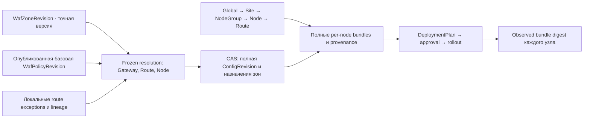

# WAF Zones: групповое управление защитой приложений

Статус: **утверждённая владельцем логика TARGET от 2026-11-17**. Документ входит в итоговое ТЗ AGP v2.
Зоны и масштабный профиль описывают разработку; работающий прототип интерфейса и AS-IS backend
не подтверждают их реализацию или производительность. Общие контракты — [протоколы](protocols.md),
[OpenAPI](api/openapi.yaml), [данные и хранение](data-model.md), [безопасность](security.md).

## 1. Назначение и границы

Инженер управляет общей защитой группы приложений одной операцией, видит её точный охват,
проверяет локальные отклонения и наблюдает применение на узлах. Выбор по одному из тысячи
ресурсов не является основным рабочим сценарием.

| Объект | Ответственность | Чего объект не означает |
| --- | --- | --- |
| `Site` | Эксплуатационная площадка и область разрешений | Автоматическое наследование WAF-зоны по IP/DNS |
| `NodeGroup` | Организация узлов и существующие profile assignments | Группу приложений с общей WAF-политикой |
| `WafZone` | Стабильная группа логических Gateway в одной Site | Отдельный runtime WAF или новый уровень inheritance |
| `WafZoneRevision` | Неизменяемая версия состава и желаемой защиты зоны | Немедленное применение на узлах |
| `WafPolicyRevision` | Точная опубликованная версия правил и параметров | Режим `detection`/`blocking` |
| `WafZoneResolution` | Зафиксированный состав, назначения, конфликты и входные данные | Постоянно обновляющийся поиск по меткам |

Зона — **слой подготовки конфигурации**. Она материализует существующий `Gateway.spec.waf`:
`engine`, `policyRevisionId`, `mode`. WAF-движок и Agent получают обычную полную конфигурацию
узла; они не вычисляют selectors и не запрашивают текущий состав зон при каждом запросе.
Один Gateway имеет одну основную зону в желаемом снимке. На одном узле могут работать Gateway
разных зон; одна зона может охватывать несколько узлов.

Полная WAF-политика назначается Gateway целиком. Его маршруты используют эту базу и узкие
route exceptions. Разные полные политики для отдельных Route одного Gateway отложены до
явного расширения схемы. Политика `Global → Site → NodeGroup → Node → Route`, ancestor locks,
security minimum и существующая provenance сохраняются. Зона не получает приоритет над ними.



## 2. Содержание зоны и версии

Тело [WafZone](schemas/waf-zone.schema.json) содержит:

| Поле | Тип и обязательная семантика |
| --- | --- |
| `apiVersion`, `kind` | `agp.waf-zone/v1alpha1`, `WafZone` |
| `metadata.id` | Стабильный opaque ID зоны; после удаления не переиспользуется |
| `metadata.name` | Имя 1..128 символов для отображения; не ссылка на политику |
| `metadata.siteId`, `metadata.ownerId` | Площадка и действительный ответственный principal |
| `spec.policyRevisionId` | Exact ID опубликованной WafPolicyRevision той же Site |
| `spec.mode` | `detection` либо `blocking`; принадлежит назначению, а не WafPolicy.spec |
| `spec.membership` | Ровно один вариант из следующего раздела |
| `spec.reason` | Причина 8..1024 символов для diff и аудита |

API envelope версии хранит отдельные `id`, `content`, `contentDigest`, `state`, decimal-string
`revision`, по тому же принципу, что WafPolicyRevision. ID версии отличается от стабильного
`content.metadata.id`. Изменение любого поля создаёт следующую immutable revision с проверкой
base/ETag. Ни тело, ни ID опубликованной версии не перезаписываются.

Имя политики, `latest` или selector версий не могут разрешаться в действующую защиту. Ссылка
синтаксически допустимого ID всё равно должна разрешиться в exact published revision. Базовая
политика зоны имеет `exceptions: []`. Настройка PL, inbound/outbound thresholds, qualified CRS
и engine проходит существующие проверки совместимости, approval и публикации политики.

Публикация новой зоны или новой базовой политики сама по себе не меняет ConfigRevision,
действующее назначение либо узлы. При resolution рассматриваются **закреплённые в base config
версии зон** с явными заменами запрашиваемого изменения; новые опубликованные версии не
подхватываются по времени публикации.

## 3. Состав, метки и отсутствие неоднозначного приоритета

Допустим ровно один вариант `membership`:

```json
{"matchLabels":{"environment":"production","exposure":"external","app_class":"api"}}
```

Все условия `matchLabels` соединяются `AND`, сравнение точное и case-sensitive. Используются
метки **Gateway**, а не Node; имя host, адрес upstream, Site и DNS suffix не превращаются
в метки автоматически. Нужен минимум один ключ, максимум 32 по общему типу `Labels`.
Пустой selector, regex, отрицания, wildcard, скрипты и произвольные SQL-условия запрещены.

```json
{"gatewayIds":["gw_orders","gw_payments"]}
```

Это явный список 1..10000 уникальных существующих Gateway той же Site. Он не получает
приоритета над selector другой зоны. Предварительный просмотр показывает все совпадения.

```json
{"siteDefault":true}
```

В закреплённом наборе зон Site допускается не более одной default zone. Она применяется
только при отсутствии обычного совпадения. `siteDefault:false` не имеет смысла и запрещён.
Пустой `matchLabels` не является сокращением default zone.

Алгоритм для каждого Gateway в затронутой области:

1. Проверить существование Gateway, совпадение Site и доступ actor ко всей области изменения.
2. Найти обычные совпадения по закреплённым версиям зон и запрашиваемым заменам.
3. Ровно одно совпадение — кандидат на назначение. Более одного — `waf_zone_ambiguous`.
   Числовые приоритеты, «последняя запись побеждает» и silent explicit-list override отсутствуют.
4. При нуле совпадений предложить единственную закреплённую default zone; если её нет —
   `waf_zone_unassigned`. Отсутствие назначения никогда не означает `WAF off`.
5. Рассчитать все затрагиваемые Route, Node, effective policy и provenance; неполный результат
   не может материализоваться. Для изменяемого Gateway не допускается ноль разрешённых узлов.

Новая зона может существовать без участников. Пустой результат не превращается во «всю Site»;
операция без изменений не создаёт rollout. Нельзя скрывать конфликтующих участников фильтром
интерфейса, лимитом страницы или отсутствием права читать их детали: изменение отклоняется.

Метки, используемые активными selectors, являются влияющими на безопасность. Их изменение
требует соответствующего права на WAF-назначение и всех затрагиваемых Gateway, diff и нового
resolution. Права менять имя или описание приложения недостаточно. Защита проверяется на API,
в импорте, интеграциях и массовом редакторе; скрытая кнопка не является контролем доступа.

Периодический поиск обнаруживает новых кандидатов и расхождения. Он создаёт предложение либо
уведомление, но не меняет pinned membership. Новые Gateway с подходящими метками включаются
в следующий явно согласованный пакет. Согласование не распространяется на будущие приложения.

## 4. Resolution, удаление и атомарное перемещение

[Resolution](schemas/waf-zone-resolution.schema.json) — immutable серверный результат. Его
создание не выполняет live apply. Вход запроса: `baseRevisionId`, `capacityProfile`,
`action: reconcile|retire` и при необходимости точные `replacementAssignments` вида
`{gatewayId, zoneRevisionId}`. Сервер читает и сохраняет полный проверяемый входной каталог;
клиент не может прислать доверенные `members` вместо серверного разрешения.

| Поля результата | Назначение |
| --- | --- |
| `id`, `siteId`, `zoneRevisionId` | Exact согласуемая или выводимая из использования версия зоны |
| `baseConfigRevisionId` | Полный parent snapshot под CAS |
| `action` | `reconcile` для изменений, `retire` для вывода зоны из desired mapping |
| `inventoryDigest` | Digest сохранённого входного каталога, security labels/версий, назначений и capabilities |
| `capacityProfile` | `pilot-500` либо `fleet-10k`; профиль не угадывается по размеру |
| `createdAt`, `expiresAt` | UTC; TTL resolution — 30 минут; expiry не продлевается редактированием |
| `resolutionDigest` | JCS SHA-256 всего canonical resolution без самого поля `resolutionDigest` |
| `members`, `conflicts` | Полный затронутый состав и диагностируемые конфликты; не текущая UI-страница |

`members` включает новых, сохраняющихся и уходящих участников, а также замыкание затронутых
назначений принимающих зон. Каждый member содержит `gatewayId`, все его `routeIds`, точные
`nodeIds`, `sourcePolicyRevisionId`, `baseBindingDigest` и disposition:

- `inherited`: итоговая политика совпадает с точной базовой политикой целевой зоны;
- `derived`: опубликована проверенная производная политика для этого Gateway;
- `conflict`: итогового безопасного назначения пока нет.

Для первых двух обязательны `targetZoneRevisionId`, `targetPolicyRevisionId`,
`targetBindingDigest`. Для `conflict` эти поля запрещены: предварительная догадка не должна
выглядеть разрешённой целью. `sourceZoneRevisionId` отсутствует только при контролируемой
миграции legacy Gateway без зоны либо у нового Gateway в ещё не активируемом onboarding draft. Для каждого conflict-member требуется диагностическая
запись `conflicts`; conflicts не могут указывать на отсутствующих members.

Binding digest — SHA-256 JCS точного `Gateway.spec.waf` до/после материализации, включая
`engine`, `policyRevisionId`, `mode`; он не заменяет digest полного configuration или bundle.
ID целевой зоны и все ancillary inputs отдельно закреплены общим resolution digest.
Массивы множеств нормализуются по opaque ID; route matching order не изменяется.

При `reconcile` вышедший из selector участник не исчезает из snapshot. Для него требуется
явная replacement assignment на допустимую опубликованную зону той же Site, включая default,
либо возвращается `waf_zone_replacement_required`. При `retire` это требуется для всех
действующих участников. Destination не обходит её membership и не разрешает неоднозначность.

Для перемещения между explicit-list зонами разрешено заранее подготовить опубликованные
версии обеих зон, затем разрешить единый переход через replacement assignments. Resolver
переключает согласованный набор версий, включает **полное замыкание** затрагиваемых Gateway
обеих зон и проверяет все совпадения. Нельзя незаметно оставить одну стабильную зону на двух
разных desired revisions или активировать версию принимающей зоны только для одного участника.
Если полный переход нельзя разрешить в одном снимке, операция блокируется, а UI предлагает
совместный пересмотр состава. Промежуточного состояния без защиты не возникает.

Материализация [WafZoneChange](schemas/waf-zone-change.schema.json) принимает только
`baseRevisionId`, `zoneRevisionId`, `resolutionId`, `resolutionDigest`, `reason` и version/kind.
Она повторно проверяет scope, published dependencies, expiry, base head, полный каталог
security inputs, минимум защиты и совпадение digest. Изменившийся security-relevant input
требует нового resolution; targets не расширяются под старым согласованием. Все WAF bindings
и pinned zone assignments записываются в **один новый полный ConfigRevision под CAS**;
остальные Gateway и profile assignments сохраняются. Ошибка любого участника отменяет
материализацию всего изменения. Это ещё не применение на узлах.

Новый Gateway сначала создаётся в **неактивируемом draft** полного снимка с exact опубликованной
baseline policy. Resolution строится над этим draft, где Gateway, его Route и исходный WAF
binding уже существуют; отсутствие существующего binding не подменяется вымышленным digest.
Материализация сохраняет draft lineage, проверяет его parent/ancestry относительно текущего
global head и назначает зону **до** публикации и rollout. Server-side merge в draft не
позволяет обойти CAS при изменившемся head. Нельзя сначала выпустить Gateway без зоны,
а затем надеяться, что периодический selector scan успеет его защитить.

## 5. Локальные исключения, lineage и обновление базы

Без отклонений все участники ссылаются на одну base policy revision: копировать одинаковую
политику тысячу раз не требуется. Локальное изменение создаёт immutable derived policy для
конкретного Gateway, не мутирует shared policy зоны и не распространяется на соседей.

Lineage хранится типизированно вне закрытого `WafPolicy.spec`: Gateway/Site, exact исходная
base policy revision, предыдущая derived revision при наличии, целевая base revision,
результирующая policy revision и применённые route exception IDs. Авторизованный API показывает
происхождение и diff. Производную политику другого Gateway нельзя подключить как локальное
отклонение даже при совпадении route name или hostname.

Исключение ограничено существующей Route данного Gateway, конечным списком rule IDs
(1..50 уникальных 6..9-значных строк), типом и literal именем поля. Обязательны owner, reason,
reviewAt, expiresAt. При создании нового исключения требуется `now < reviewAt < expiresAt`.
Прошедший reviewAt у уже действующего исключения вызывает reminder, но не приравнивается
к hard expiry и сам по себе не блокирует rebase/approval; необходимо `now < expiresAt`
и сохранение порядка reviewAt < expiresAt. Запрещены wildcard/global rule disable,
произвольные директивы и перенос значений тел запросов, заголовков, cookie или query в исключение.
Максимум 100 исключений **на итоговую effective policy**, не 100 на каждый слой наследования.

Обновление базы выполняет трёхстороннее сравнение: предыдущая base → локальные изменения →
новая base. Проверяются существование правил в qualified CRS, поддержка target field,
принадлежность Route, совместимость engine/component tuple, сроки и обязательный минимум
защиты. Исчезнувшее/изменившее семантику правило, просроченное исключение, разные Site/Gateway
или конфликт параметров дают явный конфликт. Нет silent drop исключений, автоматического
расширения их области или бесконечного закрепления старой базы без видимого отклонения.

`reviewAt` — срок пересмотра, не автоматическое удаление. До `expiresAt` scheduler должен
подготовить и применить successor без исключения. Если узел остаётся на bundle с истёкшим
исключением, Central Auth закрывает затронутые Route по существующему security-контракту;
CRS не считается самостоятельно удалившим правило по часам. Config rollback не возвращает
доступ через expired exception и не уменьшает security floors.

## 6. Массовый рабочий процесс и общие узлы

Интерфейс: **зоны → приложения → эффективная защита**, с серверными фильтрами, cursor pagination
и выбором всех результатов запроса. Выбор «все» фиксируется серверным resolution, а не списком
видимых строк браузера. В карточке зоны видны состав/кандидаты/конфликты, desired версия,
наблюдаемые версии, локальные отклонения, события и история.

Рабочая цепочка:

1. Подготовить следующую версию зоны и при необходимости базовой/derived политик.
2. Выполнить resolve. Показать добавленные/уходящие Gateway, Route, уникальные узлы,
   diff режима/правил/исключений, источник каждого effective поля и все конфликты.
3. Сохранить разрешённый change как новую конфигурацию. Validate/compile полную конфигурацию.
4. Подготовить DeploymentPlan с exact resolution/provenance input digests и node bundles.
5. Независимый approver подтверждает точный plan digest со свежей MFA; автор не одобряет своё
   опасное изменение. Scope проверяется по полному фактическому охвату, а не только владельцу зоны.
6. Выполнить canary и ограниченные волны по существующему протоколу, наблюдать receipts/probes.

При разных Site корпоративный шаблон создаёт отдельные точные zone revisions, resolutions
и планы. Одной распределённой транзакции между площадками нет. UI показывает общий запрос и
состояние каждой Site; частичный успех не переименовывается в «применено везде».

Nginx получает **полный owned bundle узла**. Поэтому plan обязан раскрыть все его изменения,
включая другую зону, сертификаты, upstream и auth/profile settings. Если они не входят в
разрешённый scope, plan creation отклоняется или готовится отдельная согласованная база;
публикация зоны не является разрешением на скрытое соседнее изменение.

Canary — конкретный узел, а не один случайно выбранный host. До старта видны все приложения,
чьи активные bundles на нём изменятся. Канареечное включение для доли запросов одного приложения
не обещается без отдельного механизма traffic routing. Нельзя считать тысячи приложений
тысячами независимых targets, если они разделяют несколько узлов.

Пауза останавливает новые задания, уже начатый local safe apply доходит до безопасного checkpoint.
Отмена не откатывает успешно обновлённые узлы. Rollback — новый plan и новый sequence, exact
проверенная база и актуальные security floors. При частичном применении отображаются каждая
observed revision/bundle, желаемая цель, причина задержки и recovery path. Aggregated «применено»
допускается только после подтверждения всех targets и functional probes; offline/unknown
не приравниваются к успеху.

## 7. Масштаб, хранение и наблюдаемость

`pilot-500` сохраняет существующие ограничения v1alpha1. `fleet-10k` — новый профиль с явно
версионированными configuration/plan контрактами; ограничения старой версии не повышаются
молча. Целевые верхние quotas профиля: 10000 Gateway в снимке, 100000 Route суммарно,
1000 Route/Gateway, 64 MiB UTF-8 полного canonical config, 20000 profile assignments,
500 Node/plan, 50000 resolved inputs/plan. Действует наиболее строгое ограничение; возможны
несколько планов для разных наборов узлов. Это **пределы допустимого входа**, а не доказанная
ёмкость, SLA либо гарантия, что любой максимальный набор уложится в лимит bytes.

Сервер хранит immutable authoring revisions, полные source inventories, resolutions и members,
типизированный lineage, pinned config assignments, validation/diff и audit. Авторитетное
хранение, индексы/FK, CAS, pin/GC и DB migration определены в [модели данных](data-model.md).
Дублирование runtime bindings и zone provenance допускается только с атомарной записью и
проверкой соответствия; ручной второй источник истины запрещён.

Необходимые измерения: время/ошибки resolve и compile, размер snapshot/bundle, память worker,
DB query count и длительность materialization, конфликты/неназначенные кандидаты, возраст
desired/observed расхождения, очередь rebase и истечения исключений. В metrics labels нельзя
бесконтрольно помещать все Gateway, hostname, exception и request IDs: подробности идут в
scoped event/audit, агрегаты — в метрики. События сохраняют zone revision/policy revision,
Gateway/Route, node bundle digest и режим **на момент события**, а не текущую цель черновика.

Квалификация на 1000, 5000 и 10000 Gateway проводится с реалистичными распределениями маршрутов,
общих узлов и исключений; измеряются resolve/rebase/compile, память, DB, размер, UI, apply и
recovery. Численные требования latency/RPS/cost утверждаются по результатам стенда; неизвестные
характеристики не объявляются подтверждёнными. Сама WAF-зона не требует новых микросервисов,
Kubernetes, облака или runtime очереди в request path.

## 8. Безопасность, экспорт и совместимость

Зона не заменяет AD, MFA/2FA, group access, CIDR или emergency deny. `detection` не открывает
приложение: оно меняет только реакцию WAF. Больший PL включает более строгую проверку и может
увеличить false positives; больший anomaly threshold уменьшает вероятность блокировки.
Anomaly score не является числом атак или вероятностью взлома. «Не заблокировано WAF» не
доказывает успешный ответ upstream. Фактическое поведение подтверждается квалифицированным
engine/ruleset/component tuple и функциональными probes, не mock-валидацией интерфейса.

Все mutation endpoints используют действующие session/CSRF/Origin, RBAC/scope, idempotency,
CAS/baseRevisionId либо ETag по типу операции и audit. Bulk API повторно проверяет каждый изменяемый объект. Чтение/экспорт полного
каталога требует полного разрешённого scope; scoped DTO не позволяет реконструировать
canonical digest полного документа и не выдаётся за переносимую конфигурацию.

Полный переносимый экспорт содержит exact zone revisions, base/derived policy revisions,
lineage, pinned membership/config references, source digests и manifest зависимостей.
Не экспортируются credentials, raw bodies, cookie/header values, plaintext OTP и private keys.
Live deployment state экспортируется как historical observation, а не команда применять.
ID mapping Site/Gateway/Route при импорте явный и проверяемый; selector не пересчитывает цели
на новой площадке незаметно. На приёмнике заново выполняются scope/reference validation,
resolution, policy qualification, approval и plan. Исходное согласование не переносится как
разрешение применять к новым hosts. Неразрешённая зависимость блокирует импорт целиком.

AS-IS Gateway мигрирует с сохранением своей точной политики и режима. Нельзя автоматически
заменить их default-политикой. Подготовка: inventory → dry-run группировка → зоны с точными
базами и локальными отклонениями → разрешение конфликтов → контролируемая ConfigRevision →
canary → сравнение effective bindings и функциональные проверки. До миграции отсутствие
source zone допустимо только в отмеченном legacy path; после — назначение обязательно для
всех управляемых Gateway. Старые клиенты получают честную ошибку неподдерживаемой версии,
не truncated snapshot. Expand/contract DDL и rollback window следуют общему плану миграции.

## 9. Стабильные ошибки и критерии приёмки

HTTP Problem и JSON Pointer используют общий [wire-контракт](protocols.md). Основные domain codes:

| Код | Причина / действие |
| --- | --- |
| `waf_zone_ambiguous` | Несколько обычных совпадений; исправить состав до materialization |
| `waf_zone_unassigned` | Нет подходящей зоны/default; назначить защиту явно |
| `waf_zone_replacement_required` | Уходящий/retiring участник без безопасной целевой зоны |
| `waf_zone_site_mismatch` | Gateway, зона, политика или Route принадлежат другой Site |
| `waf_zone_policy_not_published` | Exact policy revision не опубликована/недоступна |
| `waf_zone_base_exceptions` | Общая базовая политика содержит локальные route exceptions |
| `waf_zone_lineage_conflict` | Rebase/происхождение/Route или правило несовместимы |
| `waf_zone_exception_expired` | Исключение уже истекло либо не допускает планируемое применение |
| `waf_zone_security_minimum` | Запрошенное effective значение нарушает ancestor lock/minimum |
| `waf_zone_node_unresolved` | Не найден полный проверяемый node target set |
| `waf_zone_capacity_exceeded` | Превышен quota/byte limit выбранного профиля |

`revision_mismatch`, `permission_denied`, `step_up_required`, `conflict`, `idempotency_conflict`
и expiry errors сохраняют общий смысл. Сервер не исправляет conflict скрытым выбором цели.

Приёмка обязательна до включения зон в production:

1. Одна правка зоны формирует полный diff для всех выбранных приложений без ручного обхода;
   новая метка/новый Gateway не меняет ранее согласованный target set.
2. Zero match без default и multiple matches блокируют materialization; explicit list и
   `replacementAssignments` не обходят membership, Site, scopes и locks.
3. Удаление/перемещение/retire сохраняет защиту и все unrelated Gateway; atomic CAS conflict
   не теряет соседние правки. Direct Gateway import не обходит zone-managed binding.
4. Shared base не копируется для каждого ресурса, локальное исключение не распространяется
   на соседей; rebase конфликтов и expiry проверяется до plan и перед dispatch.
5. Digest tampering, устаревший inventory/base, replay с другим payload, отозванное право
   actor/approver и частичный scope отклоняются без частичной записи.
6. Полный snapshot, resolution и related-input cardinality соблюдают quota/bytes, а UI
   работает с серверной пагинацией и просмотром точного состава выбранного набора.
7. Canary общего узла раскрывает все затрагиваемые приложения и соседние изменения;
   автоматическое применение скрытых соседних drafts запрещено.
8. Crash/timeout/частичный rollout/offline узел дают корректные Unknown/partial/recovery,
   подтверждённые observed digests и безопасный новый rollback plan с актуальным deny floor.
9. Expired exception закрывает affected routes при старом active bundle; restore/rollback
   не воскрешает исключение и не снимает security restrictions.
10. Полный export/import воспроизводит lineage и exact references на тестовой площадке,
    требует нового согласования; scoped export не раскрывает соседние объекты/секреты.
11. Выполнены измеренные scale runs 1000/5000/10000 и recovery drill; документальный PASS
    schemas/SQL/OpenAPI не заменяет эти испытания.
12. Инженер видит источник, desired и observed защиту, «?» у ключевых параметров и manual;
    предупреждение о конфликте/частичном применении не требует чтения raw config или логов.

Примеры: [selector zone](examples/waf-zone.json), [explicit zone](examples/waf-zone-explicit.json),
[default zone](examples/waf-zone-default.json), [resolution](examples/waf-zone-resolution.json),
[conflict snapshot](examples/waf-zone-resolution-conflict.json), [change](examples/waf-zone-change.json).
Digests, ссылки и время в примерах фиктивные: structural PASS не означает готовность к исполнению.
